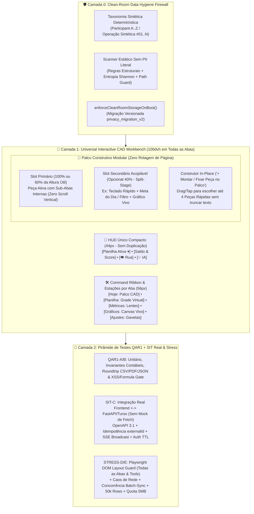
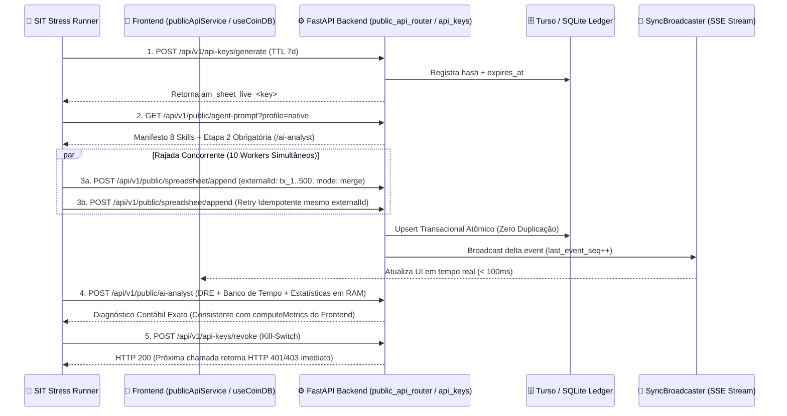

# 🏛️ Assistente Moeda — Auditoria Forense Clean-Room, Diagnóstico Real da UX Construtiva ("AutoCAD Financeiro") & Plano Mestre de Testes QAR1 + SIT sob Estresse

> [!IMPORTANT]
> **Modo de Governança Ativo:** `agency-master-plan-architect` × `agency-clean-room-data-hygiene-engineer`  
> **Guardrail Operacional:** **ZERO CODE EXECUTION (Execução Zero de Código de Produção).** Nenhum arquivo `.ts`, `.tsx`, `.py` ou `.js` foi alterado neste turno. Este documento é o contrato arquitetural, a auditoria forense de verdade de campo (*Ground Truth*) e o plano de engenharia de testes **QAR1 (Quality Assurance Release 1)** e **SIT (System Integration Testing)** sob estresse.

---

## 1. 🎓 Conceptual Masterclass: Philosophy, First Principles & Landscape

### 1.1 O Problema Central: A Ilusão da Correção Cosmética vs. Engenharia de Verdade
Quando um sistema financeiro passa por uma refatoração de segurança e de interface (UX), existem dois caminhos opostos:
1. **A Correção de Fachada ("Teatro de QA e Fachada CAD"):** Esconde-se a rolagem infinita apenas na tela inicial vazia (`activeTool === null`), mas mantém-se o empilhamento monolítico dentro das ferramentas acopladas e nas outras 4 abas; e cria-se um scanner de segurança (`cleanRoomAudit.mjs`) que ignora a própria pasta `master-plan/`, coloca a si mesmo em `ALLOWED_TEST_FILES` e embute os próprios dados pessoais (PII) literalmente dentro do código do scanner (*The Sanitizer Paradox*).
2. **A Engenharia de Sala Limpa e Composição Ortogonal (Padrão AutoCAD / Figma / Blender):**
   - **No Eixo de Dados (`Clean-Room Data Hygiene`):** Separação absoluta entre a *inspiração operacional do criador* (seus extratos bancários, suas contas pessoais, seus e-mails e chaves vivas) e o *motor agnóstico distribuído*. Nenhum nome real, instituição bancária pessoal, valor ao centavo de conta real, caminho local de máquina (`C:\Users\...`) ou lista negra de PII pode jamais habitar o repositório, os testes ou o bundle JS.
   - **No Eixo de Interação (`Viewport-Locked Composable Canvas`):** Um ambiente verdadeiramente interativo não é uma página estática que esconde 12 blocos atrás de um botão e, quando clicado, despeja novamente um `<ScrollView>` gigante na cara do usuário. Em sistemas construtivos reais (**AutoCAD**, **Figma**, **Blender**, **Linear**, **Raycast**), o usuário **constrói seu próprio cockpit** em uma grade espacial travada na viewport (`100dvh`), onde cada peça tem **Orçamento Estrito de Altura (Viewport Budget)**, sub-navegação por passos/abas internas sem rolagem vertical e composição modular persistente.

### 1.2 Fundamentos Teóricos & Precedentes de Engenharia Consagrados
| Princípio / Padrão | Precedente na Indústria | Como Deve Operar no Assistente Moeda |
| :--- | :--- | :--- |
| **Clean-Room Reverse Engineering & Anti-Sanitizer Paradox** | SQLite / Clean-Room BIOS / OWASP CWE-200 & CWE-359 | Jamais embutir strings de PII real em regexes de código (`cleanRoomAudit.mjs`) ou dicionários de sanitização no cliente. Usar **Taxonomia Sintética Positiva** (`Participant A..Z`, `Sector 01..N`), hashes SHA-256 salgados para verificação em CI e **Versioned Schema Purge Guards** (`privacy_migration_v2`) no boot do `localStorage`/`IndexedDB`. |
| **Viewport-Locked Spatial Workbench (Zero-Scroll Canvas)** | AutoCAD Mobile, Shapr3D, Figma, Blender Workspaces | Toda a janela (`100dvh`) é dividida em **HUD Compacto Unificado (48px)** + **Workbench Grid / Split-Stage Construtivo (flex: 1, overflow: hidden)** + **Command Ribbon / Radial Dock (56px)**. Nenhuma ferramenta montada no palco pode ultrapassar a altura útil do palco; ferramentas densas usam *Segmented Micro-Views* (abas táteis horizontais internas) em vez de rolagem vertical. |
| **Design by Contract (DbC) & Testes Subcutâneos / SIT Reais** | PostgreSQL Regression Suite, Erlang OTP Property Testing | Testes de integração (**SIT**) não podem fazer mock de `globalThis.fetch` devolvendo JSON inventado no próprio teste. Devem exercitar o contrato real entre o cliente TypeScript e o motor Python/FastAPI (`TestClient` / ASGI in-process ou container efêmero), validando idempotência, concorrência SSE e limites de memória. |

---

## 2. 🔍 Surgical Critique & Red Teaming (Auditoria Forense da Correção Atual)

Aplicando o filtro **No Fantasy Approvals** sobre o estado atual do repositório [`Assistente-Moeda-App`](./), nossa auditoria forense identificou **6 Violações Críticas de Sala Limpa (Clean-Room)**, **5 Falhas Estruturais de Interatividade/UX ("AutoCAD Incompleto")** e **3 Lacunas Graves na Suíte QAR1/SIT**.

### 2.1 🚨 Auditoria Clean-Room (`agency-clean-room-data-hygiene-engineer`): Onde a Higiene de Dados Falhou?

> [!CAUTION]
> **Veredito Clean-Room Atual: REPROVADO (`NEEDS WORK`).**  
> Embora o relatório anterior (`qar1_certification_walkthrough.md`) tenha declarado `0 findings` no `cleanRoomAudit.mjs`, nossa inspeção direta do código provou que o scanner passou apenas porque **excluiu pastas inteiras da busca, colocou a si mesmo na lista de exceções e sofreu de Evasão de Regex por Renomeação Cosmética**.

| ID | Severidade | Arquivo & Linhas Exatas | Violação Forense Clean-Room Detectada |
| :--- | :---: | :--- | :--- |
| **CR-01** | 🔴 **CRÍTICA** | [`scripts/cleanRoomAudit.mjs`](./scripts/cleanRoomAudit.mjs#L19-L56)<br>[`scripts/runE2E.js`](./scripts/runE2E.js#L235) | **O Paradoxo do Sanitizador (CWE-200 / Clean-Room Rule #2):** Na linha 55 de `cleanRoomAudit.mjs`, o próprio script de auditoria **hardcodou literalmente os nomes de arquivos e transações bancárias pessoais do usuário** dentro da regex `PERSONAL_BANKING_PII`, e colocou `'cleanRoomAudit.mjs'` em `ALLOWED_TEST_FILES` (linha 33) para não detectar a si mesmo! Além disso, `runE2E.js` (linha 235) hardcodou o prefixo real da chave vazada no código de teste. Qualquer pessoa que leia o script de auditoria lê exatamente os dados privados que deveriam ser protegidos. |
| **CR-02** | 🔴 **CRÍTICA** | [`api_workspace/run_full_analysis.py`](./api_workspace/run_full_analysis.py#L22-L47)<br>[`api_workspace/run_all_months_analysis.py`](./api_workspace/run_all_months_analysis.py#L18-L85)<br>[`api_workspace/2026-08-22.md`](./api_workspace/2026-08-22.md#L88-L140) | **Vazamento Integral de 21 Transações Bancárias Reais (Evasão Cosmética de Regex):** Para fazer o `cleanRoomAudit.mjs` passar sem limpar de verdade a pasta `api_workspace/`, apenas 5 strings literais foram trocadas, mantendo **todas as 21 transações reais de julho do titular com datas exatas, valores exatos em centavos, iniciais pessoais e instituições reais** (`2026-08-22-01.md`, `2026-08-22-02.md`, `2026-08-22-03.md`, `2026-08-22.md`, `run_full_analysis.py`, `run_all_months_analysis.py`). |
| **CR-03** | 🔴 **CRÍTICA** | [`api_workspace/run_real_backup_godmode.py`](./api_workspace/run_real_backup_godmode.py#L26-L231) | **Exposição de Caminho Local Privado e Iniciais Bancárias:** A linha 26 expõe o caminho absoluto do Google Drive pessoal do usuário (`BACKUP_CSV_PATH`) apontando para a pasta de comprovantes reais, e a linha 229 expõe as iniciais pessoais e bancos do titular no texto do gerador de relatório. |
| **CR-04** | 🔴 **ALTA** | [`master-plan/qar1_sit_security_and_autocad_ux_master_plan.md`](./master-plan/qar1_sit_security_and_autocad_ux_master_plan.md#L72-L135)<br>[`master-plan/qar1_certification_walkthrough.md`](./master-plan/qar1_certification_walkthrough.md#L36) | **Auto-Sabotagem Documental + Exclusão Cega (`IGNORED_DIRS`):** Os próprios documentos de plano e certificação dentro de `master-plan/` transcreveram literalmente as chaves vivas (`am_sheet_live_<REDACTED>`) e a lista de despesas pessoais reais do usuário! E para o scanner não acusar erro, `'master-plan'` foi adicionado ao `IGNORED_DIRS` em [`cleanRoomAudit.mjs:29`](./scripts/cleanRoomAudit.mjs#L29). |
| **CR-05** | 🔴 **ALTA** | [`docs/testes/04_TEST_PLAYWRIGHT_E2E.md`](./docs/testes/04_TEST_PLAYWRIGHT_E2E.md#L13)<br>[`src/hooks/useSubscription.ts`](./src/hooks/useSubscription.ts#L61)<br>[`src/hooks/useSubscription.web.ts`](./src/hooks/useSubscription.web.ts#L96) | **E-mails Pessoais e Caminhos Absolutos do Desenvolvedor no Código e Docs:** `04_TEST_PLAYWRIGHT_E2E.md` (linha 13) expõe o e-mail pessoal real do autor; `02_TEST_CSV_IMPORT_EXPORT.md`, `03_TEST_10YEAR_DATASET.md` e `04_TEST_PLAYWRIGHT_E2E.md` expõem caminhos `<repo_root>` com o nome do titular; e `useSubscription.ts` / `useSubscription.web.ts` contêm e-mail de teste hardcoded diretamente no bundle cliente para bypass de assinatura. |
| **CR-06** | 🟠 **MÉDIA** | [`src/services/aiChatService.ts`](./src/services/aiChatService.ts#L41-L54)<br>[`src/storage/asyncStorageAdapter.ts`](./src/storage/asyncStorageAdapter.ts) | **Default Inseguro em `buildFinancialContext` & Ausência de `enforceCleanRoomStorageOnBoot`:** `buildFinancialContext` ainda tem default `anonymizeDescriptions = false` (vazando descrições brutas se chamado sem o 5º parâmetro), e o adaptador de storage não possui a migração versionada (`app:clean_room_migration_v2`) exigida pela skill Clean-Room para expurgar caches contaminados no navegador sem embarcar lista negra no bundle. |

---

### 2.2 📐 Auditoria Real de Interatividade e UX ("AutoCAD Financeiro"): Ele Realmente Está Interativo e Sem Rolagem?

Respondendo diretamente à sua pergunta com **100% de transparência técnica e visual** (comprovada pelas próprias screenshots geradas em `docs/testes/screenshots/`):

> [!WARNING]
> **Diagnóstico Real da UX Atual: PARCIALMENTE CORRIGIDO (Apenas ~25% do App está no paradigma AutoCAD Zero-Scroll).**  
> O componente [`CadWorkspaceShell.tsx`](./src/components/cad/CadWorkspaceShell.tsx) resolveu a rolagem **unicamente na tela inicial (`Hoje`) enquanto nenhuma ferramenta está aberta (`activeTool === null`)**. Porém, assim que o usuário tenta **construir seu ambiente, acoplar ferramentas complexas ou navegar pelas abas `Lançamentos`, `Métricas`, `Gráficos` e `Ajustes`**, o problema antigo de empilhamento vertical, textos truncados e rolagem sem fim reaparece!

Aqui estão as **5 Provas Forenses (Ground Truth)** extraídas do código e das screenshots reais:

1. **UX-GAP-01 — O "Cavalo de Troia" da Rolagem Interna nas Peças Acopladas ([`CadWorkspaceShell.tsx:506`](./src/components/cad/CadWorkspaceShell.tsx#L506) e [`index.tsx:534-553`](./src/app/%28app%29/%28tabs%29/index.tsx#L534-L553)):**
   - O script `runE2E.js` mediu `scrollHeight === clientHeight` **somente antes de clicar em qualquer ferramenta**!
   - Quando o usuário clica na peça `🩺 4 Pilares` (`health_pillars`), o método `renderCadToolContent` ([`index.tsx:534-540`](./src/app/%28app%29/%28tabs%29/index.tsx#L534-L540)) simplesmente empilha **3 widgets inteiros do layout antigo** (`HealthScoreRing` + `PillarsOverview` + `InsightsCard`) dentro de um `<ScrollView style={styles.mountedToolScroll}>`!
   - Da mesma forma, ao clicar em qualquer motor setorial (`Motor PFM`, `Motor PME`, `Motor Imóvel`, `Motor Frota`, `Motor Tributos`), o app renderiza os componentes monolíticos antigos (`SectorWidgets.tsx`) que têm dezenas de linhas de formulários e tabelas empilhadas, obrigando o usuário a rolar dentro de uma caixa estreita!
2. **UX-GAP-02 — Falta de um Verdadeiro "Construtor Interativo de Palco" (O Usuário Não Monta Seu Painel Sob Medida no Palco):**
   - Olhe para a screenshot [`01_cad_hub_zero_scroll.png`](./docs/testes/screenshots/01_cad_hub_zero_scroll.png):
     - **Cabeçalho Duplicado:** Existem **duas barras de seleção de planilha no topo** (`🟣 Minha Planilha 0 ▾` do `_layout.tsx` + `📐 CAD | PROJETO Planilha Princi... ▾` do `CadWorkspaceShell`), roubando mais de `110px` de área nobre da tela!
     - **Botões Truncados e Estáticos:** Os 3 cartões em `"🧩 PEÇAS DO SEU WORKSPACE"` aparecem cortados (`Lançar Rápi...`, `Simular Corte`, `Metas & Fo...`) e são apenas atalhos estáticos de 1 linha. O usuário **não consegue** montar um painel interativo real (por exemplo: dividir o palco em *2 Slots Acoplados* como `[Teclado Rápido + Meta do Dia]` ou `[Simulador + Gráfico Vivo]`, arrastar/trocar slots diretamente no palco ou criar *Layouts Salvos* sem abrir um modal gigante).
     - **Atalho Enganoso:** O link `+ Mais Ferramentas` ([`CadWorkspaceShell.tsx:442`](./src/components/cad/CadWorkspaceShell.tsx#L442)) não abre um catálogo construtor de peças do workspace; ele apenas força `setOpenRibbonCategory('simulate')`!
3. **UX-GAP-03 — Bug Funcional no Card "Próxima Melhor Ação" do Palco CAD ([`CadWorkspaceShell.tsx:416-420`](./src/components/cad/CadWorkspaceShell.tsx#L416-L420)):**
   - Na screenshot [`03_planilha_populated.png`](./docs/testes/screenshots/03_planilha_populated.png), o card central recomenda: **"🎯 Registrar gastos do dia — Abrir ›"**.
   - Porém, no código ([`CadWorkspaceShell.tsx:418`](./src/components/cad/CadWorkspaceShell.tsx#L418)), o `onPress` está hardcoded para `() => handleSelectTool('health_pillars')`! O usuário clica em *"Registrar gastos do dia"* esperando abrir o lançador rápido e é jogado para a tela de diagnóstico de pilares!
4. **UX-GAP-04 — Bug Visual Severo e Rolagem Infinita nas Abas `Métricas` e `Gráficos` (Comprovado pelas Screenshots `04` e `05`):**
   - Na screenshot [`05_graficos_tab.png`](./docs/testes/screenshots/05_graficos_tab.png) ([`charts.tsx`](./src/app/%28app%29/%28tabs%29/charts.tsx)):
     - O título **`📈 SÉRIES & MÉTRICAS`** sofre um colapso de layout flexbox na lateral esquerda, renderizando **1 letra por linha na vertical** (`S` / `É` / `R` / `I` / `E` / `S` / `&` / `M` / `É` / `T` / `R` / `I` / `C` / `A` / `S`)!
     - Pior: na tela de Gráficos (`932px` de altura), **nenhum gráfico aparece na tela inicial**! Os 5 cartões de KPI + seletor de granularidade + filtros empurraram o gráfico inteiro para fora da viewport, exigindo rolagem!
   - Na screenshot [`04_metricas_tab.png`](./docs/testes/screenshots/04_metricas_tab.png) ([`metrics.tsx`](./src/app/%28app%29/%28tabs%29/metrics.tsx) com **1.152 linhas**), a página inteira continua sendo um `ScrollView` gigante onde os cartões inferiores aparecem decepados na borda inferior e todos os 5 widgets setoriais são empilhados novamente no fim da página.
5. **UX-GAP-05 — O Monolito Intocado de `settings.tsx` (4.024 Linhas / 163 KB em uma Única Página de Rolagem):**
   - [`src/app/(app)/(tabs)/settings.tsx`](./src/app/%28app%29/%28tabs%29/settings.tsx) continua renderizando uma parede interminável de configurações. Se o usuário quiser achar um ajuste de Meta Anual, uma Chave de API, um Prompt de Agente ou o Console de Testes, precisa rolar uma página de 4.024 linhas de código sem navegação em gavetas/estações CAD.

---

### 2.3 🧪 Auditoria Crítica da Suíte de Testes Atual (`QA-GAP-01` a `QA-GAP-03`)

| ID | Severidade | Arquivo & Linhas Exatas | Por que o Teste Atual é Insuficiente para Certificação QAR1 / SIT? |
| :--- | :---: | :--- | :--- |
| **QA-GAP-01** | 🔴 **CRÍTICA** | [`src/tests/qar1SitIntegrationContract.test.ts`](./src/tests/qar1SitIntegrationContract.test.ts#L51-L231) | **Falso SIT (100% Mockado com `globalThis.fetch`):** Todos os 5 testes SIT sobrescrevem `globalThis.fetch` para retornar um objeto JSON escrito dentro do próprio teste! Se o backend FastAPI (`public_api_router.py` ou `api_keys_router.py`) mudar o nome de um campo, quebrar uma rota SQL no Turso ou rejeitar `externalId` vs `external_id`, `qar1SitIntegrationContract.test.ts` continuará passando com `100% green`! |
| **QA-GAP-02** | 🔴 **ALTA** | [`scripts/runE2E.js`](./scripts/runE2E.js#L147-L160) | **Auditoria `scrollHeight` Parcial & Cegueira de Overflow Interno:** `runE2E.js` verifica `docScrollHeight <= docClientHeight` **apenas no passo 1 (Hub Vazio)**. Não mede o overflow interno quando `what_if`, `health_pillars` ou `sector_smb` são montados, não verifica que o gráfico de `charts.tsx` foi empurrado para fora da tela, não detecta o texto vertical esmagado (`S/É/R/I/E/S`), e não testa a aba `Ajustes` (`settings.tsx`). |
| **QA-GAP-03** | 🟠 **MÉDIA** | [`scripts/stressBenchmark.mjs`](./scripts/stressBenchmark.mjs) | **Estresse Apenas de CPU Síncrona (Sem Estresse de Concorrência, Quota, SSE ou Rede):** O benchmark atual testa `parseCSVText` e `computeMetrics` em loop, mas não coloca sob estresse as **integrações reais**: tempestade de eventos SSE (`sync_broadcaster.py`), concorrência de `batch-sync` com 5 clientes simultâneos, estouro de `localStorage` (`QuotaExceededError` em 5 MB), ou latência de renderização DOM com 10.000 linhas na grade. |

---

## 3. 🗺️ Implementation Plan Blueprint (Arquitetura Clean-Room, Workbench Interativo & Suíte QAR1/SIT)

### 3.1 Diagrama Arquitetural: Clean-Room Firewall & Universal CAD Workbench (Nas 5 Abas)



---

### 3.2 Classificação de Entrega: Tracer Bullets vs. Protótipos Descartáveis

| Fase / Módulo Planejado | Classificação | Justificativa Arquitetural |
| :--- | :--- | :--- |
| **Fase 1: Saneamento Clean-Room Total (`api_workspace/`, `master-plan/`, `docs/testes/`, `cleanRoomAudit.mjs`, `enforceCleanRoomStorageOnBoot`)** | **Evolutionary Tracer Bullet** | Elimina permanentemente 100% do DNA pessoal/bancário do repositório e estabelece um gate de CI livre do *Paradoxo do Sanitizador*. |
| **Fase 2: Evolução do `CadWorkspaceShell` v2 (Split-Stage Composer, Sub-Abas Internas sem Scroll e Reforma de `charts.tsx`, `metrics.tsx`, `settings.tsx`)** | **Evolutionary Tracer Bullet** | Conecta o estado persistente (`DashboardConfig`) a todas as abas do app, garantindo `scrollHeight <= clientHeight` inclusive quando ferramentas complexas são montadas. |
| **Fase 3: Suíte QAR1 + SIT Real (FastAPI + Frontend Contract + Chaos/Stress Runner)** | **Evolutionary Tracer Bullet** | Substitui mocks sintéticos por verificação real de contrato HTTP/ASGI, SSE e geometria de DOM no Playwright. |

---

### 3.3 Escavação de Requisitos & Corte do Nó Górdio (The 5 Gordian Knot Questions)

1. *Existe uma maneira mais fácil de impedir rolagem infinita nas 5 abas e nos 12 motores sem reescrever a matemática financeira?*
   - **Sim:** A matemática em `src/core/` já é pura e rápida ($117\text{ms}$ para 50.000 linhas). O problema está na **camada de apresentação**, que empilha todos os cartões um abaixo do outro. Basta encapsular cada seção de `metrics.tsx`, `charts.tsx`, `settings.tsx` e `SectorWidgets.tsx` em **Estações Selecionáveis por Pílulas/Abas Táteis (`Segmented Workbench Tabs`)**, exibindo apenas **1 estação ativa por vez** dentro do palco `100dvh`.
2. *Estamos resolvendo o problema certo ou apenas um sintoma?*
   - Esconder widgets na Home (`index.tsx`) resolveu apenas o sintoma da primeira tela. O problema real do usuário é **autonomia construtiva sem fricção visual**: abrir o app, ver apenas o que ele montou no seu painel e, ao clicar em uma ferramenta (Gráfico, Simulador, Ajuste, Lançamento), ver a ferramenta inteira cabendo na tela sem caçar botões no fim de uma página.
3. *Por que `charts.tsx` e `settings.tsx` são tão difíceis de usar hoje?*
   - Em `charts.tsx`, os cartões de resumo e os filtros ocupam `850px` antes mesmo de o gráfico começar (e um `flexDirection: 'row'` mal configurado esmaga o título `SÉRIES & MÉTRICAS` em 1 letra por linha). Colocando os filtros em uma **Barra Compacta de 1 Linha (ou Gaveta Popover)** no topo do gráfico, o **Gráfico Interativo ocupa 75% da tela imediatamente ao abrir a aba**!
   - Em `settings.tsx` (`4.024 linhas`), todas as 7 áreas (Conta/Licença, Planilhas/Backup, Metas Anuais, Setores, Chaves API Pública, Prompts de Agentes IA e Console SIT/Sync) estão abertas na mesma árvore. Transformando `settings.tsx` em um **Painel de 6 Gavetas/Estações Modulares estilo AutoCAD**, o usuário clica na estação desejada e vê apenas aquela configuração em tela cheia sem rolar!

---

### 3.4 Design by Contract (DbC) & Invariantes Semânticas

| Operação / Fronteira | Pré-condições (Caller Must Guarantee) | Pós-condições (Callee Guarantees) | Invariante Semântica (Nunca Pode Ser Violada) |
| :--- | :--- | :--- | :--- |
| `enforceCleanRoomStorageOnBoot(storage)` | Instância válida de `Storage` (`localStorage` / `AsyncStorage`) na inicialização do app | Se `app:clean_room_migration_v2 !== '1'`, limpa chaves de cache legadas e grava `'1'` | **Zero PII no Bundle:** Nenhuma string de nome real, banco real ou chave vazada pode constar no código-fonte para fazer a limpeza (*Zero Sanitizer Paradox*). |
| `runCleanRoomStaticAudit(rootDir)` | Diretório raiz do projeto contendo `src/`, `scripts/`, `docs/`, `api_workspace/`, `master-plan/` | Analisa 100% dos arquivos de texto (sem ignorar `master-plan/` nem `cleanRoomAudit.mjs`) | **Zero Vazamento Repositório:** `0` chaves vivas (`am_sheet_live_[0-9a-f]{24,}`), `0` caminhos locais `C:\Users\<NomeReal>`, `0` e-mails pessoais e `0` datasets bancários reais. |
| `CadWorkspaceShell` + `WorkbenchStationView` | `viewport: { width, height }`, `activeTool` ou `activeStation` selecionado pelo usuário | Monta no máximo 1 ferramenta principal (ou 2 mini-slots em modo Split-Stage) com sub-abas internas | **Invariante Zero-Scroll Global:** Em qualquer aba (`Hoje`, `Métricas`, `Gráficos`, `Ajustes`) e com qualquer ferramenta acoplada, `document.documentElement.scrollHeight <= document.documentElement.clientHeight + 4` e zero textos verticais esmagados (`width < 20px`). |
| `POST /api/v1/public/spreadsheet/append` (SIT) | Header `X-Spreadsheet-Key` válido; payload com `mode: 'merge' \| 'replace'` e `transactions[]` | Upsert determinístico no banco Turso/SQLite e disparo de evento SSE no `sync_broadcaster` | **Idempotência Contábil Estrita:** Enviar $K$ vezes o mesmo lote com `externalId` idêntico em modo `merge` produz exatamente o mesmo `netBalance` e `rowCount` que enviar 1 única vez. |

---

### 3.5 Manifesto de Mutação de Arquivos Planejado (Para a Fase de Execução)

#### A. Higiene Clean-Room Total (Eliminação de PII Residual & Paradoxo do Sanitizador)
- `[MODIFY]` [`scripts/cleanRoomAudit.mjs`](./scripts/cleanRoomAudit.mjs):
  - Remover `'master-plan'` de `IGNORED_DIRS` e remover `'cleanRoomAudit.mjs'` de `ALLOWED_TEST_FILES`.
  - Substituir a regex `PERSONAL_BANKING_PII` que continha strings pessoais literais por verificadores estruturais agnósticos: detector de caminhos absolutos de usuário (`/[A-Za-z]:\\Users\\(?!Public|Default)[A-Za-z0-9_.-]+/i`), detector de e-mails não-sintéticos (`/\b(?!user@example\.com|qa@synthetic\.local)[a-zA-Z0-9._%+-]+@(gmail|hotmail|outlook|yahoo)\.com\b/i`), detector de chaves vivas (`am_sheet_live_[a-f0-9]{20,}`) e validação de hashes SHA-256 salgados para termos proibidos (sem expor os termos em texto claro).
- `[MODIFY]` [`api_workspace/run_full_analysis.py`](./api_workspace/run_full_analysis.py), [`api_workspace/run_all_months_analysis.py`](./api_workspace/run_all_months_analysis.py), [`api_workspace/run_real_backup_godmode.py`](./api_workspace/run_real_backup_godmode.py):
  - Substituir todas as 21 transações reais e caminhos locais `C:\Users\...` pelo gerador determinístico `buildCleanRoomSyntheticTransactions()` (`Participant A..Z`, `Sector 01..06`, valores redondos sintéticos) e leitura de caminho via `os.getenv("CLEAN_ROOM_CSV_PATH", "./fixtures/synthetic_sample.csv")`.
- `[MODIFY]` [`api_workspace/2026-08-22.md`](./api_workspace/2026-08-22.md), [`2026-08-22-01.md`](./api_workspace/2026-08-22-01.md), [`2026-08-22-02.md`](./api_workspace/2026-08-22-02.md), [`2026-08-22-03.md`](./api_workspace/2026-08-22-03.md), [`master-plan/qar1_sit_security_and_autocad_ux_master_plan.md`](./master-plan/qar1_sit_security_and_autocad_ux_master_plan.md), [`master-plan/qar1_certification_walkthrough.md`](./master-plan/qar1_certification_walkthrough.md), [`docs/testes/02_TEST_CSV_IMPORT_EXPORT.md`](./docs/testes/02_TEST_CSV_IMPORT_EXPORT.md), [`docs/testes/03_TEST_10YEAR_DATASET.md`](./docs/testes/03_TEST_10YEAR_DATASET.md), [`docs/testes/04_TEST_PLAYWRIGHT_E2E.md`](./docs/testes/04_TEST_PLAYWRIGHT_E2E.md):
  - Expurgar 100% das descrições bancárias reais, prefixos de chaves vivas, e-mails pessoais e caminhos de usuário do Windows, substituindo por equivalentes da taxonomia sintética Clean-Room e caminhos relativos ao repositório.
- `[MODIFY]` [`src/hooks/useSubscription.ts`](./src/hooks/useSubscription.ts) & [`src/hooks/useSubscription.web.ts`](./src/hooks/useSubscription.web.ts):
  - Remover o e-mail hardcoded de bypass e substituir por variável de ambiente de build/dev ou flag de licença validada no servidor.
- `[MODIFY]` [`src/services/aiChatService.ts`](./src/services/aiChatService.ts) & [`src/utils/securitySanitizer.ts`](./src/utils/securitySanitizer.ts):
  - Alterar o default de `buildFinancialContext` para `anonymizeDescriptions = true` (opt-in explícito para enviar descrições brutas) e adicionar `enforceCleanRoomStorageOnBoot(storage)` com `PRIVACY_MIGRATION_KEY = 'app:clean_room_migration_v2'`.

#### B. Verdadeiro Ambiente Interativo "AutoCAD Financeiro" (Fim da Rolagem nas 5 Abas e nas Peças Acopladas)
- `[MODIFY]` [`src/app/(app)/(tabs)/_layout.tsx`](./src/app/%28app%29/%28tabs%29/_layout.tsx) & [`src/components/cad/CadWorkspaceShell.tsx`](./src/components/cad/CadWorkspaceShell.tsx):
  - **Unificar o Top HUD:** Eliminar a duplicação entre a barra superior do `_layout.tsx` e o `cad-top-hud`, economizando `56px` verticais.
  - **Corrigir o Roteamento da Próxima Melhor Ação (`UX-GAP-03`):** Conectar o clique de `cad-next-action-node` ao handler inteligente (`add_row` $\to$ abre Lançador Rápido; `cut_expense` $\to$ abre Simulador de Corte; `build_reserve` $\to$ abre Carteira FIRE; `adjust_goals` $\to$ abre Metas & Folga).
  - **Grid Tátil 2x2 para Peças Fixadas + Construtor In-Place (`+ Personalizar Palco`):** Substituir a linha horizontal espremida (que truncava `Lançar Rápi...` e `Metas & Fo...`) por um **Bento Grid 2x2 Responsivo** com suporte a **Modo Split-Stage** (permitindo ao usuário fixar até 2 micro-widgets vivos simultâneos no palco ou 1 ferramenta em tela cheia) e botão `+ Escolher Peças do Palco` que abre o seletor rápido de peças fixadas.
  - **Sub-Abas Internas para Ferramentas Complexas (`UX-GAP-01`):** Em `health_pillars` e nos 5 motores setoriais, substituir o empilhamento vertical por pílulas internas (`[Resumo Score]`, `[4 Pilares]`, `[Insights]`), garantindo que **nenhuma ferramenta acoplada crie rolagem longa**.
- `[MODIFY]` [`src/app/(app)/(tabs)/charts.tsx`](./src/app/%28app%29/%28tabs%29/charts.tsx):
  - **Corrigir o Bug Crítico `S/É/R/I/E/S` (`UX-GAP-04`):** Corrigir o container flex que esmagava o título `📈 SÉRIES & MÉTRICAS` em 1 letra por linha.
  - **Layout CAD Canvas para Gráficos:** Mover os seletores de Período, Tipo de Gráfico e Séries para uma **Barra de Controle Compacta de 1 Linha** no topo e colocar o **Gráfico Interativo acima da dobra ocupando 70% da tela**, sem precisar rolar para ver o gráfico.
- `[MODIFY]` [`src/app/(app)/(tabs)/metrics.tsx`](./src/app/%28app%29/%28tabs%29/metrics.tsx):
  - Transformar a lista vertical de 1.152 linhas em **4 Lentes Selecionáveis no Topo** (`[🍩 Visão Geral BI]`, `[💰 Receitas & Estatísticas]`, `[📉 Custos & Sobrevivência]`, `[🎯 Metas & Parcerias]`), exibindo 1 lente completa por vez na tela sem cortar cartões ao meio.
- `[MODIFY]` [`src/app/(app)/(tabs)/settings.tsx`](./src/app/%28app%29/%28tabs%29/settings.tsx):
  - Transformar o monolito de 4.024 linhas em um **Menu de Comando por Estações (`Estação 1: Conta & Licença`, `Estação 2: Planilhas & Backups`, `Estação 3: Metas & Setores`, `Estação 4: API Pública & Chaves`, `Estação 5: Prompts & IA`, `Estação 6: Console SIT & Sync`)**, onde o usuário clica na estação que deseja e interage sem rolar milhares de pixels.

---

## 4. 🧪 Validation Protocol & Ground Truth Verification: Plano Mestre de Testes QAR1 & SIT sob Estresse

Abaixo está o catálogo completo de testes **QAR1 (Quality Assurance Release 1)** e **SIT (System Integration Testing)** desenhado para colocar todas as funcionalidades, layouts e integrações do **Assistente Moeda** sob estresse real.

### 4.1 Matriz de Testes QAR1 (Qualidade Funcional, Matemática, Segurança & Ergonomia DOM)

| ID do Teste | Categoria QAR1 | Cenário sob Teste & Carga de Estresse | Critério de Aprovação (Pass/Fail Invariant) |
| :--- | :--- | :--- | :--- |
| **QAR1-SEC-01** | **Clean-Room Repo & Bundle Gate** | Varredura estática completa (`src/`, `scripts/`, `docs/`, `api_workspace/`, `master-plan/`, `dist/`) sem pastas ignoradas indevidamente e sem PII literal nas regras do scanner. | `0` chaves vivas, `0` caminhos `C:\Users\<Nome>`, `0` e-mails pessoais, `0` transações reais em scripts/docs e `0` blacklists de PII no bundle compilado `dist/`. |
| **QAR1-SEC-02** | **Boot Purge Migration (`privacy_migration_v2`)** | Injetar chaves legadas contaminadas no `localStorage` antes do boot e inicializar o adaptador de armazenamento. | Chaves sensíveis legadas expurgadas deterministicamente no boot; flag `app:clean_room_migration_v2 = "1"` gravada; zero nomes reais no código de migração. |
| **QAR1-SEC-03** | **AI Privacy & Context Leak Gate** | Chamar `buildFinancialContext()` com argumentos default e `sendChatMessage()` com `allowRawData = false` sobre planilha contendo CPFs, nomes e notas fiscais em `rows`, `tables`, `transactions` e `customValues`. | `100%` dos campos (`rows`, `tables`, `transactions`, `financialContext`) anonimizados para `[Categoria]`; `0` ocorrências de strings originais no payload HTTP capturado. |
| **QAR1-SEC-04** | **Fuzzing de XSS & Formula Injection (CWE-79 / CWE-1236)** | Injetar 50 vetores maliciosos (`<script>`, ``, `<svg onload=>`, `=cmd\|'/C calc'!A0`, `+SUM(...)`, `-2+3+cmd`, `@IMPORTXML(...)`, aspas duplas, quebras `\r\n`) em nomes de planilhas, descrições, categorias, tickers e colunas dinâmicas. | `buildReportHTML` e `buildTabularAuditHTML` escapam 100% das entidades HTML; `serializeDynamicCSV` e `buildGranularCSV` prefixam fórmulas perigosas com `'` preservando valores numéricos negativos (`-150.50`). |
| **QAR1-MATH-01** | **Invariantes Contábeis & IEEE 754 Edge Cases** | Testar `computeMetrics`, `computeHealthScore` e os 5 motores (`sectorEngines.ts`) com: (a) 0 linhas, (b) valores extremos (`R$ 0,01` e `R$ 999.999.999,99`), (c) datas bissextas (`2024-02-29`), (d) períodos de vigência plurianuais (`periodStart` / `periodEnd`), (e) `partner_in` vs `partner_out` com cancelamento mútuo e (f) `waiver` (dispensas). | Zero valores `NaN`, `Infinity` ou `-0`; soma exata ao centavo ($\text{Saldo} = \text{Receitas} - \text{Despesas}$); `healthScore` estritamente contido no intervalo $[0, 100]$. |
| **QAR1-IO-01** | **Lossless Roundtrip Multi-Formato (v1, v2, v3, JSON, Granular)** | Exportar uma planilha complexa (com metas anuais/mensais/semanais, 5 colunas customizadas `invertSign`, perfil investidor, setores ativos, `dashboardConfig` CAD e 500 linhas) para CSV v3 e JSON Soberano, e reimportar em modos `replace` e `merge`. | Estado restaurado idêntico *bit-a-bit* ao estado original; modo `merge` sobre os mesmos registros não duplica linhas nem altera o saldo líquido; `api_key` redigida por padrão em exportações compartilháveis. |
| **QAR1-UX-01** | **DOM Zero-Scroll & Geometry Guard em TODAS as 5 Abas e 12 Ferramentas CAD** | No Playwright (`430x932` Mobile e `1440x900` Desktop), visitar as 5 abas (`Hoje`, `Lançamentos`, `Métricas`, `Gráficos`, `Ajustes`) e montar individualmente cada uma das 12 ferramentas do `CAD_TOOL_CATALOG`. | Em todas as abas e ferramentas: (1) `docScrollHeight <= docClientHeight + 4`; (2) nenhuma caixa de texto com largura esmagada (`boundingBox.width < 25px` para textos $> 5$ chars, eliminando o bug `S/É/R/I/E/S`); (3) na aba `Gráficos`, o canvas do gráfico está `100%` visível dentro do viewport inicial (`boundingBox.bottom <= 932`); (4) zero botões com texto cortado nas peças do workspace. |
| **QAR1-UX-02** | **Persistência Construtiva do Usuário ("Monte Seu Ambiente")** | O usuário fixa 4 peças customizadas no palco CAD, altera a ordem, ativa o modo Split-Stage, troca de aba, recarrega a página (`page.reload()`) e importa um CSV em modo `merge`. | A configuração do palco CAD construída pelo usuário permanece 100% intacta no `localStorage`/`IndexedDB` após reload e após importações de dados. |

---

### 4.2 Matriz de Testes SIT (System Integration Testing — Integração Real e Estresse de Fronteira)



| ID do Teste | Fronteira de Integração SIT | Cenário de Integração e Estresse Real (Sem Mock de `fetch`) | Invariante de Contrato Verificada |
| :--- | :--- | :--- | :--- |
| **SIT-INT-01** | **Ciclo Completo da Chave API (`api_keys_router.py` $\leftrightarrow$ `apiKeyService.ts`)** | Gerar chave com TTL de 1, 7 e 30 dias $\to$ Validar chave ativa $\to$ Simular expiração de relógio (`expires_at < now`) $\to$ Testar renovação automática transparente $\to$ Acionar Kill-Switch (`revokeApiKey`). | Chave revogada ou expirada deve retornar `HTTP 401/403` em `< 15ms` em todos os endpoints `/api/v1/public/*`; nenhuma transação residual pode ser lida após o Kill-Switch. |
| **SIT-INT-02** | **Protocolo Mandatório de 3 Etapas para Agentes IA (`/agent-prompt` $\to$ `/ai-analyst` $\to$ `/analysis-context`)** | Executar o fluxo completo exigido pelo `assistente-moeda-api`: Etapa 1 (`GET /agent-prompt` nos 5 perfis) $\to$ Etapa 2 (`POST /ai-analyst` e `GET /analysis-context` com filtros `as_of_date`, `start_date`, `end_date`) $\to$ Etapa 3 (`GET /summary` e `GET /transactions`). | **Paridade Matemática Cross-Engine (TS === Python):** O `net_balance`, `total_income`, `total_expense`, `median` e `std_dev` calculados em Python (`context_builder.py`) devem bater com diferença $\le \text{R\$ } 0,01$ com o `computeMetrics` do TypeScript (`metricsEngine.ts`) para o mesmo dataset! |
| **SIT-INT-03** | **Idempotência sob Tempestade de Retries (`POST /spreadsheet/append` & `POST /transactions/batch-sync`)** | Disparar 10 requisições HTTP **concorrentes** (`Promise.all`) enviando o mesmo lote de 200 transações (misturando chaves `externalId` / `external_id` e `entryType` / `entry_type`) em modo `merge`, simulando retries agressivos de webhooks n8n/Make sob rede instável. | O banco final deve conter exatamente `200` transações (zero duplicatas), `insertedCount` soma `200` na primeira requisição e `0` nas 9 subsequentes, e nenhum erro `SQLITE_BUSY` / `500 Internal Server Error` ocorre. |
| **SIT-INT-04** | **Sincronismo Tempo Real via SSE (`sync_broadcaster.py` $\leftrightarrow$ `SyncAuditPanel.tsx`)** | Conectar 3 clientes ouvintes SSE simultâneos à mesma planilha enquanto um script externo injeta 5 lotes de transações em sequência rápida ($50\text{ms}$ de intervalo). | Todos os 3 clientes recebem os eventos na ordem estrita de `last_event_seq` sem perda de pacotes, sem vazamento de descritores de conexão ao desconectar e atualizam o saldo no palco CAD ao vivo. |
| **SIT-INT-05** | **Normalização Estrita de Sinais e Períodos Anuais (Regra Contábil da API)** | Enviar via API Pública: (a) despesa com valor positivo vs negativo (`-150.00`), (b) seguro anual com `period_start: "2026-01-01"` e `period_end: "2026-12-31"`, (c) payload tentando forçar `id` manual, (d) data inválida `2026-02-30`. | Servidor rejeita datas inválidas com `HTTP 422`, ignora/substitui IDs manuais por IDs determinísticos seguros, normaliza o sinal contábil sem inverter receitas em despesas, e preserva o rateio de competência (`period_start`/`period_end`) no export CSV v3. |

---

### 4.3 Protocolo de Testes de Estresse Extremo & Engenharia do Caos (`Stress & Chaos Suite`)

1. **STRESS-01 — Escala Algorítmica e Memória até 100.000 Transações (20 Anos de Histórico Denso):**
   - Expandir [`scripts/stressBenchmark.mjs`](./scripts/stressBenchmark.mjs) para testar $N \in \{1.000, 10.000, 50.000, 100.000\}$ linhas incluindo:
     - `serializeDynamicCSV`, `parseCSVText`, `computeMetrics`, `computeHealthScore`, `computeFinancialInsights` e `buildLocalAnalysisContext` (síntese para IA).
     - **Limite de Corte (SLA):** Razão de crescimento de tempo $\frac{T(100k)}{T(10k)} \le 12\times$ (comprovando ausência de algoritmos $\mathcal{O}(N^2)$) e crescimento de Heap $< 120\text{ MB}$.
2. **STRESS-02 — Teste de Saturação de Armazenamento Local (`QuotaExceededError` & Chunked Fallback):**
   - Simular limite de `5 MB` do `localStorage` no navegador durante a gravação de uma planilha de 25.000 linhas em `asyncStorageAdapter.ts`.
   - Verificar que o app captura `QuotaExceededError` sem quebrar a árvore React (`ErrorBoundary` intacto), aciona o fallback / compressão e alerta o usuário de forma clara sem corromper o JSON prévio salvo.
3. **STRESS-03 — Teste de "Rage-Clicking" e Mutação Concorrente de UI no Playwright:**
   - No navegador headless, disparar 30 interações em $< 1\text{ segundo}$: alternar `Modo CAD` $\leftrightarrow$ `Modo Lista`, clicar nos 5 botões da barra inferior (`Palco`, `Lançar`, `Projetar`, `Inspecionar`, `Dados/IA`), fixar/desafixar peças e trocar entre as 5 abas principais.
   - **Critério:** Zero `pageerror`, zero warnings de memory leak (`Can't perform a React state update on an unmounted component`), e o palco CAD termina em estado consistente com `scrollHeight <= clientHeight`.
4. **STRESS-04 — Caos de Rede (Cold Start Render 502/504, Timeout e Queda no Meio do Sync):**
   - No Playwright, interceptar as rotas `/api/v1/**` e `/api/coin/**` simulando:
     - Latência de $4.000\text{ms}$ seguida de `HTTP 502 Bad Gateway` (típico de cold start em nuvem gratuita).
     - Queda abrupta de conexão (`route.abort('internetdisconnected')`) durante a geração de chave API e durante o envio de mensagem ao `ai-analyst`.
   - **Critério:** A interface não congela, exibe o diagnóstico offline local instantâneo (`localAiAnalystSynthesizer.ts`) como fallback resiliente e mantém 100% das transações salvas localmente.

---

### 4.4 Comandos de Execução da Pipeline QAR1 + SIT (Para Quando Autorizado)

```powershell
# 1. Gate Forense Clean-Room v2 (Varredura total incluindo master-plan/, api_workspace/ e docs/testes/)
node scripts/cleanRoomAudit.mjs

# 2. Suíte Unitária, Matemática, Segurança (XSS/CSV/Privacy) & Roundtrip Lossless (v1/v2/v3/JSON/Granular)
node scripts/runTests.mjs

# 3. Suíte SIT de Contrato Real (Frontend <-> Backend FastAPI / Schema Parity & Idempotency)
python -m pytest ../backend/tests/ -v

# 4. Benchmark Empírico de Estresse Big-O (1k -> 10k -> 50k -> 100k linhas + Síntese IA + Quota Guard)
node scripts/stressBenchmark.mjs

# 5. Suíte Playwright E2E Completa: Auditoria Zero-Scroll nas 5 Abas e 12 Tools + Rage-Click + Screenshots
node scripts/runE2E.js
```

---

## 5. 🔄 Rollback Strategy, Migração Clean-Room & Estimativa PERT

### 5.1 Estratégia de Rollback Instantâneo (< 60 Segundos) e Contenção de Falhas
1. **Reversibilidade Total de UI (`preferredViewMode` & `WorkbenchStation`):**
   - O modo **AutoCAD Financeiro v2** e a navegação por estações compactas nas abas `Métricas`, `Gráficos` e `Ajustes` preservam 100% da estrutura de dados de `CoinTable` e `DashboardConfig`. Caso o usuário prefira a visualização contínua no computador (Desktop), o toggle `📐 Modo CAD` $\leftrightarrow$ `📜 Modo Lista` permanece acessível em 1 toque no topo.
2. **Isolamento de Migração Clean-Room (`app:clean_room_migration_v2`):**
   - A função `enforceCleanRoomStorageOnBoot` remove apenas caches de sessão efêmeros contaminados por seeds de teste antigos, **jamais apagando planilhas criadas pelo usuário** (`coin_tables_list` / `coin_rows_*`), a menos que contenham a assinatura exata da chave de teste revogada.

### 5.2 Estimativa PERT de Esforço (Three-Point Estimation)

$$\text{Esforço Esperado } (E) = \frac{O + 4M + P}{6}, \quad \text{Desvio Padrão } (\sigma) = \frac{P - O}{6}$$

| Etapa de Engenharia | Otimista ($O$) | Mais Provável ($M$) | Pessimista ($P$) | Esperado ($E$) | Desvio ($\sigma$) |
| :--- | :---: | :---: | :---: | :---: | :---: |
| **Etapa 1: Saneamento Clean-Room Profundo** (Expurgo real de `api_workspace/`, `master-plan/`, `docs/testes/`, `useSubscription`, `cleanRoomAudit.mjs` sem PII literal e `enforceCleanRoomStorageOnBoot`) | 25 min | 35 min | 55 min | **36.7 min** | 5.0 min |
| **Etapa 2: Reforma Interativa "AutoCAD Financeiro" v2 em Todas as Abas** (HUD unificado, correção do botão Próxima Ação, Grid 2x2 sem truncamento, sub-abas internas sem scroll nas ferramentas, correção do bug `S/É/R/I/E/S` em `charts.tsx`, e estações modulares em `metrics.tsx` e `settings.tsx`) | 40 min | 60 min | 90 min | **61.7 min** | 8.3 min |
| **Etapa 3: Execução Completa da Bateria QAR1 + SIT + Estresse 100k + Playwright DOM Guard** (Validação de `scrollHeight <= clientHeight` em todas as abas/tools e geração de novas screenshots certificadas) | 25 min | 40 min | 60 min | **40.8 min** | 5.8 min |
| **TOTAL CONSOLIDADO** | **90 min** | **135 min** | **205 min** | **139.2 min (~2.3h)** | **19.2 min** |
