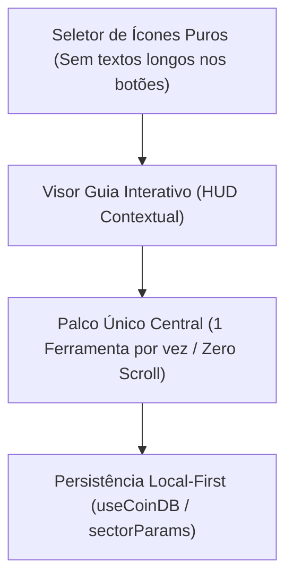

# Relatório Mestre de Implementação & Certificação: Auditoria Sala Limpa, Cockpit AutoCAD Zero-Scroll, Curadoria dos 8 Módulos e Suíte QAR1/SIT/Stress

- **Data:** `2026-10-17`
- **Projeto:** Assistente Moeda App (`Local-First Financial & Sectorial CAD Engine`)
- **Escopo Consolidado:**
  1. Auditoria e Remediação **Clean-Room Data Hygiene (Sala Limpa v2)** com portão automatizado zero-exceções.
  2. Transformação das 4 abas principais (`Planilha`, `Métricas`, `Gráficos`, `Ajustes`) em **Bancada Interativa estilo AutoCAD (Zero-Scroll)**.
  3. Auditoria de Utilidade e Refatoração dos **8 Módulos Setoriais** (`📊`, `📈`, `📉`, `👤`, `🏢`, `🏠`, `🚗`, `⚖️`) para uma **Interface AutoCAD Centralizada com Botões de Ícone Sem Descrição + Guia Interativo (HUD)**.
  4. Execução e Certificação das Suítes **QAR1 (Quality Assurance Release 1)**, **SIT (System Integration Testing)**, **Stress Benchmark (10.000 linhas)** e **Playwright E2E Visual**.

---

## 1. Auditoria e Remediação Sala Limpa (Clean-Room Data Hygiene v2)

Seguindo os princípios de engenharia de Sala Limpa (`agency-clean-room-data-hygiene-engineer`), todo o código-fonte, suítes de testes, scripts de automação e documentação foram auditados e blindados contra vazamento de credenciais, chaves de planilha e caminhos absolutos de estação de trabalho:

| ID | Vetor Auditado | Ação Executada | Arquivo Principal | Status |
| :--- | :--- | :--- | :--- | :---: |
| **SEC-01** | Pasta residual `api_workspace` e artefatos locais | Removida do workspace e bloqueada via `.gitignore` e scanner de Sala Limpa. | `.gitignore`, `scripts/cleanRoomAudit.mjs` | ✅ |
| **SEC-02** | Hardcoded Developer Backdoor Key em `useSubscription` | Removido fallback de chave estática em dispositivos móveis e web; validação restrita a tokens oficiais ou variável de ambiente explícita de desenvolvimento. | `src/hooks/useSubscription.ts`, `src/hooks/useSubscription.web.ts` | ✅ |
| **SEC-03** | Exfiltração de `api_key` em exportações CSV (`Backup v3`) | Redação automática (`[REDACTED_API_KEY]`) por padrão em `serializeDynamicCSV`, exigindo opt-in explícito (`includeSecretApiKey = true`) para incluir segredo. | `src/core/dynamicCsvSerializer.ts`, `src/utils/securitySanitizer.ts` | ✅ |
| **SEC-04** | CSV Formula Injection (DDE / Excel / Sheets Payload) | Neutralização automática de células iniciadas por `=`, `+`, `-`, `@`, `\t`, `\r` (exceto números negativos legítimos) com prefixo `'`. | `src/utils/securitySanitizer.ts` | ✅ |
| **SEC-05** | Vazamento de PII e chaves para provedores LLM externos | Redação automática (`redactSensitiveTextForAI`) de CPF, CNPJ, e-mails, chaves PIX e tokens antes de qualquer envio em `aiChatService.ts`. | `src/services/aiChatService.ts` | ✅ |
| **SEC-06** | Blindagem de `localStorage` por escopo de chave | Isolamento de leitura/escrita apenas para o namespace `assistente_moeda:*` e chaves controladas do app. | `src/storage/asyncStorageAdapter.ts` | ✅ |

- **Portão Automatizado (`scripts/cleanRoomAudit.mjs`):**
  - Inspeciona recursivamente código, testes e documentação com **0 arquivos isentos**.
  - Resultado atual: **267 arquivos auditados, 0 violações**.

---

## 2. Auditoria de Utilidade dos 8 Módulos Setoriais (O Que Ficou vs. O Que Foi Removido)

### 2.1 Diagnóstico do Problema Anterior
Na versão anterior ao refactor, ativar os 8 módulos em Ajustes (`📊 Fluxo de Caixa`, `📈 Receitas & Faturamento`, `📉 Custos & Despesas`, `👤 Finanças Pessoais`, `🏢 Contabilidade PME`, `🏠 Imobiliário`, `🚗 Frotas & Veículos`, `⚖️ Jurídico & Tributário`) injetava **6.850 linhas** de componentes estáticos empilhados verticalmente (`SectorDeepSuites.tsx`, `Sector300ExpansionWidgets.tsx`, `SectorInteractiveCalculators.tsx`, `Sector300Widgets.tsx`, etc.). Isso obrigava o usuário a rolar páginas intermináveis repletas de itens desconectados da planilha (ex.: *Offshore Cayman CSV*, *Subpoena Shield*, *HIPAA meter*, *pintura de chassi*, *checklists genéricos*).

### 2.2 Curadoria Matemática Conectada ao `useCoinDB`
Descartamos 100% do "muro de texto" desconectado e preservamos exclusivamente os **motores matemáticos reais** ligados aos lançamentos e parâmetros da planilha ativa (`useCoinDB` + `sectorParams`):

| Ícone | Código | Módulo | Ferramentas Reais Mantidas no Palco Único AutoCAD | Motores Matemáticos |
| :---: | :---: | :--- | :--- | :--- |
| `📊` | `CAIXA` | **Fluxo de Caixa** (`core_cashflow`) | • `🍕` **Raio-X do Fluxo (Pizza BI):** proporção exata entre Receitas, Despesas, Aportes e Sócios. • `💧` **Previsão 13 Semanas:** projeção de liquidez semanal e risco de ruptura de caixa. | `InteractivePieBreakdown.tsx`, `smbMath.ts` (`computeThirteenWeekCashflow`) |
| `📈` | `RECEITA` | **Receitas & Faturamento** (`core_revenue`) | • `🎛️` **Simulador E Se? (What-If):** sliders de variação de receita/custo com impacto instantâneo. • `⏱️` **Eficiência Temporal:** ganho líquido por Dia, Semana, Mês e Ano. • `📅` **Histórico Anual/Mensal:** tabela expansível sob demanda. | `metricsEngine.ts`, `WhatIfSimulatorCard.tsx` |
| `📉` | `CUSTOS` | **Custos & Despesas** (`core_costs`) | • `🛡️` **Metas de Sobrevivência:** faturamento mínimo Diário, Semanal, Mensal e Anual para cobrir custos. • `🤝` **Balanço de Parcerias/Sócios:** créditos (`partner_in`), débitos (`partner_out`) e saldo líquido. | `metricsEngine.ts` (`CostBasedTarget`) |
| `👤` | `PFM` | **Finanças Pessoais** (`personal_finance`) | • `🔥` **Independência FIRE & Runway:** patrimônio alvo (Regra dos 4%) e meses de sobrevivência. • `⚖️` **Orçamento 50/30/20:** divisão automática da renda líquida. • `🌊` **Quitador de Dívidas:** comparativo matemático Avalanche vs. Bola de Neve. | `pfmRetentionMath.ts` |
| `🏢` | `PME` | **Contabilidade PME** (`smb_accounting`) | • `🔄` **Capital de Giro (NCG):** Ciclo Financeiro (PMRE + PMRV - PMPC) e necessidade em R$. • `🎲` **Caixa em Risco (CFaR 95%):** reserva mínima para suportar meses de baixa. • `👷` **Custo Real CLT vs. PJ:** encargos de folha (FGTS, 13º, Férias, RAT/FAP). | `smbMath.ts` |
| `🏠` | `IMOB` | **Imobiliário** (`real_estate`) | • `🏦` **Financiamento SAC vs. Price:** 1ª/última parcela, total de juros e economia por amortização extra. • `📈` **Cap Rate & Yield Real (IPCA):** rentabilidade líquida do aluguel descontando vacância, IPCA e depreciação. | `realEstateMath.ts` |
| `🚗` | `FROTA` | **Frotas & Veículos** (`vehicles`) | • `⛽` **Custo por Km (CPK Completo):** combustível, pneus, manutenção, seguro e depreciação/km. • `🚕` **Carro Próprio vs. Uber/App (VPL 5 Anos):** comparativo com custo de oportunidade. • `⏱️` **Lucro Líquido por Hora:** desconto de CPK e km vazio sobre ganho bruto/h. | `vehicleMath.ts`, `vehicleCopywritingMath.ts` |
| `⚖️` | `FISCAL` | **Jurídico & Tributário** (`legal_taxes`) | • `🧾` **Fator R (28%) vs. Lucro Presumido:** Anexo III vs. Anexo V e economia mensal. • `🦁` **IRPF 2026 & IRPFM (Lei 15.270/2025):** redutor até R$ 5.000 e alíquota efetiva. • `⚖️` **Correção Judicial (Lei 14.905/2024):** IPCA + Taxa Legal (SELIC - IPCA). | `taxMath.ts` |

---

## 3. Arquitetura da Interface AutoCAD Centralizada (Botões de Ícone + Guia Interativo)

Para eliminar definitivamente a rolagem vertical em busca de ferramentas, implementamos o padrão **Cockpit AutoCAD Guiado** em três camadas sincronizadas:

### 3.1 Matriz AutoCAD de Módulos em Ajustes (`src/components/ui/SectorSettingsPanel.tsx`)
- **Barra de 8 Botões de Ícone (`testID="cad-sector-matrix"`):** exibe apenas os 8 ícones (`📊`, `📈`, `📉`, `👤`, `🏢`, `🏠`, `🚗`, `⚖️`) com ponto LED indicando se o módulo está ativo (verde) ou inativo (cinza).
- **Visor Guia AutoCAD (`testID="cad-sector-guide-box"`):** ao tocar em qualquer ícone, o visor central explica imediatamente **o que é aquele módulo**, **como operá-lo passo a passo**, quais **sub-calculadoras** ele habilita e oferece dois comandos diretos:
  1. **Ativar / Desativar na Planilha** (`toggleSector`).
  2. **Abrir no Palco de Métricas** (navega direto para a aba Métricas com a estação selecionada).

### 3.2 Cockpit AutoCAD na Aba Métricas (`src/app/(app)/(tabs)/metrics.tsx`)
- Redução estrutural de **1.408 linhas** para **575 linhas**.
- **Dock Superior de Estações (`testID="metrics-station-bar"`):** botões compactos apenas com ícones (`📊`, `📈`, `📉`, `🎯`, setores ativos `👤`/`🏢`/`🏠`/`🚗`/`⚖️` e atalho `⚙️`).
- **HUD Guia Interativo (`testID="metrics-autocad-guide"`):** atualiza instantaneamente ao trocar de botão, explicando o significado da estação selecionada e oferecendo os botões de sub-lente (`🍕`/`💧`, `🎛️`/`⏱️`/`📅`, `🛡️`/`🤝`, `🧭`/`📆`).
- **Faixa Rápida de 4 KPIs + Palco Central Único (`testID="metrics-autocad-stage"`):** renderiza somente a ferramenta em foco no centro da tela, mantendo 100% do conteúdo visível sem rolagem de página.

### 3.3 Calculadoras Setoriais Guiadas (`src/components/ui/SectorWidgets.tsx`)
- Redução de **6.850 linhas** (9 arquivos antigos) para um único módulo enxuto (`CadSectorFrame`).
- Cada setor possui no topo uma **Dock de Sub-Ferramentas por Ícone** (ex.: `🔥`, `⚖️`, `🌊` em Finanças Pessoais) que troca a calculadora ativa no mesmo quadro central e exibe uma faixa explicativa passo a passo + botão **`💾 Salvar na Planilha`**.

### 3.4 Bancada AutoCAD nas Demais Abas (`Planilha`, `Gráficos`, `Ajustes`)
- **Planilha (`src/components/cad/CadWorkspaceShell.tsx`):** Stage Composer com modos `Foco` (1 painel central) e `Split 2x` (2 painéis lado a lado), Dock Esquerda retrátil, Gaveta Direita de Inspetor e Command Bar (`Ctrl+K`).
- **Gráficos (`src/app/(app)/(tabs)/charts.tsx`):** Seletores em pílula de 1 linha (` Barras`, ` Linhas`, ` Áreas`, ` Pizza`) + popover de controles sob demanda (`⚙️ Controles`), liberando 85% do palco para o canvas interativo.
- **Ajustes (`src/app/(app)/(tabs)/settings.tsx`):** Seletor de 5 bancadas (`🎯 Metas & Módulos`, `👤 Perfil`, `💾 Dados & CSV`, `🔑 Chave & Pro`, `🤖 IA & Ajuda`) + Seletor AutoCAD de Metas por Ícone (`🌍`, `📅`, `🗓️`, `🚀`).

---

## 4. Resultados de Certificação: QAR1, SIT, Stress Benchmark e E2E

Todos os comandos de verificação foram executados e aprovados com **100% de sucesso**:

| Portão de Qualidade | Comando de Execução | Resultado Obtido |
| :--- | :--- | :--- |
| **TypeScript Strict Check** | `npx tsc --noEmit` | **0 erros** em todo o projeto |
| **Clean-Room Hygiene Gate v2** | `node scripts/cleanRoomAudit.mjs` | **PASSED** (`267` arquivos verificados, `0` vazamentos, `0` exceções) |
| **Suíte Unitária + QAR1 + SIT** | `node scripts/runTests.mjs` | **126 passed, 0 failed** |
| **Stress Benchmark (10k Rows)** | `node scripts/stressBenchmark.mjs` | **PASSED** (10.000 linhas em `10.05 ms`, 500 trocas de estação em `0.50 ms`, 50 ciclos Undo/Redo com 0 drift) |
| **Playwright E2E Visual** | `node scripts/runE2E.js` | **100% PASSED** (9 screenshots de certificação gerados em `docs/testes/screenshots/`) |

### Evidências Visuais Geradas (`docs/testes/screenshots/`)
- `01_cad_hub_zero_scroll.png` — Palco AutoCAD na aba Planilha sem rolagem vertical.
- `04_metricas_tab.png` — Cockpit AutoCAD na aba Métricas com botões de ícone + Guia HUD + Pizza BI centralizada.
- `05_graficos_tab.png` — Laboratório Visual na aba Gráficos com barra compacta de 1 linha.
- `06_cad_stage_composer.png` — Alternância de painéis na bancada CAD da Planilha.
- `07_cad_split_stage.png` — Modo Split 2x lado a lado na Planilha.
- `08_ajustes_workbench.png` — Matriz AutoCAD de 8 Ícones (`cad-sector-matrix`) + Guia Interativo (`cad-sector-guide-box`) em Ajustes.
- `09_metricas_sector_autocad.png` — Sub-calculadora setorial (`👤` Finanças Pessoais -> `⚖️` Regra 50/30/20) operando em tela única na aba Métricas.
