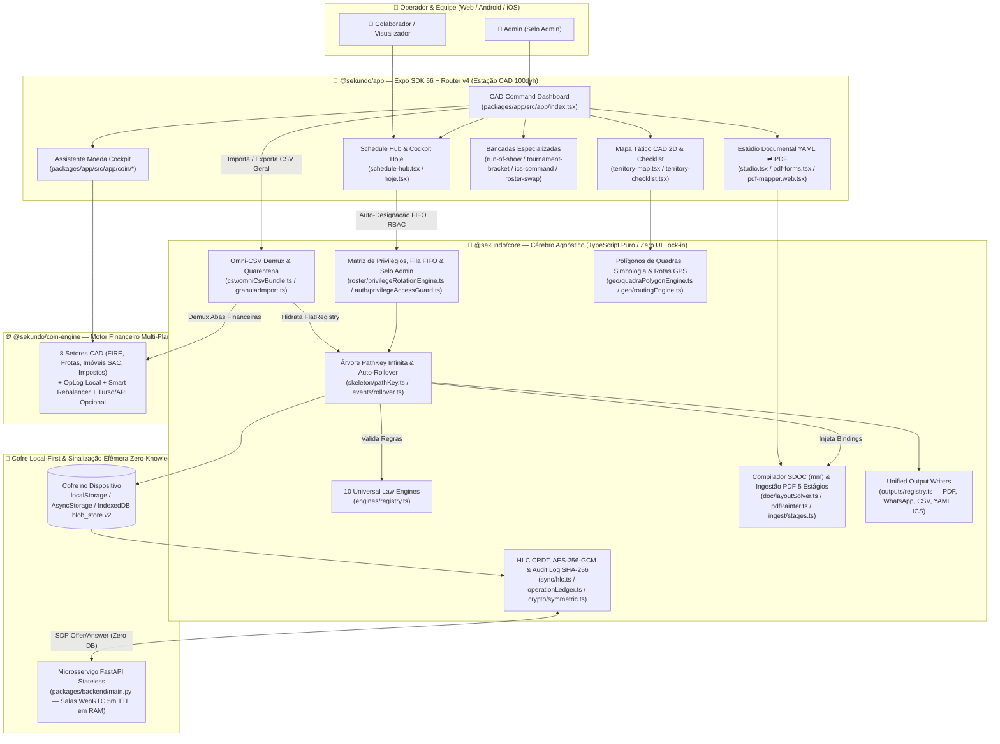
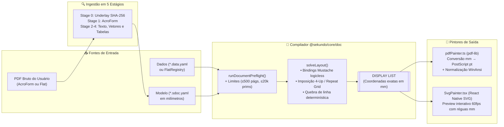
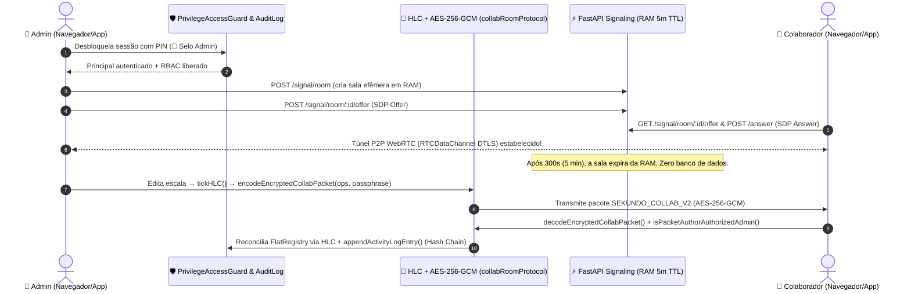
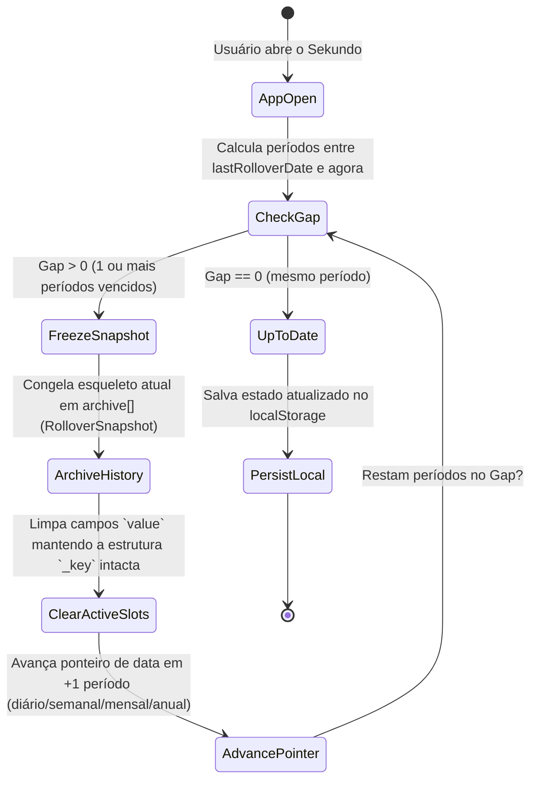

# ☀️ Sekundo — Motor Esqueleto Agnóstico, Local-First e Multi-Engine

> *"Para que você tenha o segundo necessário, para absorver toda a energia do sol que você pode receber naquele segundo."*

**Sekundo organiza escalas, mapas e PDFs no app.**  
Um ecossistema **100% Local-First, Serverless e de Profundidade Infinita** para automação temporal de eventos, escalas justas por fila FIFO com matriz dinâmica de privilégios, estúdio documental milimétrico (`YAML ⇄ DisplayList (mm) ⇄ PDF/SVG`), mapeamento tático CAD 2D com GPS/rotas offline, cockpit financeiro multi-planilha (**Assistente Moeda**) e colaboração simultânea P2P Zero-Knowledge (`AES-256-GCM` + `HLC CRDT`).

---

## 🎯 Visão Geral Interativa (ELI5 — Passo a Passo)

> **Resumo em uma frase:** *"Sekundo organiza escalas, mapas e PDFs no app."*

Para quem nunca viu o código antes, o Sekundo cresce em **5 passos visuais simples**:

1. **Passo 1 — Você e a Agenda:** Tudo começa quando você abre o Sekundo no navegador ou no celular (`ScheduleHubScreen`), sem precisar criar conta em nenhum servidor na nuvem.
2. **Passo 2 — As 4 Bancadas do Sekundo:** Na mesma estação de comando (estilo AutoCAD sem rolagem vertical), moram quatro bancadas principais:
   - 📅 **Monta a programação** (`packages/app/src/app/schedule-hub.tsx`) — Escalas semanais, grupos, trocas e avisos de WhatsApp.
   - 🗺️ **Mapeia territórios** (`packages/app/src/app/territory-map.tsx`) — Quadras em 2D, checklist de campo, GPS ao vivo e rotas a pé.
   - 🖋️ **Desenha documentos** (`packages/app/src/app/studio.tsx`) — Estúdio visual em milímetros (`mm`) que transforma YAML e dados em folhas PDF prontas para impressão.
   - 🪙 **Simula finanças** (`packages/app/src/app/coin/index.tsx`) — Assistente Moeda com múltiplas abas financeiras, 8 setores, metas FIRE, frotas e imóveis.
3. **Passo 3 — Leitura CSV e Escala Justa:** Você solta **1 único arquivo CSV Geral** (`importOmniCsvBundle`). O cérebro local lê cada linha, separa linhas defeituosas em quarentena sem travar o resto e chama o sorteador justo (`autoAssignScheduleRegistry`), que cruza a **Matriz de Privilégios** com a fila FIFO para escalar quem tem a competência certa e descansou há mais tempo.
4. **Passo 4 — Cofre Local Sem Servidor:** Todo o trabalho fica guardado no cofre do seu próprio aparelho (`localStorage`, `AsyncStorage` e `IndexedDB`) protegido por relógio lógico híbrido (`HLC`). Zero banco de dados centralizado na nuvem.
5. **Passo 5 — O Quadro Completo + Saídas Prontas:** Com um clique (`writeUnifiedOutput`), a escala pronta vira fichas PDF 4-Up (`Fichas 4-Up`), cartões e históricos de território (`Registro de Territórios`), textos formatados para WhatsApp e links de capacidade criptografados (`AES-256-GCM` + `Ed25519`).
   - **Em números:** `1` planilha CSV entra → `10` motores trabalham no aparelho → `0` bancos de dados obrigatórios na nuvem.

---

## 🏛️ 2. Masterclass Arquitetural & Diagrama Completo do Sistema

### 2.1 Índice de Subsistemas e Fluxos de Dados

| Visão / Subsistema | Descrição Técnica |
| :--- | :--- |
| **Visão Geral do Monorepo (`architecture`)** | Mapa completo das 5 raias (`@sekundo/app`, `@sekundo/core`, `Doc & Geo CAD`, `@sekundo/coin-engine` e `Local Vault & P2P`). |
| **Subsistema 1: Core Brain & 10 Engines (`architecture`)** | Como o CSV Geral hidrata a árvore `PathKey` infinita, valida as 10 Engines e executa a rotação FIFO com `👑 Selo Admin`. |
| **Subsistema 2: Estúdio YAML ⇄ PDF & Geo CAD (`architecture`)** | Compilador documental em milímetros (`DisplayList`), ingestão PDF em 5 estágios e polígonos/rotas de quadras. |
| **Subsistema 3: Cofre Local & Sync Zero-Knowledge (`architecture`)** | Persistência local, relógio lógico HLC, envelopes `AES-256-GCM`, Capability URLs v3 e relay stateless em FastAPI. |
| **Sequência 1: CSV Geral & Rotação FIFO (`data-flow`)** | Pipeline de importação multi-aba, quarentena de linhas e auto-designação por descanso FIFO. |
| **Sequência 2: Compilador YAML ⇄ PDF (`data-flow`)** | Decomposição de PDF bruto em 5 estágios, resolução `solveLayout` em `mm` e pintura `pdf-lib`. |
| **Sequência 3: Colaboração 1:N HLC & Capability Links (`data-flow`)** | Verificação de `👑 Selo Admin` / assinatura `Ed25519`, empacotamento `SEKUNDO_COLLAB_V2` e escopos `SEKUNDO_CAP_v3`. |

---

### 2.2 Diagrama Geral da Arquitetura em Camadas (Mermaid)



---

## ⚙️ 3. Explicação Profunda dos Pilares Arquiteturais e Fluxos de Dados

### 3.1 Pilar 1 — Árvore `PathKey` Infinita, Omni-CSV e Rotação Justa FIFO
Em vez de tabelas SQL engessadas, o Sekundo endereça qualquer estrutura organizacional usando **chaves numéricas hierárquicas de profundidade infinita** (`PathKey` em `packages/core/src/skeleton/pathKey.ts`):
- `01` → Grupo de Eventos / Território Macro
- `01-01` → Evento ou Reunião Específica / Cidade ou Setor
- `01-01-01` → Papel Principal, Parte da Programação ou Quadra
- `01-01-01-01-...-NN` → Subtarefas aninhadas sem limite de profundidade

O parser divide a chave por `-` e converte cada segmento em **inteiro** (`01`, `001` e `1` resolvem para o mesmo índice `1`), garantindo ordenação lexicográfica numérica exata.

#### Fluxo de Sequência: Importação do "CSV Geral" (Omni-CSV) e Auto-Designação FIFO
```mermaid
sequenceDiagram
    autonumber
    actor Admin as 👑 Operador (App)
    participant Omni as 📥 OmniCsvBundle (core/csv)
    participant Quar as 🛡️ GranularImport & Quarantine
    participant Rot as ⚖️ PrivilegeRotationEngine (FIFO)
    participant Tree as 🌳 FlatRegistry & Auto-Rollover
    participant Vault as 💾 OmniStorageBridge (Local)

    Admin->>Omni: Solta ou importa arquivo "CSV Geral" (sekundo_omni_geral.csv)
    Omni->>Omni: neutralizeCsvFormula() + resolveSheetNameToRecordKind()
    Omni->>Quar: parseCSVWithQuarantine(rows)
    Note over Quar: Linhas válidas seguem; linhas malformadas vão para quarantinedRows[] sem abortar o lote
    Quar-->>Omni: Eventos + Participantes (Matriz de Privilégios) + Rituais Hoje + Abas Financeiras
    Admin->>Rot: Solicita Auto-Designação (autoAssignScheduleRegistry)
    Rot->>Rot: inferSlotRequiredCapability(slot) + filtra participantes aptos e ativos
    Rot->>Rot: Ordena candidatos por maior tempo de descanso (FIFO) sem conflito na mesma sessão
    Rot->>Tree: applyNodeUpdates(registry, patches)
    Tree->>Vault: Salva eventos, matriz de privilégios, rituais e abas financeiras no dispositivo
```

---

### 3.2 Pilar 2 — As 10 Engines de Leis Universais (`@sekundo/core/engines`)
O registro central (`packages/core/src/engines/registry.ts`) permite que um mesmo evento opere com **múltiplas Engines simultaneamente** (`Multi-Engine Event`):

| # | Engine ID | Módulo (`packages/core/src/engines/`) | Rota / Bancada no App | Responsabilidade e Regras de Domínio |
| :--- | :--- | :--- | :--- | :--- |
| 1 | `territory_logistics` | `territoryEngine.ts` | `/territory-map`, `/territory-checklist` | Gestão de territórios, quadras, cálculo de recência (territórios não trabalhados há mais tempo), cobertura percentual e geração de cartões e registros de territórios. |
| 2 | `roster_assignments` | `rosterEngine.ts` | `/schedule-hub`, `/roster-swap` | Escalas de reuniões/turnos, detecção de choque de horário, matriz de privilégios, rotação FIFO, bitmask de disponibilidade e livro-razão de trocas. |
| 3 | `study_synthesis` | `studySynthesisEngine.ts` | `/skeleton-editor`, `/publisher` | Síntese colaborativa de pesquisa, tópicos estruturados, referências cruzadas e notas hierárquicas. |
| 4 | `generic_wbs` | `genericWbsEngine.ts` | `/skeleton-editor`, `/hoje` | Estrutura Analítica de Projetos (WBS) infinita com rollup automático de progresso de nós filhos para pais. |
| 5 | `incident_command` | `incidentCommandEngine.ts` | `/ics-command` | Sistema de Comando de Incidentes (ICS) com cadeia de comando, span-of-control e alocação tática de recursos. |
| 6 | `live_production_ros` | `runOfShowEngine.ts` | `/run-of-show` | Régie ao vivo (*Run-of-Show*), cues cronometrados em segundos, cálculo de *overrun/underrun* e transições de palco. |
| 7 | `tournament_pairings` | `tournamentEngine.ts` | `/tournament-bracket` | Chaveamento de torneios (Eliminatória / Sistema Suíço), desempates (*tie-breaks*) e avanço de rodadas. |
| 8 | `canvassing_logistics` | `canvassingEngine.ts` | `/territory-checklist`, `/territory-map` | Logística de visitação porta a porta em campo, status por unidade/imóvel e consolidação de cobertura. |
| 9 | `financial_ledger` | `financialLedgerEngine.ts` | `/coin` (`@sekundo/coin-engine`) | Livro-razão financeiro integrado ao esqueleto e demultiplexado para as múltiplas planilhas do Assistente Moeda. |
| 10 | `transformer` | `transformerEngine.ts` | `TransformerStudioModal.tsx` | Motor de transformação declarativa entre árvores, projeções customizadas e conversão de esquemas. |

---

### 3.3 Pilar 3 — Estúdio Documental Determinístico (`YAML ⇄ DisplayList (mm) ⇄ PDF / SVG`)
Inspirado em **Typst, PostScript e Skia**, o subsistema documental (`packages/core/src/doc/`) opera **100% no cliente** sem enviar documentos para servidores externos:
- **Unidade Física Única (`mm`):** Todo modelo `.sdoc.yaml` e todo pino de coordenada usam **milímetros (`mm`) com origem no canto superior esquerdo (`y` para baixo)**. A conversão para pontos PostScript (`pt`, origem no canto inferior esquerdo) ocorre exclusivamente dentro de `toPdf()` no `pdfPainter.ts`.
- **Ingestão de Qualquer PDF em 5 Estágios (`packages/core/src/doc/ingest/stages.ts`):**
  - *Stage 0 (Underlay):* Preserva o PDF original como fundo vetorial via `embedPage` e fingerprint `SHA-256` salvo no `IndexedDB` (`blob_store` v2).
  - *Stage 1 (AcroForm):* Extrai campos interativos (`TextField`, `CheckBox`, `Dropdown`) com resolução multi-página real.
  - *Stage 2 (Text Items):* Extrai blocos tipográficos e fontes.
  - *Stage 3 (Vector Paths):* Extrai linhas e caixas vetoriais.
  - *Stage 4 (Grid Detection):* Detecta tabelas colineares e sintetiza automaticamente um documento `.sdoc.yaml` editável.
- **Templates Nativos Prontos (`builtinTemplates.ts`):** Inclui imposição **4-Up de designações (`Fichas 4-Up`)**, **Registro Multi-Ciclo de Territórios (`Registro de Territórios`)** e **Mail Merge AcroForm**.



---

### 3.4 Pilar 4 — Governança Zero-Trust (`👑 Selo Admin`), HLC CRDT e Sincronismo P2P Zero-Knowledge
O Sekundo combina soberania local com colaboração simultânea em equipe (`1:N`) sem depender de banco de dados na nuvem:
1. **Transporte Nível 1 — Link-Container (`Horizon Window`):** O estado ativo (configuração + últimas 2 semanas + programação futura) é serializado, comprimido via `gzip`, criptografado com **PBKDF2 (100.000 iterações SHA-256) + AES-256-GCM** (`packages/core/src/crypto/symmetric.ts`) e embutido no **fragmento da URL (`#/view?data=...`)**. Como fragmentos `#` nunca são enviados em requisições HTTP, nem mesmo o provedor de hospedagem vê o payload. A senha viaja fora de banda (WhatsApp ou verbalmente).
2. **Transporte Nível 2 — Colaboração Simultânea `1:N` & WebRTC (`collabRoomProtocol.ts`):**
   - Cada mutação recebe um timestamp monotônico de um **Relógio Lógico Híbrido (`HLC`)** (`packages/core/src/sync/hlc.ts`) e entra no **Operation Ledger** (`operationLedger.ts`), permitindo reconciliação determinística LWW (*Last-Write-Wins*) por atributo sem conflitos destrutivos.
   - O portão de admissão **Zero-Trust RBAC (`privilegeAccessGuard.ts`)** valida o participante contra a Matriz de Privilégios e protege ações administrativas com o **`👑 Selo Admin`** e PIN verificador.
   - Toda operação fica registrada no **Audit Log encadeado por hash SHA-256 (`activityLogEngine.ts`)** (*Tamper-Evident Chain*).



---

### 3.5 Pilar 5 — Motor de Auto-Rollover Temporal (`packages/core/src/events/rollover.ts`)
Mesmo que o aplicativo permaneça fechado por dias, semanas ou meses, nenhum ciclo histórico é perdido. Ao abrir o app, o motor calcula sequencialmente todos os períodos transcorridos entre `lastRolloverDate` e `now`:



---

### 3.6 Pilar 6 — Assistente Moeda (`@sekundo/coin-engine` — Engine Financeira Multi-Planilha)
O pacote `packages/coin-engine` integra o ecossistema completo do **Assistente Moeda** dentro do Sekundo (`/coin`), conectado ao **CSV Geral** por demultiplexação automática de abas (`groupCoinLedgerRowsByTable` em `omniCsvBundle.ts`):
- **8 Setores CAD Financeiros:** Orçamento Doméstico, Metas de Independência Financeira (**FIRE**), Gestão de Frotas e Veículos (`vehicleMath.ts`), Financiamento Imobiliário (**SAC / Price**), Planejamento Tributário (`taxMath.ts`), Métricas de Investidor (`investorMetricsEngine.ts`), Saúde Financeira (`healthEngine.ts`) e Rebalanceador Inteligente de Carteira (`smartRebalancer.ts`).
- **Isolamento Estrito de Workspace:** Opera 100% local via `IndexedDB` / `AsyncStorage` + `opLog.ts`, mantendo isolamento completo de variáveis de ambiente e rotas em relação a sistemas externos.

---

## 📂 4. Estrutura Completa do Monorepo (`npm workspaces`)

```text
Sekundo/
├── .pr-lens/                              # Grafos e SVGs animados gerados pelo PR Lens e ELI5
│   ├── eli5.graph.json                    # Fonte do diagrama ELI5 (4 raias, 9 nós, 8 passos)
│   ├── graph.json                         # Fonte do diagrama de Arquitetura Completa (5 raias, 15 nós)
│   ├── sekundo-eli5-como-o-app-funciona/  # 6 SVGs animados + manifest.json (ELI5)
│   └── sekundo-arquitetura-completa-e-fluxos-de-dados/ # 7 SVGs animados + manifest.json (C4 + Flows)
├── docs/                                  # Documentação de arquitetura, manifesto e especificação CSV
│   ├── ARCHITECTURE.md                    # Architecture Decision Record (ADR) detalhado
│   ├── CSV_SCHEMA.md                      # Especificação do esquema CSV e chaves PathKey
│   └── MANIFESTO.md                       # Filosofia e princípios de design do Sekundo
├── master-plan/                           # Planos mestres de engenharia, pesquisas e evidências de QA
├── packages/
│   ├── core/                              # @sekundo/core — Cérebro agnóstico em TypeScript puro
│   │   └── src/
│   │       ├── audit/                     # Audit Log encadeado por hash SHA-256 (activityLogEngine.ts)
│   │       ├── auth/                      # Portão Zero-Trust RBAC e 👑 Selo Admin (privilegeAccessGuard.ts)
│   │       ├── chat/                      # Tipos de sinalização e mensagens P2P WebRTC
│   │       ├── composer/                  # Manifesto sekundo.app.yaml e sumário do Cockpit Hoje
│   │       ├── crypto/                    # PBKDF2 + AES-256-GCM + Gzip + URL Fragment Tokens
│   │       ├── csv/                       # Omni-CSV Geral, Quarentena, Granular Import/Export e Templates
│   │       ├── delegation/                # Delegação de subárvores CBAC (tokenManager.ts)
│   │       ├── doc/                       # Compilador YAML ⇄ DisplayList (mm) ⇄ PDF e Ingestão 5 Estágios
│   │       ├── engines/                   # As 10 Engines de Leis Universais + EngineRegistry
│   │       ├── events/                    # Container de eventos e motor de Auto-Rollover temporal
│   │       ├── geo/                       # Polígonos de quadras, Convex Hull, simbologia e rotas GPS/offline
│   │       ├── outputs/                   # Escritores unificados (PDF, WhatsApp, CSV, YAML)
│   │       ├── pdf/                       # AcroForm Filler, gerador Fichas 4-Up e Registro de Territórios, WinAnsi e Template Matcher
│   │       ├── roster/                    # Matriz de Privilégios, Rotação FIFO, Bitmask e Swap Ledger
│   │       ├── schedule/                  # Parser de programação, formatador WhatsApp e gerador ICS
│   │       ├── skeleton/                  # PathKey infinito, árvore Skeleton e fila serial
│   │       ├── sync/                      # Relógio HLC, Operation Ledger CRDT e protocolo colaborativo 1:N
│   │       ├── territory/                 # Simbologia dinâmica de mapas (cores, formas, legendas)
│   │       └── yaml/                      # Conversão bidirecional sem perdas FlatRegistry ⇄ Data YAML
│   ├── coin-engine/                       # @sekundo/coin-engine — Engine Financeira Assistente Moeda
│   │   └── src/
│   │       ├── core/                      # Reducers, OpLog, Health, Insights, Investor Metrics e Smart Rebalancer
│   │       ├── services/                  # Exportação, API Key e sincronização opcional
│   │       ├── storage/                   # Adaptadores IndexedDB e AsyncStorage
│   │       └── utils/                     # Motores matemáticos setoriais (Impostos, Veículos, Imóveis, CSV)
│   ├── app/                               # @sekundo/app — Aplicativo Universal Expo SDK 56 (Web + Mobile)
│   │   └── src/
│   │       ├── app/                       # Rotas Expo Router v4 (index, schedule-hub, studio, territory-map, coin/*)
│   │       ├── components/                # UI CAD 100dvh, SvgPainter, Mapa Leaflet/Nativo, Modais RBAC/Audit
│   │       ├── hooks/                     # Hooks reativos (useLocalEvent, useSdocDocument, useSimultaneousCollab, GPS)
│   │       ├── pdf/                       # Loader PDF.js e rasterização de underlay Web/Nativo
│   │       ├── storage/                   # Ponte OmniStorage, BlobStore IndexedDB v2 e tiles offline
│   │       └── sync/                      # Troca de blobs P2P
│   └── backend/                           # Microsserviço FastAPI 100% Stateless (Zero Banco de Dados)
│       ├── main.py                        # App factory FastAPI + isolamento CORS / X-Sekundo-Admin-Key
│       └── routers/                       # /health e /signal (Salas WebRTC em RAM com TTL de 5 minutos)
├── playstore-assets/                      # Capturas de tela certificadas (Celular, Tablet 7"/10", Desktop) e builds AAB
└── package.json                           # Raiz do Monorepo e scripts unificados
```

---

## 🚀 5. Como Executar, Testar e Atualizar os Diagramas

### 5.1 Instalação e Execução Rápida

```bash
# 1. Instalar dependências de todos os pacotes do monorepo
npm install

# 2. Executar a suíte de testes unitários e de integração do @sekundo/core (Vitest)
npm run test:core

# 3. Executar os testes matemáticos e de segurança do @sekundo/coin-engine
npm run test:coin

# 4. Verificar tipagem estrita TypeScript do core
npm run typecheck:core

# 5. Iniciar a Estação de Comando Sekundo na Web (Expo Web)
npm run dev:web

# 6. (Opcional) Iniciar o microsserviço stateless de sinalização WebRTC (FastAPI)
npm run install:backend
npm run dev:backend
```

### 5.2 Validar, Renderizar e Publicar os Diagramas (`PR Lens` & `ELI5`)

```bash
# Validar os contratos JSON Schema 0.2.0 de ambos os diagramas
npx @coldtea/pr-lens-cli@latest validate .pr-lens/eli5.graph.json
npx @coldtea/pr-lens-cli@latest validate .pr-lens/graph.json

# Renderizar os SVGs animados localmente (tema light)
npx @coldtea/pr-lens-cli@latest render .pr-lens/eli5.graph.json --theme light
npx @coldtea/pr-lens-cli@latest render .pr-lens/graph.json --theme light

# Atualizar os Canvases interativos online no PR Lens
npx @coldtea/pr-lens-cli@latest canvas push .pr-lens/sekundo-eli5-como-o-app-funciona/drawn.graph.json
npx @coldtea/pr-lens-cli@latest canvas push .pr-lens/sekundo-arquitetura-completa-e-fluxos-de-dados/drawn.graph.json
```

---

## 🛡️ 6. Invariantes de Governança e Contratos (Design by Contract)

| Fronteira / Subsistema | Garantia Arquitetural (Invariante Semântico) |
| :--- | :--- |
| **Soberania de Dados (`Local-First`)** | Nenhum dado de evento, participante, endereço ou planilha financeira é enviado a servidores de banco de dados por padrão. Fechar a aba em modo visualizador (`/view`) apaga 100% da memória em RAM. |
| **Isolamento de Workspace (`Clean-Room`)** | O Sekundo jamais compartilha variáveis `VITE_*`, cabeçalhos `X-Spreadsheet-Key` ou conexões de banco com outros projetos; utiliza exclusivamente `EXPO_PUBLIC_SEKUNDO_*` e `X-Sekundo-Admin-Key`. |
| **Segurança Documental (`Zero Eval`)** | Modelos `.sdoc.yaml` são tratados como dados não confiáveis: interpolação *logicless* sem `eval`/`new Function`, limite de `maxAliasCount: 100` no parser YAML e tetos de `500` páginas / `20.000` primitivas no `layoutSolver`. |
| **Integridade de Escala (`FIFO + RBAC`)** | `autoAssignScheduleRegistry` nunca escala um participante sem a competência exigida na Matriz de Privilégios, e pacotes colaborativos sem assinatura de um portador do `👑 Selo Admin` nunca alteram colunas protegidas. |

---

## 📄 Licença

Privado — Todos os direitos reservados. *"Nós somos somente pó, e se queremos continuar aprendendo, não podemos chamar atenção. This is the way."*
