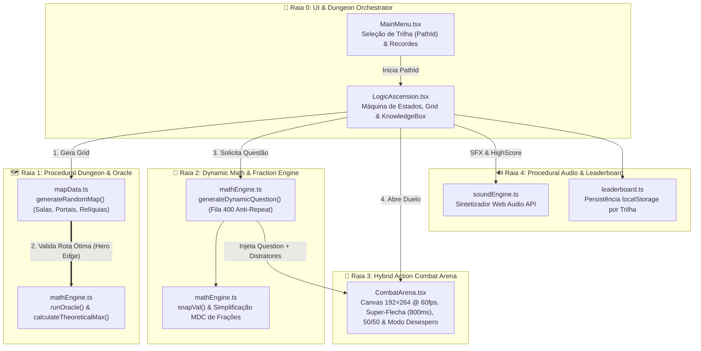
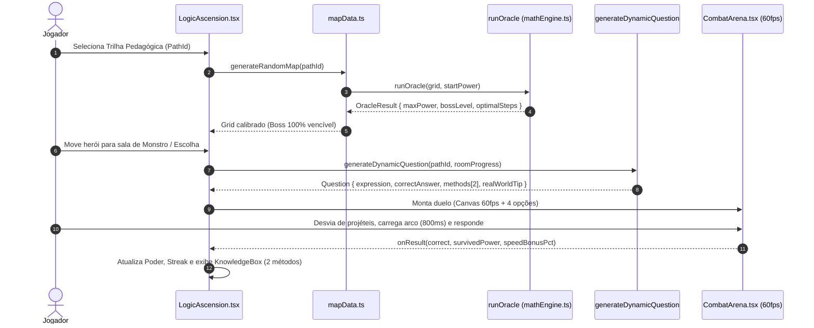

# ⚔️ Logic Ascension — RPG Tático de Masmorra, Oráculo de Rota Ótima & Duelo de Arco a 60fps

> **Resumo ELI5 em uma frase:** *"Logic Ascension usa contas para vencer chefes."*

O **Logic Ascension** (`src/games/LogicAscension`) é um **RPG Tático de Exploração de Masmorra e Progressão Matemática** que une **planejamento de rota em grid**, um **Oráculo Determinístico de Rota Ótima (`runOracle`)** que garante 100% de masmorras vencíveis, um **Gerador Dinâmico Multi-Lentes com Aritmética Exata de Frações (`snapVal`, fila anti-repetição de 400 questões)** e uma **Arena Híbrida de Ação em Canvas a 60fps (`CombatArena.tsx`)** onde o jogador atira flechas carregadas, desvia de projéteis e resolve desafios mentais sob pressão.

---

## 🎯 Links Rápidos para os Diagramas Interativos (PR Lens & ELI5)

Os diagramas abaixo foram construídos e validados com **PR Lens (`@coldtea/pr-lens-cli`)** e **ELI5**. Abra qualquer link abaixo no navegador e clique em **Start the walkthrough ▶** para navegar passo a passo:

| Diagrama Interativo | Público-Alvo & Escopo | Link do Canvas Interativo (Web) | SVG Animado (Embed) |
| :--- | :--- | :--- | :--- |
| 🟢 **1. Logic Ascension ELI5 — Masmorra da Matemática** | **Iniciantes / Visão Rápida (ELI5):** Constrói o jogo uma peça por vez (de 2 caixas até o quadro completo em 8 passos guiados). | [**👉 Abrir Canvas ELI5 Interativo (`prlens.dev/c/fk6IVdOojoz0W_4I-dDxjQ`)**](https://prlens.dev/c/fk6IVdOojoz0W_4I-dDxjQ) | [Ver SVG Animado](https://prlens.dev/c/fk6IVdOojoz0W_4I-dDxjQ.svg) |
| 🏛️ **2. Logic Ascension — Arquitetura Completa e Oráculo de Rotas** | **Engenharia & Arquitetura (Master Plan C4):** Mapeia as 5 raias arquiteturais, Oráculo `runOracle`, Motor de Lentes/Frações, `CombatArena` 60fps e payloads tipados. | [**👉 Abrir Canvas de Arquitetura Completa (`prlens.dev/c/KHf9c03vFnakuCzzmYh_5A`)**](https://prlens.dev/c/KHf9c03vFnakuCzzmYh_5A) | [Ver SVG Animado](https://prlens.dev/c/KHf9c03vFnakuCzzmYh_5A.svg) |

---

## 🧒 1. Explicação ELI5 ("Explain Like I'm Five" — Passo a Passo)

Para entender o **Logic Ascension** do zero, o [Canvas ELI5 Interativo](https://prlens.dev/c/fk6IVdOojoz0W_4I-dDxjQ) monta o jogo uma peça de cada vez:

1. **[Passo 1 — Você e o Mapa da Masmorra](.pr-lens/logic-ascension-eli5-masmorra-da-matematica/you-and-dungeon-light-f33e03f1bbac57249586a29bd9af285a.svg):** Tudo começa com você movendo seu herói por um tabuleiro de salas misteriosas (`LogicAscension.tsx` e `mapData.ts`).
2. **[Passo 2 — Mapa, Arena de Flechas e Caixa de Dicas](.pr-lens/logic-ascension-eli5-masmorra-da-matematica/what-ascension-does-light-f5813be3173356b043d9bccf3d66e088.svg):** Três painéis trabalham juntos na tela:
   - 🗺️ **Anda pelo mapa** (`LogicAscension.tsx` / `mapData.ts`) — Escolha quais salas visitar (monstros, portais, relíquias e altares `+`, `-`, `×`, `÷`).
   - 🏹 **Atira e desvia** (`CombatArena.tsx`) — Mini-arena a 60fps onde você atira flechas no monstro, desvia de ataques e escolhe a resposta certa.
   - 💡 **Lê truques mentais** (`KnowledgeEntry Box`) — Mostra na hora **dois jeitos diferentes** de resolver a conta de cabeça e onde usar aquilo na vida real.
3. **[Passo 3 — O Oráculo de Rotas e o Gerador de Contas](.pr-lens/logic-ascension-eli5-masmorra-da-matematica/plus-oracle-and-math-light-3663e4e90d7a138e5e3eca896fd46704.svg):** Antes da partida começar, o **Oráculo** (`runOracle` em `mathEngine.ts`) testa todos os caminhos possíveis do mapa para garantir que o Chefe Final seja vencível. Já o gerador (`generateDynamicQuestion`) cria até **400 contas sem repetição** usando lentes como *Massinha da Soma*, *Hack Japonês* e *Frações Simplificadas*.
4. **[Passo 4 — Multiplicador de Poder e Modo Desespero](.pr-lens/logic-ascension-eli5-masmorra-da-matematica/plus-power-scaler-light-02a1c4fb278d9a8aeba58a4c609f6d76.svg):** Acertar rápido absorve o nível do monstro e dá até **+20% de bônus de velocidade**. Se você atacar um inimigo mais forte que você, o **Modo Desespero** abre uma chance heroica de sobrevivência!
5. **[Passo 5 — O Quadro Completo + Vitória contra o Chefe](.pr-lens/logic-ascension-eli5-masmorra-da-matematica/the-whole-thing-light-f695c84164aafd3e8e90ec7ddd0fc44b.svg) & [Fluxo de Combate ELI5](.pr-lens/logic-ascension-eli5-masmorra-da-matematica/ascension-flow-view-light-3de0c00ed1668c21e142db5c361d8f1b.svg):** Quando seu poder supera o nível do Chefe Final, você vence a masmorra, ouve a fanfarra sintetizada em Web Audio (`soundEngine.ts`) e grava seu recorde (`leaderboard.ts`).

---

## 🏛️ 2. Arquitetura Completa & Fluxos de Dados (PR Lens + Mermaid)

### 2.1 Índice de Visões e Diagramas do Projeto (`PR Lens`)

| Visão / Lente | Descrição Técnica | Arquivo SVG Local (`.pr-lens/`) | Canvas Online |
| :--- | :--- | :--- | :--- |
| **Visão Geral da Arquitetura (`architecture`)** | Mapa completo das 5 raias (`UI & Dungeon Orchestrator`, `Procedural Dungeon & Oracle`, `Dynamic Math & Fraction Engine`, `Hybrid Action Combat Arena`, `Procedural Audio & Leaderboard`). | [`ascension-overview-light.svg`](.pr-lens/logic-ascension-arquitetura-completa-e-oraculo-d/ascension-overview-light-a6b447bf48ef772c58a49081001b9a16.svg) | [Abrir no Canvas](https://prlens.dev/c/KHf9c03vFnakuCzzmYh_5A) |
| **Subsistema: Oráculo de Rota Ótima e Gerador de Lentes (`architecture`)** | Calibração matemática do Boss Final via `runOracle` / `calculateTheoreticalMax` e geração de questões com `snapVal`. | [`oracle-and-math-subview-light.svg`](.pr-lens/logic-ascension-arquitetura-completa-e-oraculo-d/oracle-and-math-subview-light-794466a8c3b41a57a78d4b3339e02284.svg) | [Abrir no Canvas](https://prlens.dev/c/KHf9c03vFnakuCzzmYh_5A) |
| **Sequência: Oráculo, Duelo Híbrido e Escalada de Poder (`data-flow`)** | Fluxo de dados com payloads tipados (`DungeonGridInput` → `OracleResult` → `Question` → `onResult`). | [`ascension-sequence-view-light.svg`](.pr-lens/logic-ascension-arquitetura-completa-e-oraculo-d/ascension-sequence-view-light-2a5a977c9585bc1e6a470fcb22eccc88.svg) | [Abrir no Canvas](https://prlens.dev/c/KHf9c03vFnakuCzzmYh_5A) |

---

### 2.2 Diagrama Geral da Arquitetura em 5 Raias (Mermaid)

---

### 2.3 Fluxo de Sequência: Calibração pelo Oráculo e Duelo na Arena (Mermaid)

---

## 🧮 3. Subsistema Matemático e Mecânicas de Jogo

### 3.1 O Oráculo de Rota Ótima (`runOracle` & `calculateTheoreticalMax`)
Em jogos de masmorra baseados em progressão aritmética/geométrica (onde salas aplicam `+N`, `-N`, `×N`, `÷N` ou absorvem o poder de monstros), a geração procedural ingênua frequentemente cria **becos sem saída matemáticos** (chefes impossíveis).
- O **Oráculo (`runOracle`)** executa uma simulação de busca antes do início da partida, avaliando a sequência ótima de coleta de buffs, chaves, portais e abates de monstros.
- O nível do **Boss Final** é calibrado dinamicamente como uma fração justa do `maxPower` teórico encontrado pelo Oráculo, garantindo **Zero Deadlock** sem sacrificar o desafio tático.

### 3.2 Lentes Cognitivas, Aritmética de Frações (`snapVal`) e `KnowledgeEntry`
- **Fila Anti-Repetição de 400 Questões:** Impede que a mesma conta reapareça durante longas sessões de estudo.
- **Precisão de Frações (`snapVal`):** Operações de divisão e multiplicação fracionária são simplificadas por **Máximo Divisor Comum (MDC)** e formatadas como frações irredutíveis ou inteiros exatos, evitando dízimas truncadas.
- **Dupla Explicação (`SolutionMethod[]`):** Cada questão resolvida abre a `KnowledgeBox` com **dois caminhos mentais distintos** (ex.: *Decomposição Esquerda-Direita* vs. *Compensação/Arredondamento*) + uma **Aplicação no Mundo Real**.

### 3.3 Arena Híbrida de Combate (`CombatArena.tsx`)
- **Combate em Tempo Real (60fps):** Enquanto o cronômetro da pergunta corre, o jogador controla um arqueiro em um Canvas `192×264`, desviando de projéteis inimigos e disparando flechas normais ou **Super-Flechas carregadas (`800ms`)**.
- **Bônus de Velocidade:** Responder rapidamente concede até **+20% de poder extra** na absorção do monstro.
- **Lifeline 50/50 & Modo Desespero:** O jogador pode gastar carga para eliminar duas alternativas incorretas (`50/50`), e caso enfrente um monstro com nível superior ao seu poder atual, entra no **Modo Desespero**, podendo sobreviver na pura habilidade de esquiva e cálculo.

---

## 🛡️ 4. Master Plan Architect — Contratos (DbC) & Estrutura de Arquivos

### 4.1 Invariantes de Design by Contract (DbC)
1. **Invariante de Solubilidade do Mapa:** $\forall \text{Grid } G \text{ gerado por } \texttt{generateRandomMap}, \quad \texttt{runOracle}(G).\text{maxPower} > \text{BossLevel}(G)$.
2. **Invariante de Unicidade de Alternativas:** Em toda questão $Q$, o conjunto de opções $\{o_1, o_2, o_3, o_4\}$ possui cardinalidade 4 ($|\{o_i\}| = 4$) e exatamente um índice satisfaz $|o_k - Q.\text{correctAnswer}| < 10^{-6}$.
3. **Invariante de Limpeza do Loop Canvas:** O `requestAnimationFrame` de `CombatArena.tsx` é obrigatoriamente cancelado no `useEffect` cleanup para evitar vazamento de CPU após o término do duelo.

### 4.2 Mapa de Arquivos (`src/games/LogicAscension`)
- [`LogicAscension.tsx`](file:///C:/Users/Usuario/Desktop/AHeiss_GoogleDrive/02-Programacao/projetos-IA/LogicDefense/src/games/LogicAscension/LogicAscension.tsx) — Orquestrador principal do RPG, movimentação no grid, estado de poder e `KnowledgeBox`.
- [`CombatArena.tsx`](file:///C:/Users/Usuario/Desktop/AHeiss_GoogleDrive/02-Programacao/projetos-IA/LogicDefense/src/games/LogicAscension/CombatArena.tsx) — Arena híbrida de arco e flecha a 60fps em HTML5 Canvas + Quiz sob pressão.
- [`mathEngine.ts`](file:///C:/Users/Usuario/Desktop/AHeiss_GoogleDrive/02-Programacao/projetos-IA/LogicDefense/src/games/LogicAscension/mathEngine.ts) — Oráculo de rota ótima (`runOracle`), motor de frações (`snapVal`) e gerador de questões multi-lentes.
- [`mapData.ts`](file:///C:/Users/Usuario/Desktop/AHeiss_GoogleDrive/02-Programacao/projetos-IA/LogicDefense/src/games/LogicAscension/mapData.ts) — Gerador procedural de masmorras, salas especiais, portais e tipos de terreno.
- [`MainMenu.tsx`](file:///C:/Users/Usuario/Desktop/AHeiss_GoogleDrive/02-Programacao/projetos-IA/LogicDefense/src/games/LogicAscension/MainMenu.tsx) — Seleção de trilhas pedagógicas (`PathId`) e visualização de recordes.
- [`soundEngine.ts`](file:///C:/Users/Usuario/Desktop/AHeiss_GoogleDrive/02-Programacao/projetos-IA/LogicDefense/src/games/LogicAscension/soundEngine.ts) & [`leaderboard.ts`](file:///C:/Users/Usuario/Desktop/AHeiss_GoogleDrive/02-Programacao/projetos-IA/LogicDefense/src/games/LogicAscension/leaderboard.ts) — Sintetizador Web Audio procedural e persistência local de placares.
