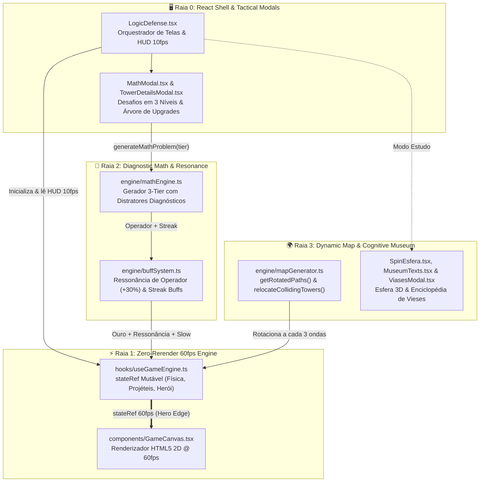
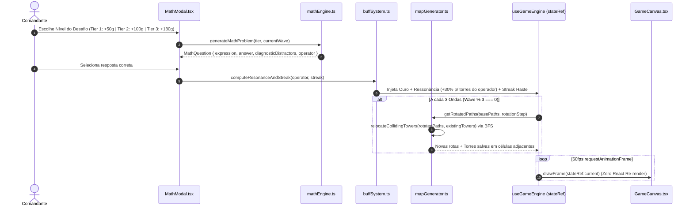

# 🏰 LogicDefense (Genesis 2.0) — Tower Defense Tático 60fps, Ressonância Matemática & SpinEsfera

> **Resumo ELI5 em uma frase:** *"Contas certas turbinam torres no mapa que gira."*

O **LogicDefense — Genesis 2.0** (`src/games/LogicDefense`) é um **Tower Defense Tático e Comando de Herói a 60fps** projetado com uma arquitetura **Zero-Rerender em HTML5 Canvas (`useGameEngine.ts`)**. Nele, o cálculo mental não é apenas uma trava de progresso, mas o **reator tático da partida**: resolver desafios de 3 níveis de risco abastece o ouro, dispara **Ressonância de Operadores (+30% de poder quando o sinal `+`, `-`, `×`, `÷` da conta combina com a especialidade da torre)**, acumula buffs globais de sequência (*Streak*) e sustenta a defesa enquanto **as estradas do mapa giram a cada 3 ondas (`mapGenerator.ts`)**. Fora do combate, o jogo inclui a **SpinEsfera 3D** e o **Museu de Vieses Cognitivos**.

---

## 🎯 Links Rápidos para os Diagramas Interativos (PR Lens & ELI5)

Os diagramas abaixo foram construídos e validados com **PR Lens (`@coldtea/pr-lens-cli`)** e **ELI5**. Abra qualquer link abaixo no navegador e clique em **Start the walkthrough ▶** para navegar passo a passo:

| Diagrama Interativo | Público-Alvo & Escopo | Link do Canvas Interativo (Web) | SVG Animado (Embed) |
| :--- | :--- | :--- | :--- |
| 🟢 **1. LogicDefense ELI5 — Torres Movidas a Matemática** | **Iniciantes / Visão Rápida (ELI5):** Constrói o jogo uma peça por vez (do campo de batalha 60fps até a Ressonância, rotação de rotas e Museu em 5 passos). | [**👉 Abrir Canvas ELI5 Interativo (`prlens.dev/c/ZcJV6JIGoWvACgeSQ2qwiA`)**](https://prlens.dev/c/ZcJV6JIGoWvACgeSQ2qwiA) | [Ver SVG Animado](https://prlens.dev/c/ZcJV6JIGoWvACgeSQ2qwiA.svg) |
| 🏛️ **2. LogicDefense — Arquitetura Genesis 2.0 (60fps Canvas & Ressonância)** | **Engenharia & Arquitetura (Master Plan C4):** Mapeia as 4 raias arquiteturais, loop `stateRef` Zero-Rerender, `buffSystem.ts`, realocação BFS de torres e payloads. | [**👉 Abrir Canvas de Arquitetura Completa (`prlens.dev/c/6d1Oj5IZ4bXslWA0JPIZEw`)**](https://prlens.dev/c/6d1Oj5IZ4bXslWA0JPIZEw) | [Ver SVG Animado](https://prlens.dev/c/6d1Oj5IZ4bXslWA0JPIZEw.svg) |

---

## 🧒 1. Explicação ELI5 ("Explain Like I'm Five" — Passo a Passo)

Para entender o **LogicDefense** do zero, o [Canvas ELI5 Interativo](https://prlens.dev/c/ZcJV6JIGoWvACgeSQ2qwiA) monta o sistema passo a passo:

1. **[Passo 1 — Você e o Campo de Batalha 60fps](.pr-lens/logicdefense-eli5-torres-movidas-a-matematica/you-and-canvas-light-90d2d9ff66c81865aa91cd8826decff3.svg):** Você comanda um Herói no mapa e constrói torres elementais num motor HTML5 Canvas (`GameCanvas.tsx` + `useGameEngine.ts`) que roda a 60 quadros por segundo sem nunca travar o React.
2. **[Passo 2 — Desafio de 3 Níveis e Ressonância (+30%)](.pr-lens/logicdefense-eli5-torres-movidas-a-matematica/plus-math-resonance-light-bc793bb53f2ee13fa1c50571c5208e85.svg):** Ao abrir o desafio matemático (`MathModal.tsx` / `mathEngine.ts`), você escolhe entre 3 níveis de recompensa (`+50g`, `+100g` ou `+180g`). Quando o operador da conta (`+`, `-`, `×`, `÷`) combina com o elemento da sua torre, o `buffSystem.ts` ativa **+30% de Ressonância de Operação**!
3. **[Passo 3 — Rotas que Giram a Cada 3 Ondas](.pr-lens/logicdefense-eli5-torres-movidas-a-matematica/plus-rotating-map-light-296430f091a103097cffaafd755e1579.svg):** A cada 3 ondas, o gerador de mapas (`mapGenerator.ts`) gira as estradas por onde os monstros passam (`90°`, `180°`, `270°`) e move automaticamente qualquer torre que ficaria em cima da nova pista!
4. **[Passo 4 — O Ecossistema Completo + SpinEsfera e Museu](.pr-lens/logicdefense-eli5-torres-movidas-a-matematica/the-whole-defense-light-ad72ea9b7f0329bd9ed3900a5920df91.svg) & [Fluxo de Ressonância ELI5](.pr-lens/logicdefense-eli5-torres-movidas-a-matematica/defense-flow-view-light-5d289b4c7ca554dce06b6cf4d51de8d9.svg):** Além da campanha e modo infinito, você pode explorar a **SpinEsfera 3D** (`SpinEsfera.tsx`) e o **Museu de Vieses Cognitivos** (`MuseumTexts.tsx` e `ViasesModal.tsx`).

---

## 🏛️ 2. Arquitetura Completa & Fluxos de Dados (PR Lens + Mermaid)

### 2.1 Índice de Visões e Diagramas do Projeto (`PR Lens`)

| Visão / Lente | Descrição Técnica | Arquivo SVG Local (`.pr-lens/`) | Canvas Online |
| :--- | :--- | :--- | :--- |
| **Visão Geral da Arquitetura — Genesis 2.0 (`architecture`)** | Mapa completo das 4 raias (`React Shell & Tactical Modals`, `Zero-Rerender 60fps Engine`, `Diagnostic Math & Resonance`, `Dynamic Map & Cognitive Museum`). | [`defense-overview-light.svg`](.pr-lens/logicdefense-arquitetura-genesis-2-0-60fps-canva/defense-overview-light-7a17f1f0ca02d3bdbb9994cadad084e2.svg) | [Abrir no Canvas](https://prlens.dev/c/6d1Oj5IZ4bXslWA0JPIZEw) |
| **Subsistema: Matemática Diagnóstica e Ressonância (`architecture`)** | Integração entre `MathModal`, `mathEngine.ts`, `buffSystem.ts` e mutação de `stateRef` no `useGameEngine.ts`. | [`math-resonance-subview-light.svg`](.pr-lens/logicdefense-arquitetura-genesis-2-0-60fps-canva/math-resonance-subview-light-9df8457180db5feff2b01412bc5dd104.svg) | [Abrir no Canvas](https://prlens.dev/c/6d1Oj5IZ4bXslWA0JPIZEw) |
| **Sequência: Ressonância de Operador e Rotação de Rota (`data-flow`)** | Pipeline completo desde `MathTierRequest` até `relocateCollidingTowers` e `drawFrame(stateRef.current)`. | [`defense-sequence-view-light.svg`](.pr-lens/logicdefense-arquitetura-genesis-2-0-60fps-canva/defense-sequence-view-light-7c738f92d043fb8331fe79c22ca6a897.svg) | [Abrir no Canvas](https://prlens.dev/c/6d1Oj5IZ4bXslWA0JPIZEw) |

---

### 2.2 Diagrama Geral da Arquitetura em 4 Raias (Mermaid)

---

### 2.3 Fluxo de Sequência: Ressonância de Operadores e Rotação Topológica (Mermaid)

---

## 🧠 3. Mecânicas Táticas, Ressonância e Pedagogia Diagnóstica

### 3.1 Desacoplamento Zero-Rerender (`stateRef` 60fps vs. HUD 10fps)
Para sustentar dezenas de inimigos, partículas, projéteis teleguiados e textos flutuantes sem sobrecarregar a árvore virtual do React:
- O estado autoritativo da batalha vive dentro de `stateRef = useRef<GameState>(...)` em `useGameEngine.ts`.
- O loop `requestAnimationFrame` atualiza posições, colisões e timers a **60fps puros**, desenhando direto no `GameCanvas.tsx`.
- Um sincronizador com *throttle* atualiza o estado superficial do React (Ouro, HP da Base, Onda, Timers de Buff) a **10fps (a cada 100ms)**, reduzindo o custo de reconciliação em **83%**.

### 3.2 Distratores Diagnósticos e Ressonância de Operadores (`buffSystem.ts`)
- **Distratores Diagnósticos (`mathEngine.ts`):** As alternativas incorretas não são números aleatórios; elas simulam erros cognitivos reais (ex.: erro de "vai-um" na dezena, inversão de sinal ou erro de unidade), treinando o jogador a validar a ordem de grandeza e o dígito final.
- **Ressonância de Operação (+30%):** Cada arquétipo de torre possui afinidade com um operador (`+`, `-`, `×`, `÷`). Resolver uma equação daquele operador ativa a **Ressonância Elemental**, concedendo **+30% de velocidade de ataque/dano** às torres compatíveis.

### 3.3 Rotação Topológica de Rotas com Salvamento BFS (`mapGenerator.ts`)
- A cada 3 ondas, a matriz de waypoints inimigos sofre uma transformação geométrica (`getRotatedPaths`).
- Caso a nova estrada passe exatamente sobre uma torre já construída pelo jogador, `relocateCollidingTowers` executa uma **Busca em Largura (BFS)** no grid para encontrar a célula livre válida mais próxima, preservando o investimento tático do jogador.

---

## 🛡️ 4. Master Plan Architect — Contratos (DbC) & Estrutura de Arquivos

### 4.1 Invariantes de Design by Contract (DbC)
1. **Invariante de Conservação de Torres na Rotação:** $|\text{Towers}_{\text{antes}}| = |\text{Towers}_{\text{depois}}|$ após qualquer chamada a `relocateCollidingTowers`, e nenhuma torre relocada intersecta o conjunto de células da nova rota.
2. **Invariante de Isolamento de Frame Rate:** Nenhuma mutação por frame dentro do `requestAnimationFrame` pode invocar `setState` sem passar pelo *throttler* de `100ms`.

### 4.2 Mapa de Arquivos (`src/games/LogicDefense`)
- [`LogicDefense.tsx`](file:///C:/Users/Usuario/Desktop/AHeiss_GoogleDrive/02-Programacao/projetos-IA/LogicDefense/src/games/LogicDefense/LogicDefense.tsx) — Shell principal, gerenciamento de telas (Campanha, Endless, SpinEsfera, Museu) e HUD.
- [`hooks/useGameEngine.ts`](file:///C:/Users/Usuario/Desktop/AHeiss_GoogleDrive/02-Programacao/projetos-IA/LogicDefense/src/games/LogicDefense/hooks/useGameEngine.ts) — Motor de jogo mutável a 60fps (`stateRef`), IA do Herói, torres e ondas.
- [`components/GameCanvas.tsx`](file:///C:/Users/Usuario/Desktop/AHeiss_GoogleDrive/02-Programacao/projetos-IA/LogicDefense/src/games/LogicDefense/components/GameCanvas.tsx) — Renderizador 2D em HTML5 Canvas.
- [`engine/mathEngine.ts`](file:///C:/Users/Usuario/Desktop/AHeiss_GoogleDrive/02-Programacao/projetos-IA/LogicDefense/src/games/LogicDefense/engine/mathEngine.ts) & [`engine/buffSystem.ts`](file:///C:/Users/Usuario/Desktop/AHeiss_GoogleDrive/02-Programacao/projetos-IA/LogicDefense/src/games/LogicDefense/engine/buffSystem.ts) — Gerador matemático de 3 tiers e motor de Ressonância/Streak.
- [`engine/mapGenerator.ts`](file:///C:/Users/Usuario/Desktop/AHeiss_GoogleDrive/02-Programacao/projetos-IA/LogicDefense/src/games/LogicDefense/engine/mapGenerator.ts) — Rotação topológica de rotas e realocação BFS de torres.
- [`components/screens/SpinEsfera.tsx`](file:///C:/Users/Usuario/Desktop/AHeiss_GoogleDrive/02-Programacao/projetos-IA/LogicDefense/src/games/LogicDefense/components/screens/SpinEsfera.tsx), [`components/MuseumTexts.tsx`](file:///C:/Users/Usuario/Desktop/AHeiss_GoogleDrive/02-Programacao/projetos-IA/LogicDefense/src/games/LogicDefense/components/MuseumTexts.tsx) & [`components/ViasesModal.tsx`](file:///C:/Users/Usuario/Desktop/AHeiss_GoogleDrive/02-Programacao/projetos-IA/LogicDefense/src/games/LogicDefense/components/ViasesModal.tsx) — Laboratório 3D SpinEsfera e Museu de Vieses Cognitivos.
