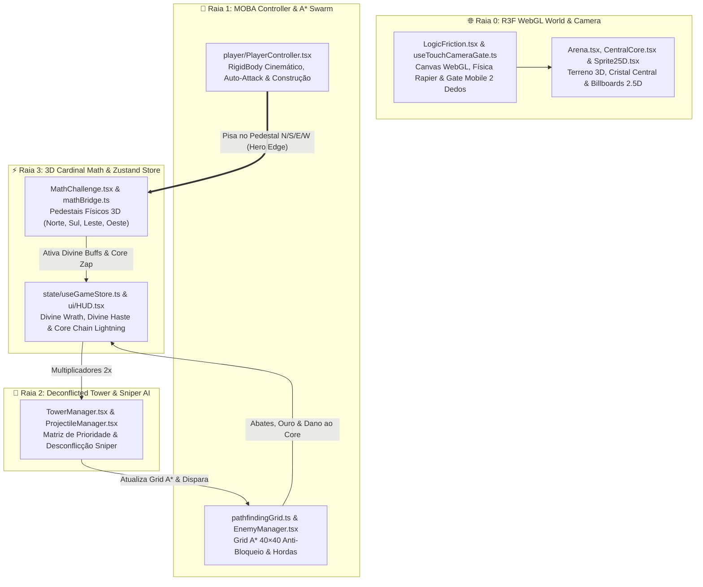
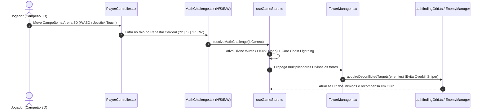

# ⚡ LogicFriction — Arena MOBA 2.5D/3D WebGL, Labirinto A* Dinâmico & Altares Matemáticos Cardeais

> **Resumo ELI5 em uma frase:** *"Pise nos altares 3D para eletrocutar hordas A*."*

O **LogicFriction** (`src/games/LogicFriction`) é um **Action Tower Defense 2.5D/3D estilo MOBA em WebGL** construído sobre **React Three Fiber (`@react-three/fiber`)**, **Three.js**, **física rígida 3D (`@react-three/rapier`)** e **Zustand (`useGameStore.ts`)**. Nele, o jogador pilota um Campeão em uma arena tridimensional protegendo o **Cristal Central (`CentralCore.tsx`)**, constrói torres que **alteram em tempo real o labirinto de busca de caminhos A* (`pathfindingGrid.ts`)** da horda inimiga, conta com **desconflicção inteligente de alvos Sniper (`TowerManager.tsx`)** e resolve equações **correndo fisicamente até os 4 Pedestais Cardeais (`Norte`, `Sul`, `Leste`, `Oeste`) no chão da arena 3D (`MathChallenge.tsx`)** para disparar Raios em Cadeia e Fúria Divina!

---

## 🎯 Links Rápidos para os Diagramas Interativos (PR Lens & ELI5)

Os diagramas abaixo foram construídos e validados com **PR Lens (`@coldtea/pr-lens-cli`)** e **ELI5**. Abra qualquer link abaixo no navegador e clique em **Start the walkthrough ▶** para navegar passo a passo:

| Diagrama Interativo | Público-Alvo & Escopo | Link do Canvas Interativo (Web) | SVG Animado (Embed) |
| :--- | :--- | :--- | :--- |
| 🟢 **1. LogicFriction ELI5 — Arena 3D e Altar Matemático** | **Iniciantes / Visão Rápida (ELI5):** Constrói o jogo uma peça por vez (da arena 3D até o labirinto A*, pedestais N/S/L/O e raios em cadeia em 5 passos). | [**👉 Abrir Canvas ELI5 Interativo (`prlens.dev/c/Me1xixa3VNSVkZaqmRle3w`)**](https://prlens.dev/c/Me1xixa3VNSVkZaqmRle3w) | [Ver SVG Animado](https://prlens.dev/c/Me1xixa3VNSVkZaqmRle3w.svg) |
| 🏛️ **2. LogicFriction — Arquitetura 2.5D/3D WebGL MOBA & A* Tower Defense** | **Engenharia & Arquitetura (Master Plan C4):** Mapeia as 4 raias 3D (R3F/Rapier, MOBA + Grid A* 40×40, Sniper Deconfliction e Altares Cardeais + Zustand). | [**👉 Abrir Canvas de Arquitetura Completa (`prlens.dev/c/5ecXQNKGoPrIsmtr5Lbyvw`)**](https://prlens.dev/c/5ecXQNKGoPrIsmtr5Lbyvw) | [Ver SVG Animado](https://prlens.dev/c/5ecXQNKGoPrIsmtr5Lbyvw.svg) |

---

## 🧒 1. Explicação ELI5 ("Explain Like I'm Five" — Passo a Passo)

Para entender o **LogicFriction** do zero, o [Canvas ELI5 Interativo](https://prlens.dev/c/Me1xixa3VNSVkZaqmRle3w) monta o mundo 3D passo a passo:

1. **[Passo 1 — Você e a Arena 3D com Física](.pr-lens/logicfriction-eli5-arena-3d-e-altar-matematico/you-and-3d-arena-light-a417fd42146d118e949c13fb100358c5.svg):** Você controla um campeão em 2.5D (`Sprite25D.tsx` + `PlayerController.tsx`) dentro de uma arena 3D WebGL com física Rapier (`LogicFriction.tsx` e `Arena.tsx`), defendendo o Cristal Central (`CentralCore.tsx`).
2. **[Passo 2 — Labirinto A* e Torres Sniper Inteligentes](.pr-lens/logicfriction-eli5-arena-3d-e-altar-matematico/plus-astar-and-snipers-light-590cfed7dbea8845ff9bc44f9a8e45e7.svg):** Cada torre construída vira um obstáculo real no mapa (`pathfindingGrid.ts`), obrigando a horda de monstros (`EnemyManager.tsx`) a recalcular o caminho A* pelo labirinto. Ao mesmo tempo, suas torres Sniper (`TowerManager.tsx`) dividem os alvos entre si para nunca desperdiçarem dois tiros no mesmo inimigo!
3. **[Passo 3 — Os 4 Pedestais Matemáticos no Chão (N/S/L/O)](.pr-lens/logicfriction-eli5-arena-3d-e-altar-matematico/plus-cardinal-pads-light-6d0d6eb47a9f4fb9bf0761b6d525513b.svg):** Aqui você não clica num botão parado para responder: o Altar Matemático (`MathChallenge.tsx` + `mathBridge.ts`) projeta a conta em 3D e acende **4 pisos cardeais (Norte, Sul, Leste, Oeste)** no chão da arena. Você precisa correr com o herói e pisar no piso certo!
4. **[Passo 4 — O Mundo Completo + Raios em Cadeia e Fúria Divina](.pr-lens/logicfriction-eli5-arena-3d-e-altar-matematico/the-whole-friction-light-b60a7a2977a254e6eb373557ad8c190f.svg) & [Fluxo do Altar 3D ELI5](.pr-lens/logicfriction-eli5-arena-3d-e-altar-matematico/friction-flow-view-light-6d8723e8678a7503610c4cdb9bdb9f38.svg):** Pisar na resposta correta faz o `useGameStore.ts` disparar **Core Chain Lightning** (raios em cadeia que eletrocutam os inimigos próximos ao núcleo) e concede **Divine Wrath (+100% de dano)** ou **Divine Haste (+50% de velocidade)**!

---

## 🏛️ 2. Arquitetura Completa & Fluxos de Dados (PR Lens + Mermaid)

### 2.1 Índice de Visões e Diagramas do Projeto (`PR Lens`)

| Visão / Lente | Descrição Técnica | Arquivo SVG Local (`.pr-lens/`) | Canvas Online |
| :--- | :--- | :--- | :--- |
| **Visão Geral da Arquitetura — LogicFriction 3D (`architecture`)** | Mapa completo das 4 raias (`R3F WebGL World & Camera`, `MOBA Controller & A* Swarm`, `Deconflicted Tower & Sniper AI`, `3D Cardinal Math & Zustand Store`). | [`friction-overview-light.svg`](.pr-lens/logicfriction-arquitetura-2-5d-3d-webgl-moba-a-t/friction-overview-light-e2c38eddef3f1a21f874f62019fb5a24.svg) | [Abrir no Canvas](https://prlens.dev/c/5ecXQNKGoPrIsmtr5Lbyvw) |
| **Subsistema: Altar Cardeal 3D e Buffs Divinos (`architecture`)** | Colisão espacial nos pedestais `N/S/E/W`, resolução em `useGameStore` e multiplicadores nas torres. | [`cardinal-shrine-subview-light.svg`](.pr-lens/logicfriction-arquitetura-2-5d-3d-webgl-moba-a-t/cardinal-shrine-subview-light-82548e2242f22cee86c0d123b4b8a1b9.svg) | [Abrir no Canvas](https://prlens.dev/c/5ecXQNKGoPrIsmtr5Lbyvw) |
| **Sequência: Altar Cardeal, Fúria Divina e Sniper A* (`data-flow`)** | Fluxo tipado desde `CardinalPadStep` até `ShrineResolution` e `acquireDeconflictedTargets`. | [`friction-sequence-view-light.svg`](.pr-lens/logicfriction-arquitetura-2-5d-3d-webgl-moba-a-t/friction-sequence-view-light-060b495e2dd50d18a819ca894a1f2edc.svg) | [Abrir no Canvas](https://prlens.dev/c/5ecXQNKGoPrIsmtr5Lbyvw) |

---

### 2.2 Diagrama Geral da Arquitetura em 4 Raias (Mermaid)

---

### 2.3 Fluxo de Sequência: Resolução Física no Altar 3D e Desconflicção A* (Mermaid)

---

## 🧠 3. Destaques de Engenharia 3D, IA e Física

### 3.1 Grid de Pathfinding A* com Validação Anti-Bloqueio (`pathfindingGrid.ts`)
- O mapa 3D é discretizado em uma malha `40×40` centrada na origem.
- Sempre que o jogador tenta construir uma torre, o algoritmo simula a inserção do obstáculo e executa o **A\*** dos pontos de spawn até o `CentralCore`. Se a torre bloquear 100% dos caminhos possíveis, a construção naquele tile é impedida, evitando *exploit* de cercamento total.

### 3.2 Desconflicção Multi-Alvo de Torres Sniper (`TowerManager.tsx`)
- Em Tower Defenses tradicionais, múltiplas torres de alto dano e baixa cadência (*Snipers*) costumam mirar no mesmo inimigo líder no mesmo frame, desperdiçando 80% do dano em *overkill*.
- O `TowerManager.tsx` mantém um conjunto de reservas de alvos por ciclo de disparo, distribuindo os tiros das torres Sniper entre inimigos distintos de alto HP antes de permitir foco duplicado.

### 3.3 Gate de Câmera Touch Balanceado (`useTouchCameraGate.ts`)
- Em dispositivos móveis, o uso simultâneo de um joystick virtual (1 dedo) e `OrbitControls` na cena 3D frequentemente causa rotações acidentais de câmera durante o combate.
- O hook `useTouchCameraGate.ts` monitora os ponteiros ativos e **só libera o giro/zoom da câmera 3D quando detecta exatamente 2 ou mais dedos**, mantendo a movimentação de 1 dedo 100% estável.

---

## 🛡️ 4. Master Plan Architect — Contratos (DbC) & Estrutura de Arquivos

### 4.1 Invariantes de Design by Contract (DbC)
1. **Invariante de Conectividade Topológica A\*:** Para todo ponto de spawn $S_i$, deve existir pelo menos um caminho válido $P(S_i \to \text{Core})$ no `pathfindingGrid` após o posicionamento de qualquer torre.
2. **Invariante Cardeal 3D:** Os 4 pedestais de resposta $(N, S, E, W)$ possuem posições ortogonais equidistantes ao centro do Altar e exatamente 1 pedestal contém `option === currentChallenge.answer`.

### 4.2 Mapa de Arquivos (`src/games/LogicFriction`)
- [`LogicFriction.tsx`](file:///C:/Users/Usuario/Desktop/AHeiss_GoogleDrive/02-Programacao/projetos-IA/LogicDefense/src/games/LogicFriction/LogicFriction.tsx) — Raiz do Canvas React Three Fiber, iluminação, física Rapier e pós-processamento.
- [`state/useGameStore.ts`](file:///C:/Users/Usuario/Desktop/AHeiss_GoogleDrive/02-Programacao/projetos-IA/LogicDefense/src/games/LogicFriction/state/useGameStore.ts) — Store Zustand com estado de combate, ondas, Divine Buffs e Chain Lightning.
- [`player/PlayerController.tsx`](file:///C:/Users/Usuario/Desktop/AHeiss_GoogleDrive/02-Programacao/projetos-IA/LogicDefense/src/games/LogicFriction/player/PlayerController.tsx) — Controle MOBA em 3D, auto-ataque e construção de torres.
- [`enemies/pathfindingGrid.ts`](file:///C:/Users/Usuario/Desktop/AHeiss_GoogleDrive/02-Programacao/projetos-IA/LogicDefense/src/games/LogicFriction/enemies/pathfindingGrid.ts) & [`enemies/EnemyManager.tsx`](file:///C:/Users/Usuario/Desktop/AHeiss_GoogleDrive/02-Programacao/projetos-IA/LogicDefense/src/games/LogicFriction/enemies/EnemyManager.tsx) — Malha A* dinâmica e gerenciador de hordas 2.5D.
- [`towers/TowerManager.tsx`](file:///C:/Users/Usuario/Desktop/AHeiss_GoogleDrive/02-Programacao/projetos-IA/LogicDefense/src/games/LogicFriction/towers/TowerManager.tsx) & [`towers/ProjectileManager.tsx`](file:///C:/Users/Usuario/Desktop/AHeiss_GoogleDrive/02-Programacao/projetos-IA/LogicDefense/src/games/LogicFriction/towers/ProjectileManager.tsx) — IA de torres com desconflicção Sniper e física de projéteis.
- [`math/MathChallenge.tsx`](file:///C:/Users/Usuario/Desktop/AHeiss_GoogleDrive/02-Programacao/projetos-IA/LogicDefense/src/games/LogicFriction/math/MathChallenge.tsx) & [`math/mathBridge.ts`](file:///C:/Users/Usuario/Desktop/AHeiss_GoogleDrive/02-Programacao/projetos-IA/LogicDefense/src/games/LogicFriction/math/mathBridge.ts) — Altares matemáticos 3D com pedestais cardeais N/S/E/W.
- [`world/Arena.tsx`](file:///C:/Users/Usuario/Desktop/AHeiss_GoogleDrive/02-Programacao/projetos-IA/LogicDefense/src/games/LogicFriction/world/Arena.tsx), [`world/CentralCore.tsx`](file:///C:/Users/Usuario/Desktop/AHeiss_GoogleDrive/02-Programacao/projetos-IA/LogicDefense/src/games/LogicFriction/world/CentralCore.tsx) & [`sprites/Sprite25D.tsx`](file:///C:/Users/Usuario/Desktop/AHeiss_GoogleDrive/02-Programacao/projetos-IA/LogicDefense/src/games/LogicFriction/sprites/Sprite25D.tsx) — Cenário 3D, núcleo energético e sistema de billboards 2.5D.
