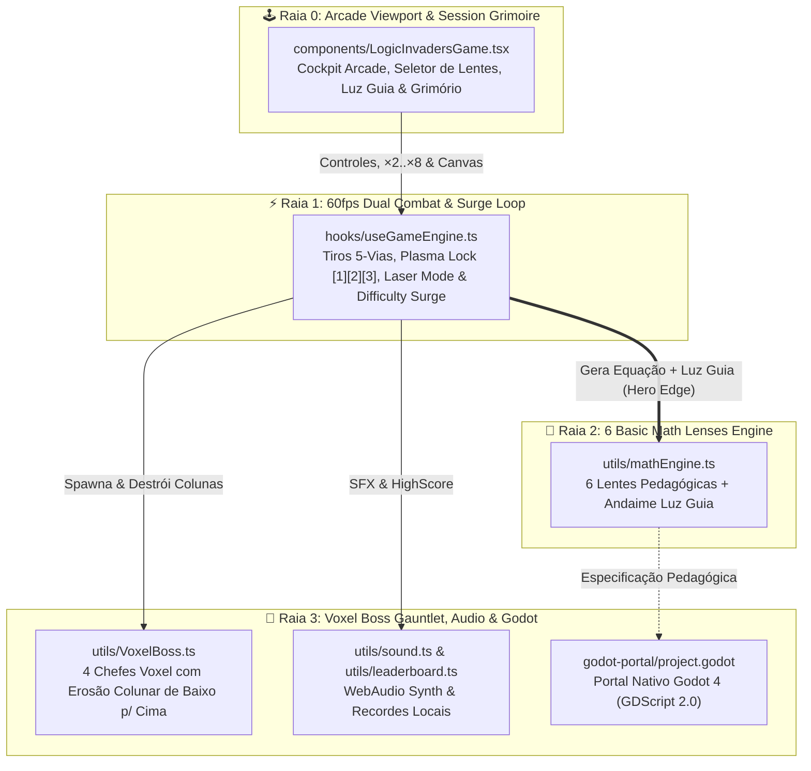
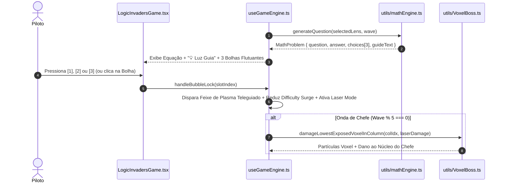

# 🚀 LogicInvaders v5 — Space Shooter das 6 Lentes Matemáticas, Chefes Voxel & Luz Guia

> **Resumo ELI5 em uma frase:** *"Trave nas bolhas certas para explodir chefes."*

O **LogicInvaders v5 — 6 Lentes da Matemática Básica** (`src/games/LogicInvaders`) é um **Arcade Space Shooter de Reflexo e Cálculo Mental a 60fps** com filosofia **Zero Game-Over por Falha Brusca**. Nele, o jogador pilota uma nave estelar em **Combate Duplo**: dispara canhões espaciais (com *Overdrive de 5 vias* e *Modo Laser Contínuo*) enquanto usa as teclas `[1]`, `[2]` ou `[3]` para **travar feixes de plasma teleguiados nas bolhas de resposta** das **6 Lentes Pedagógicas da Matemática Básica**, apoiado pelo andaime cognitivo **"💡 Luz Guia"**, **4 Chefes Voxel destrutíveis coluna por coluna (`VoxelBoss.ts`)**, **Grimório da Sessão** e um **Portal Nativo Godot 4 (`godot-portal/project.godot`)**.

---

## 🎯 Links Rápidos para os Diagramas Interativos (PR Lens & ELI5)

Os diagramas abaixo foram construídos e validados com **PR Lens (`@coldtea/pr-lens-cli`)** e **ELI5**. Abra qualquer link abaixo no navegador e clique em **Start the walkthrough ▶** para navegar passo a passo:

| Diagrama Interativo | Público-Alvo & Escopo | Link do Canvas Interativo (Web) | SVG Animado (Embed) |
| :--- | :--- | :--- | :--- |
| 🟢 **1. LogicInvaders ELI5 — 6 Lentes Matemáticas e Chefes Voxel** | **Iniciantes / Visão Rápida (ELI5):** Constrói o jogo uma peça por vez (da nave e bolhas até a Luz Guia, Chefes Voxel e Grimório em 5 passos). | [**👉 Abrir Canvas ELI5 Interativo (`prlens.dev/c/Y56Ui9cQ3xTopiafkP2FJw`)**](https://prlens.dev/c/Y56Ui9cQ3xTopiafkP2FJw) | [Ver SVG Animado](https://prlens.dev/c/Y56Ui9cQ3xTopiafkP2FJw.svg) |
| 🏛️ **2. LogicInvaders v5 — Arquitetura das 6 Lentes Matemáticas e Chefes Voxel** | **Engenharia & Arquitetura (Master Plan C4):** Mapeia as 4 raias arquiteturais, Combate Duplo, Difficulty Surge sem Game-Over, `VoxelBoss.ts` e Portal Godot 4. | [**👉 Abrir Canvas de Arquitetura Completa (`prlens.dev/c/sI239OE5lya_IRmlFcx2mw`)**](https://prlens.dev/c/sI239OE5lya_IRmlFcx2mw) | [Ver SVG Animado](https://prlens.dev/c/sI239OE5lya_IRmlFcx2mw.svg) |

---

## 🧒 1. Explicação ELI5 ("Explain Like I'm Five" — Passo a Passo)

Para entender o **LogicInvaders v5** do zero, o [Canvas ELI5 Interativo](https://prlens.dev/c/Y56Ui9cQ3xTopiafkP2FJw) monta o sistema passo a passo:

1. **[Passo 1 — Você, a Nave e as Bolhas Matemáticas](.pr-lens/logicinvaders-eli5-6-lentes-matematicas-e-chefes/you-and-starfighter-light-e306f061372fd99e1fb1778464976205.svg):** Você pilota uma nave espacial (`useGameEngine.ts` + `LogicInvadersGame.tsx`) enquanto o gerador das 6 Lentes (`utils/mathEngine.ts`) faz descer 3 bolhas flutuantes com opções de resposta. Basta apertar `[1]`, `[2]` ou `[3]` para travar um raio de plasma na bolha certa!
2. **[Passo 2 — Luz Guia, Modo Laser e Zero Game-Over](.pr-lens/logicinvaders-eli5-6-lentes-matematicas-e-chefes/plus-luz-guia-light-9d48f063b78fe960c7147c0a401406d6.svg):** Se uma nave inimiga passar pela base, **o jogo não dá Game Over**: ele ativa um **Difficulty Surge** (a onda fica mais rápida), e cada conta matemática que você acerta acalma a velocidade da invasão! Além disso, o painel **"💡 Luz Guia"** mostra na tela o atalho mental para fazer a conta de cabeça, e sequências de acertos ligam o **Modo Laser Contínuo** com multiplicadores até `×8`!
3. **[Passo 3 — Os 4 Chefes Voxel Desmontáveis](.pr-lens/logicinvaders-eli5-6-lentes-matematicas-e-chefes/plus-voxel-bosses-light-95b287fbce8464bb48f0a9a26bd64daa.svg):** A cada 5 ondas, surge um dos **4 Chefes Voxel** gigantes (`VoxelBoss.ts`: *Cyber-Crab*, *Mothership*, *Mind-Eye* ou *Brainiac*). Eles são feitos de blocos pixelados que você precisa destruir **coluna por coluna, de baixo para cima**!
4. **[Passo 4 — O Universo Completo + Grimório da Sessão e Godot 4](.pr-lens/logicinvaders-eli5-6-lentes-matematicas-e-chefes/the-whole-invaders-light-5350b5ef0b068e15706204981c3fd3a8.svg) & [Fluxo do Raio de Plasma ELI5](.pr-lens/logicinvaders-eli5-6-lentes-matematicas-e-chefes/invaders-flow-view-light-b4de13ccbdbb55426f014cf90cdf739e.svg):** Ao encerrar a missão, o **Grimório da Sessão** lista cada equação resolvida e sua explicação passo a passo, salvando seu recorde (`leaderboard.ts`).

---

## 🏛️ 2. Arquitetura Completa & Fluxos de Dados (PR Lens + Mermaid)

### 2.1 Índice de Visões e Diagramas do Projeto (`PR Lens`)

| Visão / Lente | Descrição Técnica | Arquivo SVG Local (`.pr-lens/`) | Canvas Online |
| :--- | :--- | :--- | :--- |
| **Visão Geral da Arquitetura — LogicInvaders v5 (`architecture`)** | Mapa completo das 4 raias (`Arcade Viewport & Session Grimoire`, `60fps Dual Combat & Surge Loop`, `6 Basic Math Lenses Engine`, `Voxel Boss Gauntlet, Audio & Godot`). | [`invaders-overview-light.svg`](.pr-lens/logicinvaders-v5-arquitetura-das-6-lentes-matema/invaders-overview-light-f503fc96ff1563f40304c7630cb0e2e2.svg) | [Abrir no Canvas](https://prlens.dev/c/sI239OE5lya_IRmlFcx2mw) |
| **Subsistema: 6 Lentes Matemáticas e Trava de Plasma (`architecture`)** | Conexão entre o seletor de Lentes, `mathEngine.ts` (Luz Guia) e o sistema de mira `[1][2][3]` em `useGameEngine.ts`. | [`lenses-and-combat-subview-light.svg`](.pr-lens/logicinvaders-v5-arquitetura-das-6-lentes-matema/lenses-and-combat-subview-light-92b2bbc28c96518716bbd6e8c32cf7eb.svg) | [Abrir no Canvas](https://prlens.dev/c/sI239OE5lya_IRmlFcx2mw) |
| **Sequência: Lente Matemática, Plasma Lock e VoxelBoss (`data-flow`)** | Fluxo tipado desde `LensQuestionRequest` até `handleBubbleLock` e `damageLowestExposedVoxelInColumn`. | [`invaders-sequence-view-light.svg`](.pr-lens/logicinvaders-v5-arquitetura-das-6-lentes-matema/invaders-sequence-view-light-1c295d919982d972b71b9edb557244b0.svg) | [Abrir no Canvas](https://prlens.dev/c/sI239OE5lya_IRmlFcx2mw) |

---

### 2.2 Diagrama Geral da Arquitetura em 4 Raias (Mermaid)

---

### 2.3 Fluxo de Sequência: Trava de Plasma `[1][2][3]` e Destruição Voxel (Mermaid)

---

## 🧮 3. As 6 Lentes da Matemática Básica & Engenharia Voxel

### 3.1 As 6 Lentes Pedagógicas (`utils/mathEngine.ts`)
| ID da Lente | Nome Pedagógico | Estratégia Mental ("💡 Luz Guia") | Exemplo Prático |
| :--- | :--- | :--- | :--- |
| `comp_add_sub` | **1. Soma/Subtração Compensada** | Arredonda para a dezena mais próxima e compensa o excesso. | `68 + 29` $\rightarrow$ `68 + 30 - 1 = 97` |
| `halving_doubling` | **2. Dobrar e Dividir por 2** | Dobra um fator e divide o outro ao meio para simplificar o produto. | `16 × 25` $\rightarrow$ `8 × 50 = 400` |
| `comp_100` | **3. Complemento para 100** | Soma dezena para `90` e unidade para `10`. | `100 - 37` $\rightarrow$ `(9-3) dezenas e (10-7) unid = 63` |
| `golden_fractions` | **4. Frações e % de Ouro** | Converte porcentagens em divisões inteiras rápidas (`10%`, `25%`, `50%`). | `25% de 84` $\rightarrow$ `84 ÷ 4 = 21` |
| `contextual` | **5. Matemática Contextual** | Problemas rápidos do cotidiano (troco, tempo, desconto). | `3 itens de R$ 19` $\rightarrow$ `3 × 20 - 3 = 57` |
| `free` | **6. Modo Livre / Mix** | Combina todas as lentes com progressão adaptativa de onda. | Mix dinâmico |

### 3.2 Destruição Voxel Restrita por Coluna (`utils/VoxelBoss.ts`)
- Os 4 Chefes (*Cyber-Crab*, *Mothership*, *Mind-Eye* e *Brainiac*) são representados por matrizes 2D de voxels coloridos com blindagem estrutural.
- Um projétil ou feixe de laser na coluna $c$ **só pode causar dano ao voxel ativo de maior índice vertical $r_{\max}(c)$** (a base exposta daquela coluna). Isso obriga o jogador a escavar túneis na armadura do chefe até expor seu núcleo vital.

---

## 🛡️ 4. Master Plan Architect — Contratos (DbC) & Estrutura de Arquivos

### 4.1 Invariantes de Design by Contract (DbC)
1. **Invariante Zero Game-Over (Difficulty Surge):** A passagem de um invasor pela borda inferior nunca encerra abruptamente a sessão; incrementa `surgeLevel` com teto máximo limitado e decrementa a cada `MathKill` válido.
2. **Invariante de Blindagem Colunar Voxel:** Para toda coluna $c$ do `VoxelBoss`, um voxel $(r, c)$ só recebe dano se $\forall r' > r, \text{voxel}(r', c).\text{alive} = \text{false}$.

### 4.2 Mapa de Arquivos (`src/games/LogicInvaders`)
- [`components/LogicInvadersGame.tsx`](file:///C:/Users/Usuario/Desktop/AHeiss_GoogleDrive/02-Programacao/projetos-IA/LogicDefense/src/games/LogicInvaders/components/LogicInvadersGame.tsx) — Interface principal, seletor das 6 Lentes, Luz Guia, multiplicadores (`×2`–`×8`) e Grimório da Sessão.
- [`hooks/useGameEngine.ts`](file:///C:/Users/Usuario/Desktop/AHeiss_GoogleDrive/02-Programacao/projetos-IA/LogicDefense/src/games/LogicInvaders/hooks/useGameEngine.ts) — Motor de combate duplo a 60fps, trava de plasma `[1][2][3]`, Laser Mode e Difficulty Surge.
- [`utils/mathEngine.ts`](file:///C:/Users/Usuario/Desktop/AHeiss_GoogleDrive/02-Programacao/projetos-IA/LogicDefense/src/games/LogicInvaders/utils/mathEngine.ts) — Gerador das 6 Lentes da Matemática Básica com dicas `Luz Guia`.
- [`utils/VoxelBoss.ts`](file:///C:/Users/Usuario/Desktop/AHeiss_GoogleDrive/02-Programacao/projetos-IA/LogicDefense/src/games/LogicInvaders/utils/VoxelBoss.ts) — Arquitetura dos 4 Chefes Voxel com erosão colunar e partículas.
- [`utils/sound.ts`](file:///C:/Users/Usuario/Desktop/AHeiss_GoogleDrive/02-Programacao/projetos-IA/LogicDefense/src/games/LogicInvaders/utils/sound.ts) & [`utils/leaderboard.ts`](file:///C:/Users/Usuario/Desktop/AHeiss_GoogleDrive/02-Programacao/projetos-IA/LogicDefense/src/games/LogicInvaders/utils/leaderboard.ts) — Áudio procedural Web Audio e persistência de recordes.
- [`godot-portal/project.godot`](file:///C:/Users/Usuario/Desktop/AHeiss_GoogleDrive/02-Programacao/projetos-IA/LogicDefense/src/games/LogicInvaders/godot-portal/project.godot) — Projeto nativo Godot 4 complementar.
