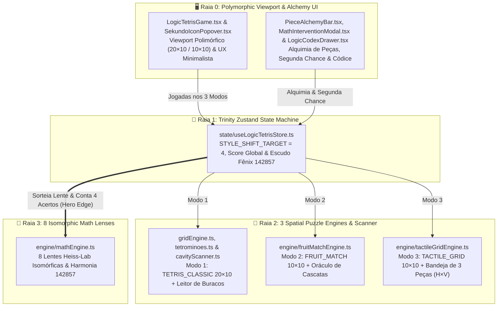
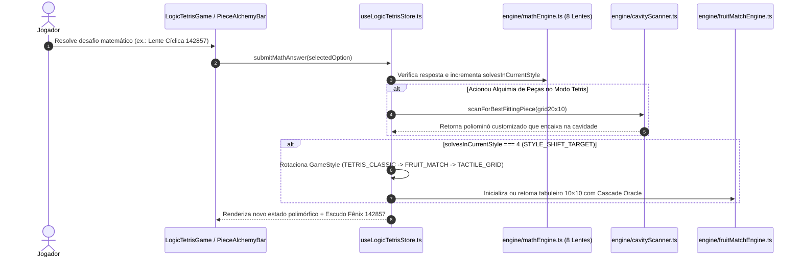

# 🧩 LogicTetris (Expansão Cordão Tríplice) — Motor Polimórfico 3-em-1, Cavity Scanner & Escudo Fênix 142857

> **Resumo ELI5 em uma frase:** *"Acerte 4 contas para mutar entre 3 puzzles."*

O **LogicTetris — Expansão Cordão Tríplice** (`src/games/LogicTetris`) é um **Motor de Puzzle Espacial e Matemático Polimórfico 3-em-1** orquestrado via **Zustand (`useLogicTetrisStore.ts`)**. A cada **4 desafios matemáticos resolvidos (`STYLE_SHIFT_TARGET = 4`)**, o jogo sofre uma **Mutação de Estilo (*Cordão Tríplice Style Shift*)**, transformando a partida em tempo real entre três gêneros clássicos de puzzle espacial:
1. **`TETRIS_CLASSIC` (20×10):** Queda de tetrominós com **Scanner Topológico de Cavidades (`cavityScanner.ts`)** que analisa os buracos do seu tabuleiro para forjar peças sob medida via **Alquimia de Peças (`PieceAlchemyBar.tsx`)**;
2. **`FRUIT_MATCH` (10×10):** Grade Match-3+ com cascatas gravitacionais, frutas-bomba e **Oráculo de Cascatas (`fruitMatchEngine.ts`)**;
3. **`TACTILE_GRID` (10×10):** Tabuleiro tátil sem gravidade com bandeja de 3 poliominós e limpeza simultânea horizontal e vertical (`tactileGridEngine.ts`).

Tudo isso é movido por um **Motor Isomórfico Infinito de 8 Lentes Mentais (`mathEngine.ts`)**, **Intervenção Matemática de Segunda Chance (`MathInterventionModal.tsx`)**, **Escudos Fênix baseados no número cíclico `142857`** e o **Códice Lógico (`LogicCodexDrawer.tsx`)**.

---

## 🎯 Links Rápidos para os Diagramas Interativos (PR Lens & ELI5)

Os diagramas abaixo foram construídos e validados com **PR Lens (`@coldtea/pr-lens-cli`)** e **ELI5**. Abra qualquer link abaixo no navegador e clique em **Start the walkthrough ▶** para navegar passo a passo:

| Diagrama Interativo | Público-Alvo & Escopo | Link do Canvas Interativo (Web) | SVG Animado (Embed) |
| :--- | :--- | :--- | :--- |
| 🟢 **1. LogicTetris ELI5 — 3 Jogos de Blocos Num Só** | **Iniciantes / Visão Rápida (ELI5):** Constrói o jogo uma peça por vez (do Tetris com scanner de buracos até a mutação 3-em-1, Alquimia de 8 Lentes e Escudo Fênix em 5 passos). | [**👉 Abrir Canvas ELI5 Interativo (`prlens.dev/c/q_ssSxw3zIVDPbEr9WN2aw`)**](https://prlens.dev/c/q_ssSxw3zIVDPbEr9WN2aw) | [Ver SVG Animado](https://prlens.dev/c/q_ssSxw3zIVDPbEr9WN2aw.svg) |
| 🏛️ **2. LogicTetris — Arquitetura Polimórfica Trinity 3-em-1 & 8 Lentes** | **Engenharia & Arquitetura (Master Plan C4):** Mapeia as 4 raias arquiteturais, máquina de estados `useLogicTetrisStore`, os 3 motores espaciais, `cavityScanner.ts` e 8 Lentes Isomórficas. | [**👉 Abrir Canvas de Arquitetura Completa (`prlens.dev/c/yE8FmxmKF31memO1-HTKaw`)**](https://prlens.dev/c/yE8FmxmKF31memO1-HTKaw) | [Ver SVG Animado](https://prlens.dev/c/yE8FmxmKF31memO1-HTKaw.svg) |

---

## 🧒 1. Explicação ELI5 ("Explain Like I'm Five" — Passo a Passo)

Para entender o **LogicTetris Trinity** do zero, o [Canvas ELI5 Interativo](https://prlens.dev/c/q_ssSxw3zIVDPbEr9WN2aw) monta o sistema passo a passo:

1. **[Passo 1 — Você, o Tetris 20×10 e o Scanner de Buracos](.pr-lens/logictetris-eli5-3-jogos-de-blocos-num-so/you-and-tetris-light-90f73da6c1606f53bbe8cb9e8b65e460.svg):** Você começa jogando Tetris clássico (`gridEngine.ts`), mas com um superpoder: o **Scanner de Cavidades** (`cavityScanner.ts`) lê o formato exato dos buracos deixados na sua pilha!
2. **[Passo 2 — A Mutação Trinity para Frutas e Grade Tátil](.pr-lens/logictetris-eli5-3-jogos-de-blocos-num-so/plus-three-modes-light-bc788dc2b9ce1f6a8c0c632f46913fec.svg):** O controlador central (`useLogicTetrisStore.ts`) conta suas respostas certas. **A cada 4 acertos matemáticos**, o jogo inteiro se transforma: sai do **Tetris 20×10**, vira um **Fruit Match 10×10** (`fruitMatchEngine.ts`) e depois vira um **Tactile Grid 10×10** de arrastar peças (`tactileGridEngine.ts`), mantendo seus pontos e combos!
3. **[Passo 3 — As 8 Lentes Mentais e a Alquimia de Peças](.pr-lens/logictetris-eli5-3-jogos-de-blocos-num-so/plus-alchemy-lenses-light-28eb815d132defa3164e55d19a3799e6.svg):** Resolver as contas das **8 Lentes Isomórficas** (`mathEngine.ts`) carrega a **Alquimia de Peças** (`PieceAlchemyBar.tsx`), permitindo transmutar uma peça ruim numa peça desenhada sob medida para tapar o buraco do seu tabuleiro.
4. **[Passo 4 — A Expansão Trinity Completa + Escudo Fênix 142857](.pr-lens/logictetris-eli5-3-jogos-de-blocos-num-so/the-whole-trinity-light-f5b3f2ba1178e73bc48879c48d88aadb.svg) & [Fluxo de Mutação ELI5](.pr-lens/logictetris-eli5-3-jogos-de-blocos-num-so/trinity-flow-view-light-1aa59ca2fec1899533e524685722e581.svg):** Se o tabuleiro lotar, o jogo abre a **Intervenção Matemática de Segunda Chance** (`MathInterventionModal.tsx`) e libera os **Escudos Fênix** inspirados no número cíclico `142857`, vaporizando as linhas do topo para você continuar jogando!

---

## 🏛️ 2. Arquitetura Completa & Fluxos de Dados (PR Lens + Mermaid)

### 2.1 Índice de Visões e Diagramas do Projeto (`PR Lens`)

| Visão / Lente | Descrição Técnica | Arquivo SVG Local (`.pr-lens/`) | Canvas Online |
| :--- | :--- | :--- | :--- |
| **Visão Geral da Arquitetura — LogicTetris Trinity (`architecture`)** | Mapa completo das 4 raias (`Polymorphic Viewport & Alchemy UI`, `Trinity Zustand State Machine`, `3 Spatial Puzzle Engines & Scanner`, `8 Isomorphic Math Lenses & Codex`). | [`tetris-trinity-overview-light.svg`](.pr-lens/logictetris-arquitetura-polimorfica-trinity-3-em/tetris-trinity-overview-light-e4ebf8710d59423203c0a414a7d72723.svg) | [Abrir no Canvas](https://prlens.dev/c/yE8FmxmKF31memO1-HTKaw) |
| **Subsistema: Os 3 Motores Espaciais e Cavity Scanner (`architecture`)** | Orquestração polimórfica entre `gridEngine.ts` + `cavityScanner.ts`, `fruitMatchEngine.ts` e `tactileGridEngine.ts`. | [`spatial-trinity-subview-light.svg`](.pr-lens/logictetris-arquitetura-polimorfica-trinity-3-em/spatial-trinity-subview-light-b31637908b0d59b1815672b7c87cc0de.svg) | [Abrir no Canvas](https://prlens.dev/c/yE8FmxmKF31memO1-HTKaw) |
| **Sequência: Alquimia de Cavidade e Mutação Trinity (`data-flow`)** | Fluxo tipado desde `IsomorphicRequest` (`142857`) até `scanForBestFittingPiece` e `transitionStyle`. | [`tetris-sequence-view-light.svg`](.pr-lens/logictetris-arquitetura-polimorfica-trinity-3-em/tetris-sequence-view-light-46d5cc1199f406e926421579426b1f1d.svg) | [Abrir no Canvas](https://prlens.dev/c/yE8FmxmKF31memO1-HTKaw) |

---

### 2.2 Diagrama Geral da Arquitetura em 4 Raias (Mermaid)

---

### 2.3 Fluxo de Sequência: Alquimia por Cavity Scanner e Mutação Trinity (Mermaid)

---

## 🧠 3. Os 3 Motores Espaciais, Cavity Scanner & Harmonia `142857`

### 3.1 Os 3 Motores do Ciclo Trinity (`STYLE_SHIFT_TARGET = 4`)
1. **`TETRIS_CLASSIC` (`20×10` — `gridEngine.ts` + `cavityScanner.ts`):**
   - Queda gravitacional clássica com *Ghost Piece*, *Hold Piece* e *Hard Drop*.
   - **Scanner de Cavidades (`cavityScanner.ts`):** Inspeciona o perfil topográfico da pilha de blocos para identificar vales e buracos de 1 a 4 células, permitindo que a **Alquimia de Peças** sintetize a peça exata necessária para limpar linhas.
2. **`FRUIT_MATCH` (`10×10` — `fruitMatchEngine.ts`):**
   - Troca adjacente (*Swap*) de frutas lógicas com detecção de cadeias $\ge 3$, geração de bombas especiais em combinações de $4+$ e **Oráculo de Cascatas** que garante que o tabuleiro nunca nasça travado.
3. **`TACTILE_GRID` (`10×10` — `tactileGridEngine.ts`):**
   - Inspirado em puzzles táteis 10×10: sem gravidade, o jogador recebe uma **bandeja com 3 poliominós** e os posiciona livremente na grade para completar e limpar linhas horizontais e colunas verticais simultaneamente (`H × V`).

### 3.2 As 8 Lentes Isomórficas e o Escudo Fênix `142857` (`mathEngine.ts`)
- O motor gera variações isomórficas infinitas em **8 Lentes Heiss-Lab**, destacando a **Harmonia Cíclica de `142857` ($\frac{1}{7} = 0,\overline{142857}$)**, onde multiplicar `142857` por `2, 3, 4, 5, 6` apenas gira os mesmos seis dígitos em carrossel (`285714`, `428571`, `571428`, `714285`, `857142`), e por `7` resulta em `999999`!
- **Segunda Chance (`MathInterventionModal.tsx`):** Quando qualquer um dos 3 tabuleiros atinge a condição de derrota (topo atingido ou sem movimentos), o jogo intercepta o Game Over com um desafio matemático de emergência, limpando a zona crítica se o jogador acertar.

---

## 🛡️ 4. Master Plan Architect — Contratos (DbC) & Estrutura de Arquivos

### 4.1 Invariantes de Design by Contract (DbC)
1. **Invariante de Preservação de Estado no Style Shift:** Durante qualquer transição $S_a \to S_b$ quando `solvesInCurrentStyle === 4`, os acumuladores `score`, `streak`, `alchemyCharges` e `phoenixShields` permanecem estritamente monotônicos/preservados.
2. **Invariante de Segunda Chance (Phoenix Save):** Nenhum estado de overflow em `TETRIS_CLASSIC`, `FRUIT_MATCH` ou `TACTILE_GRID` transita direto para `GAME_OVER` enquanto `phoenixShields > 0` ou a intervenção matemática estiver disponível.

### 4.2 Mapa de Arquivos (`src/games/LogicTetris`)
- [`LogicTetrisGame.tsx`](file:///C:/Users/Usuario/Desktop/AHeiss_GoogleDrive/02-Programacao/projetos-IA/LogicDefense/src/games/LogicTetris/LogicTetrisGame.tsx) — Viewport polimórfico que renderiza os 3 modos espaciais e o HUD Trinity.
- [`state/useLogicTetrisStore.ts`](file:///C:/Users/Usuario/Desktop/AHeiss_GoogleDrive/02-Programacao/projetos-IA/LogicDefense/src/games/LogicTetris/state/useLogicTetrisStore.ts) — Máquina de estados Zustand com ciclo Trinity, Alquimia e Escudos Fênix.
- [`engine/gridEngine.ts`](file:///C:/Users/Usuario/Desktop/AHeiss_GoogleDrive/02-Programacao/projetos-IA/LogicDefense/src/games/LogicTetris/engine/gridEngine.ts), [`engine/tetrominoes.ts`](file:///C:/Users/Usuario/Desktop/AHeiss_GoogleDrive/02-Programacao/projetos-IA/LogicDefense/src/games/LogicTetris/engine/tetrominoes.ts) & [`engine/cavityScanner.ts`](file:///C:/Users/Usuario/Desktop/AHeiss_GoogleDrive/02-Programacao/projetos-IA/LogicDefense/src/games/LogicTetris/engine/cavityScanner.ts) — Motor Tetris 20×10 e scanner topológico de cavidades.
- [`engine/fruitMatchEngine.ts`](file:///C:/Users/Usuario/Desktop/AHeiss_GoogleDrive/02-Programacao/projetos-IA/LogicDefense/src/games/LogicTetris/engine/fruitMatchEngine.ts) — Motor 10×10 Match-3+ com Oráculo de Cascatas.
- [`engine/tactileGridEngine.ts`](file:///C:/Users/Usuario/Desktop/AHeiss_GoogleDrive/02-Programacao/projetos-IA/LogicDefense/src/games/LogicTetris/engine/tactileGridEngine.ts) — Motor 10×10 de bandeja de 3 peças e limpeza `H×V`.
- [`engine/mathEngine.ts`](file:///C:/Users/Usuario/Desktop/AHeiss_GoogleDrive/02-Programacao/projetos-IA/LogicDefense/src/games/LogicTetris/engine/mathEngine.ts) — Gerador isomórfico das 8 Lentes Mentais e número cíclico `142857`.
- [`components/PieceAlchemyBar.tsx`](file:///C:/Users/Usuario/Desktop/AHeiss_GoogleDrive/02-Programacao/projetos-IA/LogicDefense/src/games/LogicTetris/components/PieceAlchemyBar.tsx), [`components/MathInterventionModal.tsx`](file:///C:/Users/Usuario/Desktop/AHeiss_GoogleDrive/02-Programacao/projetos-IA/LogicDefense/src/games/LogicTetris/components/MathInterventionModal.tsx), [`components/LogicCodexDrawer.tsx`](file:///C:/Users/Usuario/Desktop/AHeiss_GoogleDrive/02-Programacao/projetos-IA/LogicDefense/src/games/LogicTetris/components/LogicCodexDrawer.tsx) & [`components/SekundoIconPopover.tsx`](file:///C:/Users/Usuario/Desktop/AHeiss_GoogleDrive/02-Programacao/projetos-IA/LogicDefense/src/games/LogicTetris/components/SekundoIconPopover.tsx) — Componentes de Alquimia, Segunda Chance, Códice das 8 Lentes e UX minimalista.
