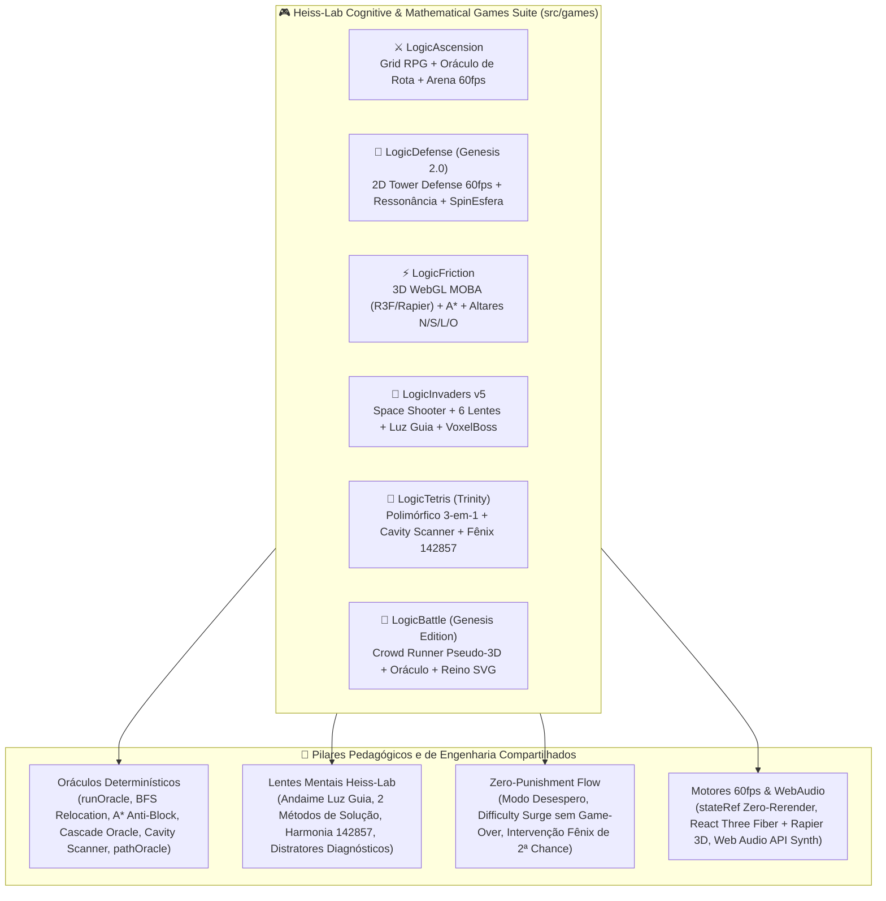

# 🎮 Heiss-Lab Logic Games Suite (`src/games`) — Catálogo Arquitetural & Diagramas Interativos (PR Lens + ELI5)

Bem-vindo à suíte de jogos cognitivos e matemáticos do ecossistema **LogicDefense (`src/games`)**. Cada um dos **6 jogos** foi documentado com **Master Plan Architect (`agency-master-plan-architect`)**, um **Guia ELI5 (`@[.agents/skills/eli5]`)** para entendimento imediato passo a passo e **Arquitetura Completa (`@[.agents/skills/pr-lens]`)** com fluxos de dados e payloads tipados.

---

## 🗺️ Tabela Mestra dos 6 Jogos e READMEs

| Jogo & Pasta | Gênero & Mecânica Central | Resumo ELI5 em 1 Frase | 📖 README Completo | 🟢 Canvas Interativo ELI5 | 🏛️ Canvas Arquitetura Completa |
| :--- | :--- | :--- | :--- | :--- | :--- |
| ⚔️ **1. Logic Ascension** (`src/games/LogicAscension`) | **RPG Tático de Masmorra + Arena de Arco 60fps** Oráculo de Rota Ótima (`runOracle`), 400 contas sem repetição, Frações MDC (`snapVal`) e Modo Desespero. | *"Logic Ascension usa contas para vencer chefes."* | [**📄 Ler README do Logic Ascension**](./LogicAscension/README.md) | [**👉 Abrir ELI5 (`fk6IVd...`)**](https://prlens.dev/c/fk6IVdOojoz0W_4I-dDxjQ) [[SVG](https://prlens.dev/c/fk6IVdOojoz0W_4I-dDxjQ.svg)] | [**👉 Abrir Arquitetura (`KHf9c0...`)**](https://prlens.dev/c/KHf9c03vFnakuCzzmYh_5A) [[SVG](https://prlens.dev/c/KHf9c03vFnakuCzzmYh_5A.svg)] |
| 🏰 **2. LogicDefense (Genesis 2.0)** (`src/games/LogicDefense`) | **Tower Defense Tático 2D a 60fps Zero-Rerender** Ressonância de Operadores (`+30%`), Rotas que Giram a cada 3 Ondas (com salvamento BFS), SpinEsfera 3D e Museu de Vieses. | *"Contas certas turbinam torres no mapa que gira."* | [**📄 Ler README do LogicDefense**](./LogicDefense/README.md) | [**👉 Abrir ELI5 (`ZcJV6J...`)**](https://prlens.dev/c/ZcJV6JIGoWvACgeSQ2qwiA) [[SVG](https://prlens.dev/c/ZcJV6JIGoWvACgeSQ2qwiA.svg)] | [**👉 Abrir Arquitetura (`6d1Oj5...`)**](https://prlens.dev/c/6d1Oj5IZ4bXslWA0JPIZEw) [[SVG](https://prlens.dev/c/6d1Oj5IZ4bXslWA0JPIZEw.svg)] |
| ⚡ **3. LogicFriction** (`src/games/LogicFriction`) | **Arena MOBA 2.5D/3D WebGL (R3F + Rapier) & Labirinto A\*** Grid A\* dinâmico anti-bloqueio, Desconflicção de Torres Sniper e 4 Pedestais Matemáticos Cardeais (`N/S/L/O`) que soltam Raios em Cadeia. | *"Pise nos altares 3D para eletrocutar hordas A\*."* | [**📄 Ler README do LogicFriction**](./LogicFriction/README.md) | [**👉 Abrir ELI5 (`Me1xix...`)**](https://prlens.dev/c/Me1xixa3VNSVkZaqmRle3w) [[SVG](https://prlens.dev/c/Me1xixa3VNSVkZaqmRle3w.svg)] | [**👉 Abrir Arquitetura (`5ecXQN...`)**](https://prlens.dev/c/5ecXQNKGoPrIsmtr5Lbyvw) [[SVG](https://prlens.dev/c/5ecXQNKGoPrIsmtr5Lbyvw.svg)] |
| 🚀 **4. LogicInvaders v5** (`src/games/LogicInvaders`) | **Space Shooter Arcade das 6 Lentes Matemáticas** Trava de Plasma `[1][2][3]` nas bolhas, Zero Game-Over (*Difficulty Surge*), Andaime *"💡 Luz Guia"*, 4 Chefes Voxel e Portal Godot 4. | *"Trave nas bolhas certas para explodir chefes."* | [**📄 Ler README do LogicInvaders**](./LogicInvaders/README.md) | [**👉 Abrir ELI5 (`Y56Ui9...`)**](https://prlens.dev/c/Y56Ui9cQ3xTopiafkP2FJw) [[SVG](https://prlens.dev/c/Y56Ui9cQ3xTopiafkP2FJw.svg)] | [**👉 Abrir Arquitetura (`sI239O...`)**](https://prlens.dev/c/sI239OE5lya_IRmlFcx2mw) [[SVG](https://prlens.dev/c/sI239OE5lya_IRmlFcx2mw.svg)] |
| 🧩 **5. LogicTetris (Cordão Tríplice)** (`src/games/LogicTetris`) | **Puzzle Polimórfico 3-em-1 (Tetris + Fruit Match + Tactile Grid)** Muta de jogo a cada 4 acertos, Scanner de Buracos (`cavityScanner`), Alquimia de Peças, 8 Lentes Isomórficas e Escudo Fênix `142857`. | *"Acerte 4 contas para mutar entre 3 puzzles."* | [**📄 Ler README do LogicTetris**](./LogicTetris/README.md) | [**👉 Abrir ELI5 (`q_ssSx...`)**](https://prlens.dev/c/q_ssSxw3zIVDPbEr9WN2aw) [[SVG](https://prlens.dev/c/q_ssSxw3zIVDPbEr9WN2aw.svg)] | [**👉 Abrir Arquitetura (`yE8Fmx...`)**](https://prlens.dev/c/yE8FmxmKF31memO1-HTKaw) [[SVG](https://prlens.dev/c/yE8FmxmKF31memO1-HTKaw.svg)] |
| 🌉 **6. LogicBattle (Genesis Edition)** (`src/games/LogicBattle`) | **Crowd Runner de Portões Honestos + Reino Territorial** Oráculo de Caminhos (`pathOracle`), Pelotões Posicionais na Base 10 (`Vai-Um`), 20 Pegadinhas com Fichas de Resgate e Cidadela. | *"Cruze os portões certos, funda 10 soldados em 1 pelotão e conquiste o Reino."* | [**📄 Ler README do LogicBattle**](./LogicBattle/README.md) | [**👉 Ver Diagrama no README**](./LogicBattle/README.md) | [**👉 Ver Master Plan**](./LogicBattle/master-plan/MASTER_PLAN_LOGIC_BATTLE_GENESIS.md) |

---

## 🏛️ Visão Arquitetural Unificada da Suíte (`src/games`)

---

## 📂 Estrutura de Diretórios e Artefatos `.pr-lens`

- [`LogicAscension/`](file:///C:/Users/Usuario/Desktop/AHeiss_GoogleDrive/02-Programacao/projetos-IA/LogicDefense/src/games/LogicAscension/README.md) — Contém `README.md`, `.pr-lens/eli5.graph.json`, `.pr-lens/graph.json` e 9 SVGs renderizados.
- [`LogicDefense/`](file:///C:/Users/Usuario/Desktop/AHeiss_GoogleDrive/02-Programacao/projetos-IA/LogicDefense/src/games/LogicDefense/README.md) — Contém `README.md`, `.pr-lens/eli5.graph.json`, `.pr-lens/graph.json` e 8 SVGs renderizados.
- [`LogicFriction/`](file:///C:/Users/Usuario/Desktop/AHeiss_GoogleDrive/02-Programacao/projetos-IA/LogicDefense/src/games/LogicFriction/README.md) — Contém `README.md`, `.pr-lens/eli5.graph.json`, `.pr-lens/graph.json` e 8 SVGs renderizados.
- [`LogicInvaders/`](file:///C:/Users/Usuario/Desktop/AHeiss_GoogleDrive/02-Programacao/projetos-IA/LogicDefense/src/games/LogicInvaders/README.md) — Contém `README.md`, `.pr-lens/eli5.graph.json`, `.pr-lens/graph.json` e 8 SVGs renderizados.
- [`LogicTetris/`](file:///C:/Users/Usuario/Desktop/AHeiss_GoogleDrive/02-Programacao/projetos-IA/LogicDefense/src/games/LogicTetris/README.md) — Contém `README.md`, `.pr-lens/eli5.graph.json`, `.pr-lens/graph.json` e 8 SVGs renderizados.
