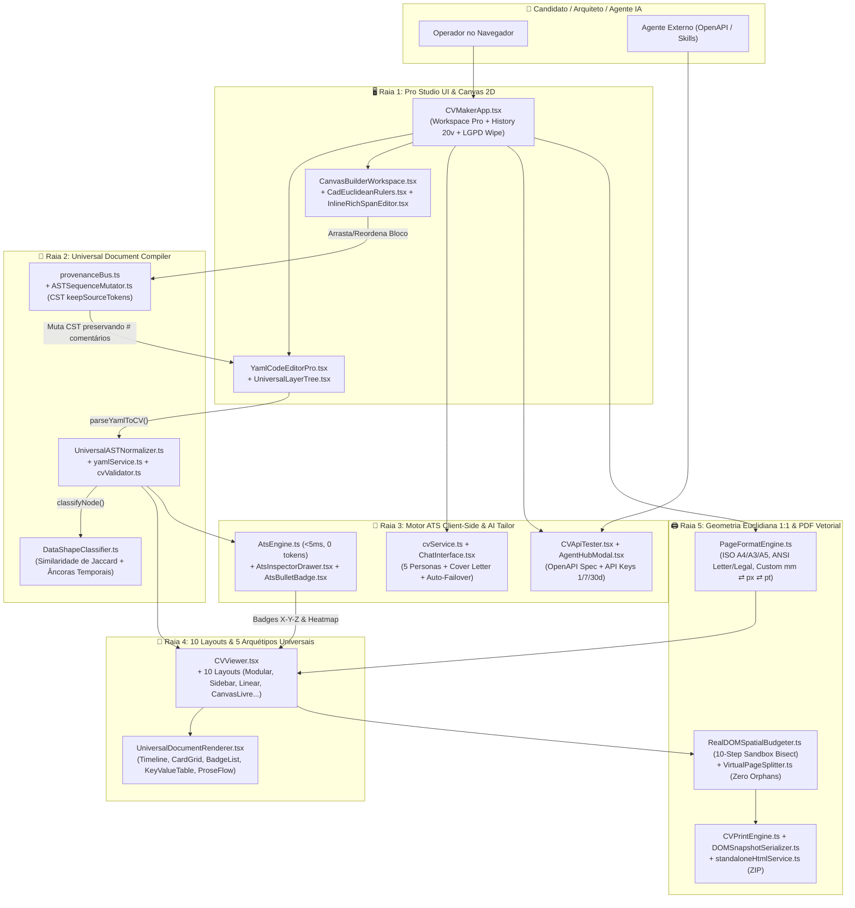
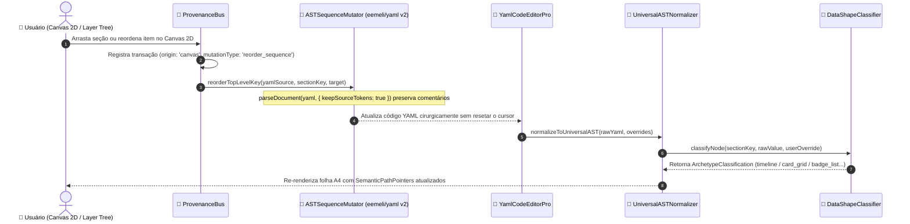
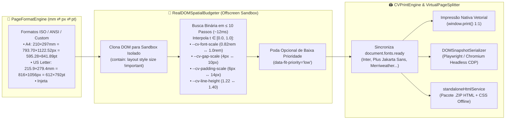

# 📄 CV Maker 3.0 — Compilador Universal de Documentos, Auditor ATS (<5ms) & Motor PDF 1:1

> **Resumo ELI5 em uma frase:** *"CV Maker transforma YAML em currículo PDF A4."*

O **CV Maker 3.0** (`src/tools/cv-maker`) é um **Compilador Universal de Documentos e Estúdio de Currículos de Alta Precisão** (*Local-First*, *Schema-Agnostic* e *Zero-Drift*). Ele une um editor de código **YAML ao vivo**, uma **bancada visual 2D livre com réguas CAD em milímetros**, um **classificador algorítmico de forma de dados por Similaridade de Jaccard (5 Arquétipos)**, um **motor de auditoria ATS 100% client-side (<5ms, 0 tokens, fórmula Google/IBM X-Y-Z)**, **geração multi-persona por IA (5 Arquétipos + Cover Letter)** e um **motor de impressão PDF vetorial com bissecção espacial em sandbox (10 passos)** que garante encaixe matemático exato em 1 folha física (`A4`, `Letter`, `A3`, `A5`, `Legal` ou customizada).

---

## 🎯 Links Rápidos para os Diagramas Interativos (PR Lens & ELI5)

Os diagramas abaixo foram construídos e validados com **PR Lens (`@coldtea/pr-lens-cli`)** e **ELI5**. Basta abrir qualquer link abaixo no navegador e clicar em **Start the walkthrough ▶** para navegar passo a passo:

| Diagrama Interativo | Público-Alvo & Escopo | Link do Canvas Interativo (Web) | SVG Animado (Embed) |
| :--- | :--- | :--- | :--- |
| 🟢 **1. CV Maker ELI5 — Do YAML ao PDF Perfeito** | **Iniciantes / Visão Rápida (ELI5):** Constrói o sistema uma peça por vez (de 2 caixas até o quadro completo em 8 passos guiados). | [**👉 Abrir Canvas ELI5 Interativo (`prlens.dev/c/myeAy2GlR3nDcbS-X_iNiA`)**](https://prlens.dev/c/myeAy2GlR3nDcbS-X_iNiA) | [Ver SVG Animado](https://prlens.dev/c/myeAy2GlR3nDcbS-X_iNiA.svg) |
| 🏛️ **2. CV Maker 3.0 — Compilador Universal e Motor PDF** | **Engenharia & Arquitetura (Master Plan C4):** Mapeia as 5 raias arquiteturais, 14 módulos, CST Sync, Jaccard AST, ATS `<5ms`, Sandbox Budgeter e 3 fluxos com payloads. | [**👉 Abrir Canvas de Arquitetura Completa (`prlens.dev/c/KVXYUmHhFQQ91-vy4GMTNw`)**](https://prlens.dev/c/KVXYUmHhFQQ91-vy4GMTNw) | [Ver SVG Animado](https://prlens.dev/c/KVXYUmHhFQQ91-vy4GMTNw.svg) |

---

## 🧒 1. Explicação ELI5 ("Explain Like I'm Five" — Passo a Passo)

[](https://prlens.dev/c/myeAy2GlR3nDcbS-X_iNiA)

Para entender o **CV Maker 3.0** do zero, o [Canvas ELI5 Interativo](https://prlens.dev/c/myeAy2GlR3nDcbS-X_iNiA) monta a arquitetura uma peça de cada vez:

1. **[Passo 1 — Você e o Editor YAML](.pr-lens/cv-maker-eli5-do-yaml-ao-pdf-perfeito/you-and-editor-light-f207110d3e4f44d6ebf38a61373f2bb0.svg):** Tudo começa com você e o editor de texto (`YamlCodeEditorPro.tsx`), direto no navegador e salvo localmente no seu aparelho.
2. **[Passo 2 — As 4 Ferramentas da Bancada](.pr-lens/cv-maker-eli5-do-yaml-ao-pdf-perfeito/what-cv-maker-does-light-07aa145aa97646478498ff045aea913f.svg):** Na mesma tela você tem quatro formas de trabalhar:
   - 📝 **Edita código YAML** (`components/Editor/YamlCodeEditorPro.tsx`) — Escreve experiências, formação ou qualquer seção nova em texto limpo.
   - 📐 **Arrasta caixas 2D** (`components/CanvasBuilder/CanvasBuilderWorkspace.tsx`) — Move, redimensiona e reordena blocos diretamente sobre a folha A4 com réguas em milímetros, atualizando o YAML na hora sem apagar seus comentários.
   - ✨ **Adapta com IA** (`components/Chat/ChatInterface.tsx`) — Pede para a IA gerar 5 versões de perfil (*Professional*, *Architect*, *Historian*, *Didactic*, *Alien*) e Carta de Apresentação.
   - 🎯 **Testa vaga ATS** (`components/ATS/AtsInspectorDrawer.tsx`) — Cola a descrição da vaga desejada para auditar seu currículo contra robôs de recrutamento.
3. **[Passo 3 — Compilador Inteligente e Nota ATS](.pr-lens/cv-maker-eli5-do-yaml-ao-pdf-perfeito/plus-ast-and-ats-light-3d8c48fdbf94ed303255583c406f5411.svg):** O compilador (`UniversalASTNormalizer.ts` + `DataShapeClassifier.ts`) olha o formato dos seus dados e decide sozinho se desenha linha do tempo, grade de cartões, tabela chave-valor, lista de tags ou texto corrido. Ao mesmo tempo, o avaliador ATS (`AtsEngine.ts`) analisa cada frase em **menos de 5 milissegundos** procurando **Verbo de Ação + Número/Métrica + Ferramenta (Fórmula X-Y-Z)**.
4. **[Passo 4 — Ajuste Matemático em 1 Página A4](.pr-lens/cv-maker-eli5-do-yaml-ao-pdf-perfeito/plus-page-budgeter-light-c334b575103463c000ff855fe849fe1e.svg):** Para evitar que sobrem 3 linhas perdidas numa segunda página em branco, o medidor invisível (`RealDOMSpatialBudgeter.ts`) testa **10 escalas de fonte e espaçamento** em um rascunho oculto até cravar o currículo inteiro dentro de 1 folha A4 (`210 × 297 mm`).
5. **[Passo 5 — O Quadro Completo + Impressão PDF Vetorial](.pr-lens/cv-maker-eli5-do-yaml-ao-pdf-perfeito/the-whole-thing-light-0eb175d6331d2ebbed1c8b42a5be98e7.svg) & [Fluxo de Dados ELI5](.pr-lens/cv-maker-eli5-do-yaml-ao-pdf-perfeito/yaml-to-pdf-flow-view-light-62e2adeb3aecc0df99f107eb52db2cf6.svg):** O motor de saída (`CVPrintEngine.ts`) entrega um **PDF 100% vetorial e selecionável** em qualquer um dos **10 Layouts**, além de dossiês executivos multi-página sem quebras feias (`VirtualPageSplitter.ts`) ou pacote `.zip` HTML autônomo (`standaloneHtmlService.ts`).

---

## 🏛️ 2. Arquitetura Completa & Fluxos de Dados (PR Lens + Mermaid)

[](https://prlens.dev/c/KVXYUmHhFQQ91-vy4GMTNw)

### 2.1 Índice de Visões e Diagramas do Projeto (`PR Lens`)

| Visão / Lente | Descrição Técnica | Arquivo SVG Local (`.pr-lens/`) | Canvas Online |
| :--- | :--- | :--- | :--- |
| **Visão Geral do CV Maker 3.0 (`architecture`)** | Mapa completo das 5 raias (`Pro Studio UI & Canvas 2D`, `Universal Document Compiler`, `Client-Side ATS & AI Tailor`, `10 Layouts & 5 Archetypes`, `1:1 Page Geometry & Vector PDF`). | [`cv-maker-overview-light.svg`](.pr-lens/cv-maker-3-0-compilador-universal-de-documentos/cv-maker-overview-light-013df6070489bdca14646fc2b6047cf5.svg) | [Abrir no Canvas](https://prlens.dev/c/KVXYUmHhFQQ91-vy4GMTNw) |
| **Subsistema 1: Universal Document Compiler & CST Sync (`architecture`)** | Sincronização bidirecional `YAML ⇄ CST ⇄ Universal AST ⇄ Canvas 2D` via `ProvenanceBus` e inferência Jaccard. | [`compiler-and-cst-sync-view-light.svg`](.pr-lens/cv-maker-3-0-compilador-universal-de-documentos/compiler-and-cst-sync-view-light-b6e70f8dd95bd18dc58cbecd0d09ee8e.svg) | [Abrir no Canvas](https://prlens.dev/c/KVXYUmHhFQQ91-vy4GMTNw) |
| **Subsistema 2: Motor ATS Client-Side (<5ms), 5 Personas IA & OpenAPI (`architecture`)** | Auditoria instantânea X-Y-Z, geração multi-persona com failover e bancada REST/OpenAPI (`CVApiTester`). | [`ats-and-ai-tailor-view-light.svg`](.pr-lens/cv-maker-3-0-compilador-universal-de-documentos/ats-and-ai-tailor-view-light-4bfa57f314ace49f2340d47bde66a248.svg) | [Abrir no Canvas](https://prlens.dev/c/KVXYUmHhFQQ91-vy4GMTNw) |
| **Subsistema 3: Geometria 1:1, Sandbox Budgeter & PDF Vetorial (`architecture`)** | Conversão exata `mm ⇄ px ⇄ pt`, bissecção binária em 10 passos e compilação PDF vetorial. | [`euclidean-pdf-print-view-light.svg`](.pr-lens/cv-maker-3-0-compilador-universal-de-documentos/euclidean-pdf-print-view-light-2c0d288bfcc4908581b310ef5ee58a01.svg) | [Abrir no Canvas](https://prlens.dev/c/KVXYUmHhFQQ91-vy4GMTNw) |
| **Sequência 1: Sincronização YAML ⇄ CST ⇄ Canvas 2D (`data-flow`)** | Mutação cirúrgica da CST (`keepSourceTokens: true`) e classificação de forma de dados por Jaccard. | [`flow-view-cst-canvas-light.svg`](.pr-lens/cv-maker-3-0-compilador-universal-de-documentos/flow-view-cst-canvas-light-e4e2cc09a9c336ee7b5598096033155c.svg) | [Abrir no Canvas](https://prlens.dev/c/KVXYUmHhFQQ91-vy4GMTNw) |
| **Sequência 2: Auditoria ATS (<5ms) e Fórmula X-Y-Z (`data-flow`)** | Cálculo dos 4 pilares ATS no navegador e injeção de `AtsBulletBadge` e Heatmap na folha. | [`flow-view-ats-xyz-light.svg`](.pr-lens/cv-maker-3-0-compilador-universal-de-documentos/flow-view-ats-xyz-light-c33a2e40b1e07740f3da6ddb6689a71a.svg) | [Abrir no Canvas](https://prlens.dev/c/KVXYUmHhFQQ91-vy4GMTNw) |
| **Sequência 3: Bissecção em Sandbox e Impressão PDF 1:1 (`data-flow`)** | Busca binária de altura em sandbox offscreen e disparo de impressão vetorial / snapshot HTML. | [`flow-view-budgeter-pdf-light.svg`](.pr-lens/cv-maker-3-0-compilador-universal-de-documentos/flow-view-budgeter-pdf-light-14317254ec53c56502dd42ffe7328cad.svg) | [Abrir no Canvas](https://prlens.dev/c/KVXYUmHhFQQ91-vy4GMTNw) |

---

### 2.2 Diagrama Geral da Arquitetura em 5 Raias (Mermaid)



---

## ⚙️ 3. Explicação Detalhada dos Subsistemas e Motores

### 3.1 Compilador Universal de Documentos & Inferência por Similaridade de Jaccard (`engine/`)
O CV Maker 3.0 não se limita a currículos tradicionais: seu **Universal Document Compiler** (`UniversalASTNormalizer.ts` + `DataShapeClassifier.ts`) aceita **qualquer chave YAML arbitrária** (propostas comerciais, laudos técnicos, portfólios de patentes, cronogramas, KPIs) e infere automaticamente o melhor componente visual em $O(N)$:

$$\text{Jaccard}(A, B) = \frac{|A \cap B|}{|A \cup B|}$$

| Arquétipo Canônico (`LayoutArchetype`) | Regra de Inferência Algorítmica (`DataShapeClassifier.ts`) | Renderizador Universal (`components/UniversalRenderers/`) |
| :--- | :--- | :--- |
| `timeline` | Array de objetos com alta uniformidade de chaves ($J \ge 0.5$) contendo âncoras temporais (`date`, `period`, `ano`, `2020 - Presente`). | `TimelineRenderer.tsx` |
| `card_grid` | Array de objetos estruturados sem eixo cronológico dominante (ex: projetos, certificações, entregas, portfólio). | `CardGridRenderer.tsx` |
| `badge_list` | Array de strings curtas ou objetos compactos de tags/competências/ferramentas. | `BadgeListRenderer.tsx` |
| `key_value_table` | Objeto plano chave-valor ou array de pares de metadados/indicadores (KPIs, dados civis, especificações). | `KeyValueTableRenderer.tsx` |
| `prose_flow` | Strings longas ($> 100$ caracteres ou múltiplas linhas) de narrativa, resumo executivo, termos ou carta de apresentação. | `ProseFlowRenderer.tsx` |

> **Soberania Total do Usuário:** Embora a inferência seja automática, o usuário pode sobrepor (*override*) o arquétipo de qualquer seção com 1 clique na árvore de camadas ou no inspetor.

#### Sequência Bidirecional: `YAML ⇄ CST ⇄ Universal AST ⇄ Canvas 2D`


---

### 3.2 Os 10 Layouts Arquiteturais & Bancada Canvas Livre 2D (`components/CVViewer/layouts/`)

| # | Layout ID (`LayoutVariant`) | Componente (`components/CVViewer/layouts/`) | Estilo e Indicação |
| :--- | :--- | :--- | :--- |
| 1 | `modular` | `LayoutModular.tsx` | Grade executiva equilibrada de alta densidade e leitura rápida. |
| 2 | `sidebar` | `LayoutSidebar.tsx` | Coluna lateral dedicada para competências, idiomas e contatos + coluna principal cronológica. |
| 3 | `linear` | `LayoutLinear.tsx` | Coluna única clássica (*Single-Column ATS Gold Standard*) ideal para sistemas ATS rigorosos e Big Tech. |
| 4 | `compact_split` | `LayoutCompactSplit.tsx` | Divisão assimétrica compacta otimizada para caber grande volume de experiências em 1 página A4. |
| 5 | `corporate_timeline` | `LayoutCorporateTimeline.tsx` | Linha do tempo corporativa contínua com marcadores visuais de progressão de carreira. |
| 6 | `dynamic_math` | `LayoutDynamicMath.tsx` | Proporções matemáticas adaptativas com distribuição dinâmica de espaço entre seções. |
| 7 | `editorial_accent` | `LayoutEditorialAccent.tsx` | Tipografia editorial de alto contraste para diretores, designers e liderança executiva. |
| 8 | `hero_matrix` | `LayoutHeroMatrix.tsx` | Cabeçalho de impacto com matriz de competências e destaques quantitativos no topo. |
| 9 | `canvas_livre` | `LayoutCanvasLivre.tsx` + `CanvasBuilderWorkspace.tsx` | **Movimentação Livre 2D** com réguas euclidianas em milímetros (`CadEuclideanRulers.tsx`), splitter de colunas, edição rich-text inline e botão **Auto-Pack** para eliminar vácuos. |
| 10 | *Universal Blueprints* | `UniversalLayoutRenderer.tsx` | Renderização polimórfica para documentos não-currículo (Propostas Técnicas, Dossiês, Laudos, Certificados). |

---

### 3.3 Motor de Auditoria ATS Client-Side (`< 5ms`, `0 Tokens`) & Fórmula Google/IBM X-Y-Z (`engine/AtsEngine.ts`)
O motor ATS roda **100% no navegador do usuário**, sem enviar dados para servidores externos e em menos de `5 milissegundos` a cada tecla digitada:
1. **Aderência de Palavras-Chave da Vaga (Peso 40%):** Tokeniza a *Job Description* (removendo acentos e *stopwords* PT/EN) e extrai *Unigrams, Bigrams e Trigrams* (`extractNGrams`) para medir a cobertura exata de tecnologias e competências.
2. **Fórmula de Impacto Google / IBM X-Y-Z (Peso 30%):** Audita cada *bullet point* de experiência profissional verificando a tríade:
   - **X (Verbo de Ação Forte):** Ex: *Liderou, Arquitetou, Reduziu, Automatizou, Escalou* (`ACTION_VERBS_PT` / `ACTION_VERBS_EN`).
   - **Y (Métrica Quantificada):** Percentuais (`35%`), valores monetários (`$120k`, `R$ 500 mil`), volumetria (`10M+ req/dia`, `99.99% SLA`, `12ms`).
   - **Z (Ferramenta / Contexto Técnico):** Tecnologias e metodologias aplicadas para atingir o resultado.
3. **Parseabilidade Estrutural (Peso 15%):** Verifica presença de contatos essenciais, seções canônicas e ausência de armadilhas ópticas.
4. **Densidade e Orçamento de Leitura (Peso 15%):** Avalia contagem total de palavras, número de bullets e estimativa de páginas.

---

### 3.4 Geometria Euclidiana 1:1 (`PageFormatEngine.ts`) & Bissecção Espacial em Sandbox (`RealDOMSpatialBudgeter.ts`)



---

## 📂 4. Estrutura Completa de Diretórios (`src/tools/cv-maker/`)

```text
src/tools/cv-maker/
├── .pr-lens/                                  # Grafos e SVGs animados gerados pelo PR Lens e ELI5
│   ├── eli5.graph.json                        # Fonte do diagrama ELI5 (4 raias, 9 nós, 8 passos)
│   ├── graph.json                             # Fonte do diagrama de Arquitetura Completa (5 raias, 14 nós)
│   ├── cv-maker-eli5-do-yaml-ao-pdf-perfeito/ # 6 SVGs animados + manifest.json (ELI5)
│   └── cv-maker-3-0-compilador-universal-de-documentos/ # 7 SVGs animados + manifest.json (C4 + Flows)
├── CVMakerApp.tsx                             # Aplicação principal e orquestrador do Pro Studio
├── index.ts                                   # Barrel export público da ferramenta
├── api-workspace/                             # Bancada visual de testes REST/OpenAPI (CVApiTester.tsx)
├── api_workspace/                             # Cliente Python e suíte de testes de integração da API
├── components/
│   ├── ApiKeyModal/                           # Gestão de chaves de licença e API Keys
│   ├── ATS/                                   # AtsInspectorDrawer.tsx e AtsBulletBadge.tsx (X-Y-Z inline)
│   ├── blocks/                                # 15 blocos atômicos (Work, Education, Skills, Photo, CoverLetter...)
│   ├── CanvasBuilder/                         # Bancada 2D livre, réguas CAD em mm, Layer Tree e RichText inline
│   ├── Chat/                                  # ChatInterface.tsx (Geração IA multi-persona e tailoring)
│   ├── CVViewer/                              # Visualizador com Viewport Scaler, 10 Layouts e Print Container
│   ├── Editor/                                # YamlCodeEditorPro.tsx
│   ├── History/                               # CVHistoryTab.tsx (Até 20 versões locais + Wipe LGPD)
│   ├── Landing/                               # AcademySection, CertificateView, Gallery e Download de Skills
│   ├── Modals/                                # AgentHubModal (Prompts, Síntese, OpenAPI, API Key), CoverLetter, Store
│   ├── ProLayout/                             # AppHeaderPro, ResizableSplitter e RightInspectorDrawer
│   ├── Toolbar/                               # CanvasControlDock, CVToolbar e DesignCustomizerDrawer
│   └── UniversalRenderers/                    # Os 5 Renderizadores Universais (Timeline, CardGrid, BadgeList, Table, Prose)
├── engine/
│   ├── ASTSequenceMutator.ts                  # Mutador CST in-place preservando comentários (eemeli/yaml v2)
│   ├── AtsEngine.ts                           # Motor determinístico ATS (<5ms) e detector X-Y-Z
│   ├── atsKeywords.ts                         # Dicionários léxicos PT/EN, verbos de ação e stopwords
│   ├── backgroundCatalog.ts                   # Catálogo de texturas e fundos arquiteturais A4
│   ├── blueprints.ts                          # Blueprints canônicos de documentos
│   ├── DataShapeClassifier.ts                 # Inferência de forma de dados por Similaridade de Jaccard
│   ├── DomainCatalog.ts                       # Catálogo de domínios profissionais
│   ├── DynamicDensityCompressor.ts            # Compressor contínuo de densidade tipográfica
│   ├── PageFormatEngine.ts                    # Geometria física ISO/ANSI/Custom (mm ⇄ px ⇄ pt)
│   └── UniversalASTNormalizer.ts              # Normalizador de qualquer YAML em UniversalDocumentAST
├── services/
│   ├── canvasBuilderService.ts                # Persistência e geometria de caixas no Canvas 2D
│   ├── CVPrintEngine.ts                       # Fachada de impressão A4 nativa e compilação Playwright
│   ├── cvService.ts                           # Cliente HTTP multi-endpoint com failover automático
│   ├── cvValidator.ts                         # Validação e sanitização de estruturas CVData
│   ├── DOMSnapshotSerializer.ts               # Serializador de DOM + CSS computado para HTML autônomo
│   ├── historyService.ts                      # Ledger local-first de histórico e limpeza LGPD
│   ├── provenanceBus.ts                       # Barramento transacional anti-loop (editor/canvas/tree/inspector)
│   ├── RealDOMSpatialBudgeter.ts              # Busca binária em 10 passos em sandbox offscreen
│   ├── standaloneHtmlService.ts               # Exportador de pacote .ZIP standalone
│   ├── VirtualPageSplitter.ts                 # Divisor determinístico de páginas virtuais sem órfãos
│   └── yamlService.ts                         # Parser e serializador YAML com suporte a overrides de arquétipo
├── skills/                                    # Agent Skills oficiais (agency-pdf-engine-architect, agency-resume-tailor)
├── store/                                     # useCanvasStore.ts (Estado de seleção e coordenadas do Canvas 2D)
├── styles/                                    # Sistema de design CSS, temas, regras @media print e réguas CAD
├── templates/                                 # Template padrão e Universal Blueprints
├── types/                                     # Contratos TypeScript (cv.ts, universalAST.ts, canvasStudio.ts...)
└── utils/                                     # Utilitários de grid, cores, IDs atômicos e compressão de imagem
```

---

## 🚀 5. Como Executar, Testar e Atualizar os Diagramas

### 5.1 Executar no Projeto Principal (`LogicDefense`)

```bash
# Na raiz do repositório LogicDefense:
npm install
npm run dev

# Executar a suíte de testes da API do CV Maker (Python):
python src/tools/cv-maker/api_workspace/run_all_tests.py
```

### 5.2 Validar, Renderizar e Publicar os Diagramas (`PR Lens` & `ELI5`)

```bash
cd src/tools/cv-maker

# 1. Validar os contratos JSON Schema 0.2.0 de ambos os diagramas
npx @coldtea/pr-lens-cli@latest validate .pr-lens/eli5.graph.json
npx @coldtea/pr-lens-cli@latest validate .pr-lens/graph.json

# 2. Renderizar os 13 SVGs animados localmente (tema light)
npx @coldtea/pr-lens-cli@latest render .pr-lens/eli5.graph.json --theme light
npx @coldtea/pr-lens-cli@latest render .pr-lens/graph.json --theme light

# 3. Atualizar os Canvases interativos online no PR Lens
npx @coldtea/pr-lens-cli@latest canvas push .pr-lens/cv-maker-eli5-do-yaml-ao-pdf-perfeito/drawn.graph.json
npx @coldtea/pr-lens-cli@latest canvas push .pr-lens/cv-maker-3-0-compilador-universal-de-documentos/drawn.graph.json
```

---

## 🛡️ 6. Contratos e Invariantes de Engenharia (Design by Contract)

| Fronteira / Módulo | Invariante Semântico Garantido |
| :--- | :--- |
| **`ASTSequenceMutator` + `ProvenanceBus`** | Reordenar seções ou itens no Canvas 2D jamais apaga comentários `#` do YAML nem causa loop circular de perda de cursor no editor de código. |
| **`DataShapeClassifier` (Jaccard)** | Qualquer estrutura YAML válida é classificada deterministicamente em 1 dos 5 arquétipos (`timeline`, `card_grid`, `badge_list`, `key_value_table`, `prose_flow`), respeitando sempre o *override* manual do usuário. |
| **`AtsEngine` (`< 5ms`)** | O cálculo de aderência à vaga e validação X-Y-Z executa 100% localmente no navegador em menos de 5ms, com 0 tokens de IA e 0 vazamento de dados. |
| **`RealDOMSpatialBudgeter` (`10-Step Bisect`)** | Toda medição espacial ocorre em um clone *offscreen* isolado (`contain: layout style size !important`) que é destruído ao final das 10 iterações, garantindo 0 *layout thrashing* na tela do usuário. |
| **`historyService` (Soberania & LGPD)** | O histórico de até 20 versões vive exclusivamente no `localStorage` do navegador e pode ser erradicado instantaneamente com 1 clique via `clearAllCVDataAndHistory()`. |
